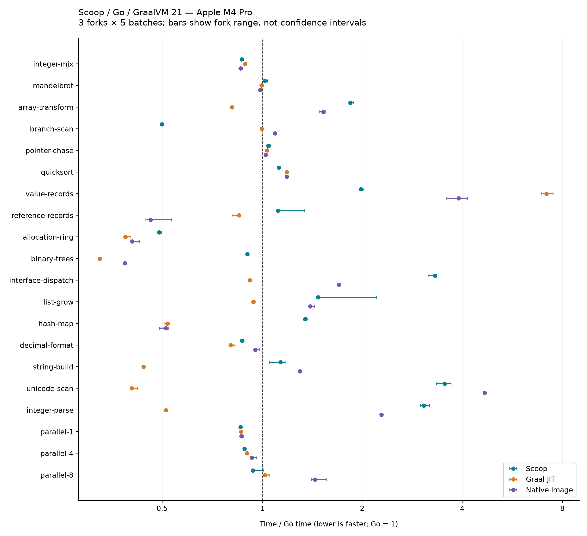

# Scoop / Go / GraalVM 21：M4 Pro 本机性能实测

2026-10-29，macOS 27.0.1，Apple M4 Pro，14 核，64 GiB 内存。

**Scoop 的纯计算已经接近 Go 和 GraalVM；短命对象分配和连续值表示具有竞争力，当前更明显的差距集中在接口调用、字符串遍历／解析、数组处理及部分容器操作。** Java JIT 在多项库和对象负载中吞吐领先，但本次配置下的进程内存明显更大。Go 的构建、启动和连续值数组表现突出。Native Image 消除了 JVM 启动和预热需求，但吞吐并不总能达到同一 Java 源码的 JIT 结果。

本次没有修改编译器、runtime 或标准库实现。先把 `~/.scoop` 更新到
`ae13036d9ce6740517df96152707a30934ed4c3e`，重建五个 release 命令、25 个内置库和四种 runtime，
随后所有 Scoop 应用都由 **`~/.scoop/bin/scoop`** 构建。

## 测量范围

20 个工作负载 × 4 种执行方式 × 3 个独立进程，共 **240 次正式进程测量、1200 个正式批次**。
每批至少 200 ms；Java JIT 每进程预热 5 秒，其他方式预热 500 ms。表中数字是进程内
中位数再取进程间中位数。完整范围、逐次样本、RSS 和复跑方法见
[数据表](TABLES.md)、[原始测量](measurements.json) 和 [基准说明](../../README.md)。

执行配置：

| 实现 | 版本与选项 |
|---|---|
| Scoop | 当前提交，LLVM 22.1.8，release/O2，普通 runtime |
| Go | go1.27.3 darwin/arm64，默认优化与 GC |
| Java JIT | Oracle GraalVM 21.0.12+7.1，Graal JIT/libgraal，G1，`-Xms64m -Xmx1g` |
| Java Native Image | 同一 GraalVM，`--no-fallback -O2`，Serial GC，运行时 `-Xms64m -Xmx1g` |

Native Image 未使用运行采样训练的 PGO，保留构建器默认的 ML-inferred profile。
Java 两种模式的堆参数相同；Scoop、Go 沿用各自默认堆策略，**这不是等堆大小实验**。
Native Image 的运行时与 JVM 不同，Darwin 上本次使用 Serial GC；这符合其
[JDK 21 内存管理说明](https://www.graalvm.org/jdk21/reference-manual/native-image/optimizations-and-performance/MemoryManagement/)。

四种执行方式的完整规模结果均一致；缩小输入对照独立 Python 实现／数学公式，
共 80 个进程、640 个 seed 结果通过。完整规模的 20 项 × 8 个 seed 也另外计算了独立
参考结果，正式测量、定向复测及采样的全部 264 个进程均通过
[完整校验](full-verification.json)，测量源码与保存的 SHA-256 一致。
每个正式批次继续验证调用数和累计校验和。
构造输入、分配、初始化、处理和结果消费都属于一次 kernel，未在不同语言间移动计时边界。

## 运行时间

单位为 **ms / 完整 kernel 调用**，越小越快。星号项另做了延长批次复测，见后文。

| 工作负载 | Scoop | Go | Graal JIT | Native Image |
|---|---:|---:|---:|---:|
| 整数依赖链，100 万次 | 1.428 | 1.647 | 1.462 | 1.418 |
| Mandelbrot，160×160 | 0.856 | 0.841 | 0.837 | 0.829 |
| 浮点数组，262,144 项 | 0.894 | 0.486 | 0.394 | 0.741 |
| 整数数组条件归约 | 0.590 | 1.181 | 1.178 | 1.290 |
| 随机索引追逐，209 万步 | 14.352 | 13.752 | 14.231 | 14.080 |
| 相同快速排序，32,768 项 | 1.600 | 1.427 | 1.692 | 1.690 |
| 值记录数组，131,072 项 | 0.441 | 0.222 | 1.593 | 0.866 |
| 引用记录数组 * | 2.110 | 1.892 | 1.612 | 0.874 |
| 20 万次逃逸对象分配 | 0.537 | 1.099 | 0.425 | 0.446 |
| 10 棵深度 12 二叉树 | 0.572 | 0.634 | 0.205 | 0.244 |
| 50 万次动态接口调用 | 1.246 | 0.376 | 0.346 | 0.641 |
| 动态容器增长，10 万项 * | 0.429 | 0.291 | 0.274 | 0.407 |
| 哈希表，10 万次更新／读取 | 4.747 | 3.518 | 1.824 | 1.804 |
| 十进制格式化，3 万个数 | 0.359 | 0.412 | 0.331 | 0.393 |
| 字符串构建，2 万个数 | 0.307 | 0.270 | 0.119 | 0.350 |
| Unicode 标量遍历 | 1.089 | 0.307 | 0.124 | 1.436 |
| 十进制解析，10 万个数 | 3.725 | 1.216 | 0.624 | 2.779 |
| 并行计算，1 worker | 6.001 | 6.971 | 6.020 | 6.031 |
| 同样工作量，4 workers | 1.616 | 1.827 | 1.645 | 1.701 |
| 同样工作量，8 workers | 0.897 | 0.956 | 0.974 | 1.381 |

横轴是“该实现耗时 / Go 耗时”，误差线是三个进程中位数的范围，**不是置信区间**。
Go 分母使用其中位数，图中的误差线不包含 Go 自身的波动。可缩放版本见 [SVG](relative-time.svg)。

## 差异来源与证据

### 纯计算、分支和访存

Mandelbrot 与随机访存的四种实现接近。整数依赖链中 Scoop 耗时约为 Go 的 0.87 倍，
与 GraalVM 接近。这些结果表明 Scoop 并非在所有生成代码上都存在明显差距。

条件归约中 Scoop 约快两倍。检查 ARM64 机器码，Scoop 用 **`CSEL`** 选择加减结果，
Go 保留依赖随机数据最低位的 **`TBNZ`** 条件跳转；Scoop 的循环仍有 poll 和边界检查。
这是明确观察到的代码生成差异，与分支不可预测负载上的结果相符。没有硬件分支失误计数，
不把全部差额精确归于单条指令，也不宣称这里发生了 SIMD 向量化。

浮点数组完整任务中 Scoop 分别耗时约为 Go 的 **1.84 倍**、Graal JIT 的 **2.27 倍**。
该任务包含三块数组的分配、初始化、变换和归约，当前数据尚不能分离每一环节的贡献；
后续应拆分这些实际阶段再检查生成代码。

### 值布局、对象与 GC

值记录数组中 Scoop 比 Java JIT 快约 **3.6 倍**，但比 Go 慢约 **2 倍**。
Scoop／Go 保存连续的三个 64 位字段，Java 21 的 `record[]` 保存引用。
Java record 仍是一种 class，创建实例遵循普通对象语义，见
[Java 21 record 文档](https://docs.oracle.com/en/java/javase/21/language/records.html)。
因此这里包含语言表示的优势，不能当成同布局编译器比较；相邻的引用记录项提供了对照。

在 1024 项环形存活集中持续发布 20 万个对象，Scoop 耗时约为 Go 的 **0.49 倍**，
但仍比 Graal JIT 慢约 26%。Scoop GC 统计确认每次 kernel 实际分配约 **6.41 MB**，
没有把整个对象循环消除。二叉树中 Scoop 略快于 Go，而 Graal JIT 比 Scoop 快约 2.8 倍。

引用记录任务对 Scoop GC 更不利：每次分配约 **11.53 MB**；单独的八次调用诊断中，
6 次 minor、3 次 full 合计暂停 **5.15 ms**，该诊断进程总耗时 23.68 ms（含启动）。
采样也出现分配慢路径、搬迁目标预留和回收路径。这里同时存在对象构造和 GC 成本，
不能把引用对象较慢全部归给字段访问或泛型。

### 接口调用

Scoop 的动态接口任务约慢于 Go **3.3 倍**、Graal JIT **3.6 倍**。
诊断中没有发生 GC，分配仅约 2.6 KB / kernel，热点集中在调用循环及四个 `apply` 方法。
生成代码保留每轮 poll、数组检查、接口表加载、间接调用及调用前后根保存／恢复；
很小的 `Add.apply` 仍有建帧／退帧指令。实际栈和指令支持“调用路径开销值得优化”，
尚不足以给其中某个检查分配独立的耗时比例。

### 字符串和解析

十进制格式化表现接近，Scoop 比 Go 快约 13%，比 Graal JIT 慢约 9%。
字符串构建则比 Graal JIT 慢约 2.6 倍。三者均显式先产生十进制字符串再加入 builder；
本项未使用 Scoop／Java 的数字直接 append，因此不能外推为各语言所有最佳写法。

Unicode 遍历中 Scoop 慢于 Go **3.5 倍**、Graal JIT **8.8 倍**。
三者都累计 Unicode 标量；Java 正确处理 surrogate pair，内部使用 UTF-16，Scoop／Go
使用 UTF-8。采样反复落在 `StringIterator.next` 和 `scoop_rt_string_character_at_byte_leaf`，
八次调用的 GC 诊断没有收集。主要问题在迭代／解码调用链，而不是收集暂停。
Native Image 在同一 Java 源码上比 JIT 慢得多，也说明不能把 JIT 结果直接当作 AOT 结果。

整数解析中 Scoop 慢于 Go **3.1 倍**、Graal JIT **6.0 倍**。
每 10 万个数字分配约 **3.21 MB**，和逐数创建 `StringIterator` 的 32 字节成本相符；
采样明确经过 `toLong → parseSignedInteger → parseIntegerMagnitude → StringIterator.next`，
并反复调用 `textDigit`。八次调用的 GC 暂停仅 **0.116 ms**，进程耗时 36.17 ms，
因此仅调整 GC 不能解决这项主要差距。普通库中的十进制／ASCII 解析路径和调用内联是更直接的调查方向。

### 容器

Scoop 的泛型 List 和 Map 可以直接保存 Long；Java 的 `Long` 容器存在装箱。
但本次 Java JIT 仍在这两项中更快，说明消除装箱不会自动抵消容器实现和代码生成的成本。
Go map 与其他两者的 hash、探测和扩容实现也不同；Go 官方介绍了其
[Swiss Table 实现](https://go.dev/blog/swisstable)。这些是标准库组合的比较。

Scoop Map 的采样同时出现 `HashMap.locate`、`insertAbsent`、`ensureRoom`、
`HashStorage.rehashed` 和存储清零；八次调用分配约 58.73 MB，GC 暂停 1.13 ms，
总进程耗时 44.43 ms。增长／重哈希和普通查找都值得检查，当前证据不支持“主要是 GC 慢”。

所有 GC 原始计数见 [scoop-gc.json](scoop-gc.json)，独立符号化采样见
[profiles.json](profiles.json)，关键汇编和采样摘录见 [归因证据](EVIDENCE.md)。
采样采用单独的 release + line tables 产物，不混入正式时间；折叠帧没有被强行分摊成精确 CPU 百分比。

## 内存、启动、构建和多核

| 指标 | Scoop | Go | Graal JIT | Native Image |
|---|---:|---:|---:|---:|
| 空工作进程启动／退出中位数，ms | 6.03 | 3.64 | 35.75 | 5.77 |
| 同上峰值 RSS，MiB | 5.7 | 4.3 | 40.0 | 9.0 |
| 值记录任务峰值 RSS，MiB | 21.1 | 24.2 | 714.5 | 373.8 |
| 引用记录任务峰值 RSS，MiB | 70.2 | 27.4 | 680.3 | 333.8 |
| 短命对象环峰值 RSS，MiB | 25.3 | 11.5 | 366.2 | 58.6 |
| 固定计算工作量的 8-worker 加速比 | 6.69× | 7.29× | 6.18× | 4.37× |

启动测试丢弃每种实现的前三次，再交错运行 30 次；OS 文件缓存温热，包含进程创建、
运行时初始化、打印与退出。它测的是本基准程序的空工作分支，不是磁盘冷启动。

RSS 是整个进程的峰值，包含预热；JIT 预热更长，堆自适应有更长时间增长。
这些数字反映本次配置的运行占用，**不是最小可运行内存，也不是对象存活集大小**。
Scoop 通常比 Java 小，但并不普遍比 Go 小；引用记录和短命对象环就是反例。
不能据此推断 Java 一定要用数百 MiB 才能完成该任务。

多核测试的总工作量固定为 400 万次整数混合，始终分为 8 个 shard，再分给 1／4／8 个
worker，包含每轮启动与 join。Scoop 能取得良好的扩展；这里没有测工作窃取池、长驻线程、
Go 大量 goroutine 或 Java 虚拟线程，不能用这项结果评价这些调度器。

应用构建在标准库已经准备好、OS 缓存温热的条件下进行，三次结果取中位数：

| 构建 | 应用缓存未命中 | 输入不变再次执行 |
|---|---:|---:|
| Scoop，含 native 链接 | **4.978 s** | **0.019 s** |
| Go，含 native 链接 | **0.109 s** | **0.043 s** |
| javac，生成字节码 | **0.297 s** | **0.296 s** |
| Native Image，由字节码生成 image | **20.704 s** | 无对应增量模式 |

Go 每次使用只预热标准依赖的独立缓存；另一次 `-x` 核对实际执行了应用 compile 和 link。
Scoop 直接消费安装中的预编译 `.slib`，没有把标准库重建计入应用构建。
Native Image 使用 6 个构建线程，其时间还不含 javac。不同产物和构建线程配置要分开理解。
Scoop 的无变化复用很快，但应用首次编译仍明显慢于 Go；需要额外的 stage 计时才能归因到前端、IR、发射或链接。

默认文件大小约为 Scoop **2.12 MiB**、Go **2.38 MiB**、Native Image **13.00 MiB**；
Java class 文件合计约 20 KiB，另需 JVM 安装。Go 默认保留调试信息，额外构建的
`-ldflags='-s -w'` 版本为 **1.56 MiB**，另记在 [build.json](build.json)，不能直接把默认文件大小差异解释成代码体积优势。

## 复测与结论边界

引用记录和容器增长出现较大进程间差异，因此增加了 7×300 ms 批次、每种实现三个进程的
[定向复测](repeat/measurements.json)，没有删除原始样本：

| 项目 | Scoop 初测中位数 → 复测中位数 | 复测进程范围 |
|---|---:|---:|
| 引用记录 | 2.110 → 2.569 ms | 2.386–2.996 ms |
| 容器增长 | 0.429 → 0.545 ms | 0.518–0.636 ms |

Go 的对应复测中位数为 1.982／0.280 ms，Native Image 为 0.966／0.401 ms。
Scoop 在这些任务上较慢的方向保持，但不应把初测的某一个百分比当作稳定常数。
其余多数项目的进程间范围较窄；这是描述性结果，没有统计显著性声明。

这是共享桌面环境，观察到 `fseventsd` 持续占用约一个 CPU 核，期间也有桌面应用活动。
正式采样串行执行，没有与工具链／应用构建并行；没有 CPU 绑核、频率锁定或隔离性能核。
没有覆盖 HTTP／数据库、磁盘持久化、异步 I/O、异常抛出、服务尾延迟和长时间运行的老年代行为。
这些结果适合决定下一步优化方向，不能代表所有应用或另一台机器。

建议优先调查 **字符串迭代和数字解析调用链、动态接口调用路径、数组初始化／聚合循环、
HashMap 增长与查找**；引用对象工作负载再结合分配和搬迁成本处理。每项改动都应回到
当前程序复测吞吐、内存与正确性，保留已有 GC／ABI 合同。当前测试没有证据支持先对纯整数算术做大范围调整。
