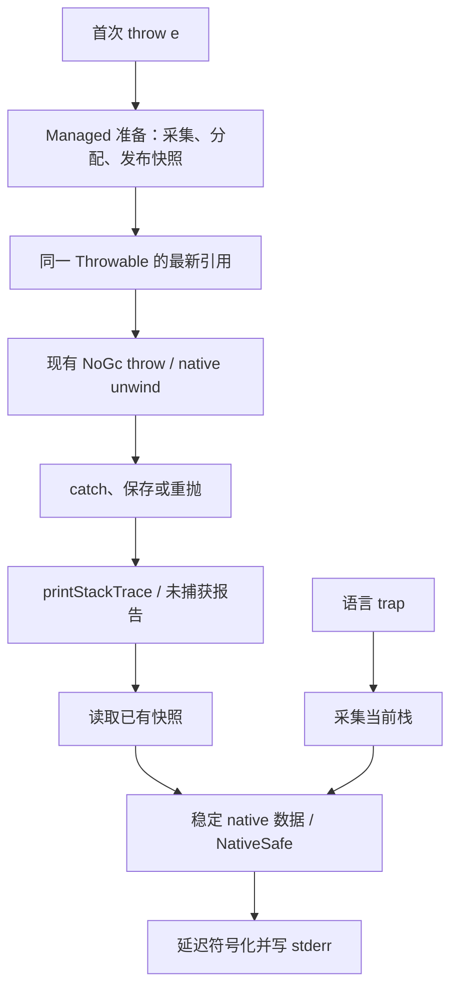

# Scoop 异常与 trap 的 stack trace 设计

日期：2026-10-29。

状态：本轮实现及 Darwin、Linux GNU／musl 定向验收已完成，实际验证范围见 [实施记录](IMPLEMENTATION.md)。用户选择的行为是“首次抛出时采集，重抛保留原栈”，并允许在必要时使用 intrinsic class。所需合同已同步到语言规范 11.7、运行时规范 5.6／第 7 章、实现规范 2.10／2.21。独立调试文件及 debugger 支持沿用 [主设计](DESIGN.md)。

## 1. 方案

由程序自身的 runtime 采集和打印栈，运行时不依赖 LLDB、lldb-dap 或外部符号化进程。

- Throwable 成为可继承的 intrinsic class，持有一份私有 managed 栈快照，并提供 `public final fun printStackTrace(): Unit`。
- Exception 保持普通 open 子类，现有 `message: String?` 和构造接口不变；直接继承 Throwable 的自定义异常同样获得能力。
- 首次 throw 前保存物理地址快照，后续重抛、catch 保存、callback、初始化失败及协程传播保留它；打印时才读取符号／调试文件。
- 未捕获异常自动输出已有快照；语言 trap 在终止前采集当前栈并输出，不创建 Throwable，也不改变其不可捕获和退出码 1 的语义。
- 对当前目标优先复用已有 unwind provider 采集，并用 C 库 libbacktrace 解析 DWARF。没有调试文件也输出可定位的模块和地址。



该能力和 debugger 的协程逻辑栈共享来源映射、调试产物及符号化基础，但第一版异常快照只承诺物理栈及可用的 inline 位置，不等待完整 Scoop 表达式求值或协程逻辑栈实现。

## 2. 实施前的基线与改动依据

下表保留设计开始时的代码事实，不作为当前缺口清单；实际实现及验收见实施记录。

| 位置 | 现有事实 | 所需调整 |
| --- | --- | --- |
| [throwable.scoop](../../sysroot/src/scoop.core/src/throwable.scoop) | Throwable 已是公共 open 根类；Exception 已有 message。两者没有栈字段和打印方法 | 在 Throwable 提供能力，保留普通继承与 Exception 的接口 |
| [eh.c](../../runtime/src/eh.c)／[eh_internal.h](../../runtime/src/eh_internal.h) | record 只保存原 managed 对象及 unwind 状态；EndCatch 会释放 record | 快照必须随 Throwable 保活，不能仅放在 record 中 |
| [LIR throw lowering](../../compiler/lir-lower/src/function/statements.rs)／[LLVM throw 发射](../../compiler/codegen/src/function/instruction/exceptions.rs) | 现有 throw 使用 NoGc runtime 调用 | 在其前面加入真正参与 GC 规划的 Managed 准备操作 |
| [startup/failure.c](../../runtime/src/startup/failure.c) | gateway 已捕获并结束 native catch；这里只从 failure root 读取类型名 | 从原 Throwable 取得已有快照，不能在此重新捕获原栈 |
| [process.c](../../runtime/src/process.c) | scoop_rt_trap 只打印原因，然后 `_exit(1)` | 在触发栈还存在时采集，输出前按现有规则进入 NativeSafe |
| [trap block](../../compiler/lir-lower/src/function/expression_support.rs) | 同一函数按消息字符串复用 trap block | 同一消息可能来自不同源码位置，位置必须分别保留 |
| [callback 发射](../../compiler/codegen/src/function/instruction/callbacks.rs) | 无效 callback state 有直接 llvm.trap | 改接内部 fatal 诊断入口，保留 abort 类语义 |
| [C bridge flags](../../compiler/lir/src/c_bridge_toolchain/flags.rs) | 当前显式关闭 unwind tables | 为需要出现在物理栈中的桥保留可用 unwind 数据 |
| [Linux 工具链 probe](../../compiler/toolchain/src/final_link/linux/probe.rs) | 已使用 `_Unwind_Backtrace` 验证选中的 provider | 复用同一 provider，不额外引入另一套 unwinder |

普通 runtime C 已使用 frame pointer 和禁用 sibling-call 的编译参数；Scoop Managed 函数也有相关设置。仍需逐目标检查生成对象的 unwind 数据，不能由编译参数名称推断完整性。

## 3. API 与确定的行为

公共新增成员只有 `Throwable.printStackTrace()`，返回 Unit，写 stderr，普通调用可以继续执行。不新增公共栈修改接口、cause／suppressed 模型或通用栈检查 API。

| 情况 | 快照行为 |
| --- | --- |
| 构造异常、但尚未 throw | 不采集；打印时明确表示尚未采集 |
| 首次 `throw e` | 实参求值后、unwind 前采集 |
| 同一个对象被再次 `throw` 或同步 rethrow | 保留首次快照 |
| 从 catch 返回、存入容器、跨 GC／线程／协程再抛出 | 保持对象身份和已有快照 |
| 创建一个新异常并抛出 | 新对象有自己的首次抛出栈 |
| 两个线程同时首次抛出同一对象 | 一份完整快照原子发布；不声称记录了墙钟最早的线程 |
| `resumeWithException` 接受尚未抛出的对象 | 不伪造一次 throw；若后来实际 throw，以那次为首次抛出 |
| 未捕获异常／eager 或 root gateway 失败 | 自动打印已有快照，再遵守原退出合同 |
| 语言 trap | 当场捕获当前栈，打印后退出 1，不建立 exception record |
| 内部 ABI／不变量 fatal | 可以输出原因及可取得的部分栈，继续使用 abort 语义 |

打印头至少包含动态异常类型，后跟由近到远的帧。保持 Exception.message 的既有属性，不为让终止路径读取 message 而移动字段、复制字段或调用用户代码；本次不把 message 扩展到所有 Throwable。普通 I/O 不暴露新的失败异常，沿用语言规范 14.4。例示格式不是逐字兼容合同：

```text
app.ParseFailure
  at app.readConfig (config.scoop:42)
  at app.main (main.scoop:8)
```

未展开出的帧、缺少来源和必要的截断均有明确说明。符号缺失时保留实际模块、标识和地址，不将完整输出退化为一串 `<unknown>`。第一次采集获得空／部分结果后仍保存该结果，后续打印不能换成新的当前栈。

## 4. 为什么选 intrinsic Throwable

普通 Throwable 加私有字段及 core helper 也能实现首次采集。然而 runtime 当前有真实的无 managed 回调消费者：gateway 失败报告、无 handler 退出和 unwind 失败诊断。它们拿到的是 opaque Throwable，且需要在进入可能阻塞的输出前取得稳定快照。

在共同基类固定一个引用槽，能让这些入口直接消费同一个布局。无需为此增加每类型诊断字段描述表、打印 thunk 目录、按 FQN 查找的规则或全局“对象地址到 trace”映射。只把 Exception 做成 intrinsic 不够，因为直接继承 Throwable 的 class 仍合法。

运行时规范 5.6 确定的前缀为：

| offset | 字段 |
| --- | --- |
| 0～15 | 既有对象头：TD 与 GC word |
| 16～23 | 可空 managed snapshot 引用；构造时为 null |
| 24 起 | 按普通继承布局排列的派生字段 |

Throwable 仍使用 FixedObject，不引入新的 GC 实例种类。snapshot 使用普通无引用 byte array；runtime 内部编码帧、模块标识／地址和采集状态，编译器只传递实际 Array<UInt8> 的 TD 与引用。byte-array 载荷不保存 managed pointer，GC 只需按通常规则追踪 Throwable 到这个数组的引用。

这种设计避免为每次抛出分配一组带 finalizer 的 native 对象。既有 Throwable 继承闭包不能声明 release block，也不需要为栈信息放开这一限制。

## 5. 首次抛出准备与 GC

语义上将首次抛出路径展开为：

```text
e0 = evaluate exception expression
e1 = prepareThrowableTrace(e0, actual_trace_byte_array_td)  // Managed
throwNoGc(e1)
```

这里的操作名用于描述职责，不提前冻结 C symbol 或 wire tag。

1. acquire 读取快照引用，已有结果直接复用。
2. 保活 e0，使用现有 provider 采集未展开的物理 PC；采集阶段不读 DWARF、不调用用户代码。
3. 为实际地址附上打印／离线定位需要的模块信息。模块数据取自当前加载映像或系统查询，复制必要的 native 数据，不能留指向可卸载模块的借用指针。
4. 分配并填充普通 managed byte array。e0 跨该步骤可能搬迁，使用现有 native roots 和 relocation。
5. 对同一对象原子发布完整快照并执行所需写屏障；竞争失败的临时数组由普通 GC 回收。不发布正在写入的数组，也不新增全局异常锁。
6. 返回同一对象的最新引用，后续 throw 直接消费 e1。

准备操作必须在常规 roots／statepoint 生成前进入 typed MIR／LIR。不能为沿用 NoGc 签名而在 C throw 里偷偷调用 managed allocator，也不能保留 e0 的旧地址用于抛出。普通源码 NoGC 的规则不放宽；它本来就不能处理 Throwable 这样的 ref value。

记录复制、发布和读取都不依赖 native exception record 的生命周期。同步 rethrow 已有快照，保留原记录和快照；跨 callback／协程建立新 native record 时仍是同一 managed Throwable。

可恢复的展开／符号错误只产生不可用或部分结果；诊断所需的普通堆分配失败沿原 OOM 终止规则，不为本功能引入另一套可恢复分配框架。原始 PC 容量的实现上限只允许造成显式的诊断截断，不影响程序是否合法。

## 6. 物理地址、来源与 trap

当前三目标使用 `_Unwind_Backtrace` 及所选 provider 的 PC 语义。`_Unwind_GetIPInfo` 可区分返回地址与确切指令地址；只有普通返回地址进行查询用的减一调整。保存 raw PC 和规范化地址，避免后续再次减一。

打印至少要能将一帧关联到原模块及链接地址：Mach-O 处理 slide 和 LC_UUID；ELF 处理 PT_LOAD 所定义的 load bias 及可用 build-id。模块标识用于普通符号匹配，不是授权或防伪体系。native 模块信息不全时保留已知地址并说明限制；模块卸载或地址复用后不错误绑定到另一映像。

unwind 信息与 DWARF 分工不同：前者找下一帧，后者解释帧。`--debug-info=none`、release strip 或生成外置 debug 文件都不能删除必须的 `.eh_frame`、compact unwind、EH 或 GC stackmap。generated-C bridge 当前的关闭 unwind 设置需调整；native 源码也需通过正式跨 FFI 回溯测试。

异常快照在首次抛出前取得，顶层报告只读取它。trap 没有可保存的异常对象，直接在仍有原调用栈时采集，再进入终止诊断。直接 `llvm.trap` 只能触发硬件异常，不能满足普通栈打印：语言 trap 和编译器明确产生的 fatal 分别接到保持其原终止语义的 runtime 入口。

现有 trap block 的 message 去重可以保留，但来源不能仅跟 message 走。对两个源码位置相同消息的 guard，按 source origin 区分 trap 调用，必要时使用独立 block、no-merge 和 no-tail 约束；否则打印出的顶帧可能总是某一个 guard。采集 helper 和 generated glue 使用人工来源，符号化按真实来源隐藏／折叠；不能在所有 profile 固定跳过 N 层来假定得到用户帧。

第一版不安装通用 signal handler，也不接管 SIGSEGV、外部 SIGILL、kill 或所有 libc abort。采集部分诊断不能被表述为从已损坏的任意 native 栈中恢复完整 trace。

## 7. 符号器选择与工具实验

本轮固定使用一个进程生命周期的 libbacktrace state。第一版不重建卸载模块的离线解析器：loader 集合变化时，对不再匹配的快照／缓存明确降级为已复制的模块标识和地址；查询前后再次比较变更序号，丢弃竞争期间的符号结果。回调字符串在返回前复制，不能保留借用。

优先选择 [libbacktrace](https://github.com/ianlancetaylor/libbacktrace)，使用 C 接口 `backtrace_pcinfo` 解释保存的 PC；不要使用在打印位置重新采集栈的 `backtrace_print` 代替它。[S1][S2]

本次检查的提交为 `0b9b49cf4a2c9229fc052d6716e1528b2f23e91a`，提交日期 2026-09-03。该库使用 BSD 许可，近期仍有维护；适合现有 C runtime，也不要求为 musl 引入 C++ 运行库。正式接入时按仓库既有 vendor／目标产物流程固定源码、许可与必要补丁，不运行时下载。

| 能力 | 调研结论 |
| --- | --- |
| macOS 外置 DWARF | macho.c 查找邻接 `.dSYM/Contents/Resources/DWARF/<binary>` 并匹配 UUID |
| Linux 外置 DWARF | elf.c 处理 build-id、`.gnu_debuglink` 搜索及 CRC |
| inline 来源 | pcinfo 可为一个机器 PC 回调多条 inline 信息 |
| 多线程使用 | 单个持久 state 以 threaded 标志初始化；不能每个异常创建 state，该库没有 free_state |
| Windows | PE／CodeView／PDB 通过 DbgHelp 解析；调用串行化，复制路径及 GUID／age，模块卸载后保留历史地址；见运行时规范 5.6 |

首轮不默认链接整套 LLVM C++ symbolizer 库，也不在每次 throw／打印时启动 llvm-symbolizer。LLVM 工具继续承担开发、离线归因和交叉验收；运行时库只在真正打印时查符号。外置文件不可用则使用 native 符号／模块地址降级。

设计阶段在仓库外编译了该提交的静态 C 库，使用独立 C probe，未调用 Scoop 编译器，也没有模拟 Scoop GC：

- 使用 `_Unwind_Backtrace`／`_Unwind_GetIPInfo` 保存调用链，原采集函数返回后再打印。
- 同一存储第二次请求采集时保留第一次；输出包含原 `origin_site`，不包含稍后的 `later_site`。这只证明采集和保存机制，不证明 Scoop 重抛已经实现。
- 生成 dSYM 后执行 strip 并重新签名，运行时仍解析出原函数及源码行，不需要启动 LLDB。
- DWARF 5 的“相对文件名 + 编译目录”输入得到可定位的真实路径；一个绝对文件名与不同编译目录组合被 libbacktrace 错误拼接。相同绝对文件名的 DWARF 4 对照正常。因此 DWARF 5 的文件／目录编码及完整路径必须进入验收，不能只断言行号，也不能用随意删前缀掩盖错误。

主设计采用 DWARF 5；初始 DIFile 使用文件名与目录分离的规范输入。遇到依赖库缺陷时保留明确的小补丁及上游版本依据，或调整经过验证的标准发射方式，不增加用户级多版本开关。

该版本 dwarf.c 原先优先采用 `DW_AT_linkage_name`，而 Scoop 的 [persistent mangling](../../compiler/identity/src/mangling.rs) 用于精确身份，不能普遍反解源码 FQN。固定 vendor 版本已加入源码名与 DWARF 5 完整路径修补，使 Scoop 渲染使用 `DISubprogram.name` 提供的可读名称。compiler 继续发射两种名称，精确 linkage identity 供原生链接和离线归因使用；不能删除 linkageName 绕过符号器偏好，也不能把 opaque 标识当作已恢复的函数名。普通 native 名称保持原有回退。该接入已由真实 Scoop 栈诊断用例验证。

上述独立 C probe 不覆盖 Linux GNU／musl、真实 Scoop 函数、GC 或全部 FFI 组合；后续运行时专测与真实 Scoop 用例的验证范围见实施记录，不由最小工具实验替代。

## 8. 打印与 NativeSafe

普通 `printStackTrace()` 可以使用已知 snapshot bytes 的既有 pin／借用协议，或先复制到 native buffer，然后在 NativeSafe 进行符号查询和 stderr 输出。它不调用用户 toString 或动态打印回调，符号器中的内存／文件错误不会变成新的 Scoop 异常。

root／eager 失败报告已在 native coordinator 中，不能回调一个会分配的 managed 方法来打印。沿现有 rooted failure 读取协议取得快照，必要时在受保护的短读取阶段复制 native 数据；离开 registry 锁后再查文件和输出。若需要扩容 native buffer，先离开锁完成分配，再按原 failure root 重取可能搬迁后的引用。不可把“读过指针”当作其后可在 NativeSafe 解引用的保证。

无 handler／unwind 失败路径在 record 仍保活对象时取得 native 输出数据；若采用终止时单向进入 NativeSafe，record 清理必须先完成。这样既不在符号化时阻塞 GC，也不在 collector 可以扫描的同时擅自修改异常记录链。

语言 trap 复用同一 native 渲染器。它不需要 managed 快照分配；有界的即时采集缓冲不足时输出明确的截断标记。正常 trap 仍可做普通文件查询，不以 signal-safe 的名义加入全局 crash 框架。

## 9. 实施顺序与验收

1. **Throwable 存储与首次采集**：core 声明、intrinsic 继承布局、typed Managed 准备、GC roots／屏障和快照发布，先完成原始地址输出。
2. **终止诊断与 trap**：printStackTrace、root／eager 失败、无 handler、语言 trap 和已知 compiler fatal 入口，确认 NativeSafe、来源及原退出状态。
3. **标准符号化**：接入固定 libbacktrace 版本、三目标依赖和 dSYM／ELF debug 文件，完成 Scoop 名称、inline 与路径匹配。源码行显示依赖主设计的行表交付，不依赖 full 局部变量调试。

修改 Throwable 布局和 intrinsic／runtime 操作后，按实际编码同步提升相关版本，并重建 compiler、runtime、core、所有派生异常所在库及消费者。不要提前填入尚未落地的 wire tag；不能通过兼容旁表让旧前缀继续运行。

必要验收集中在真实能力，不扩展成每个普通 API 的重复冷／热构建：

| 验收 | 核心断言 |
| --- | --- |
| 自定义 Throwable 与 Exception 子类、generic 异常 | 两条继承路径均有方法，字段与 catch 身份正常 |
| 构造后延迟 throw、catch 后打印、连续重抛 | 首次抛出位置稳定，打印位置和再次抛出位置不替代它 |
| catch 返回／存储、callback observer、初始化失败、协程保存 | native record 销毁后 trace 仍可用；真实移动 GC 后保持身份与快照 |
| 同对象并发首次 throw | 只出现完整发布的一份 trace，不观察半成品；未获胜数组正常回收 |
| 主入口、eager failure、语言 trap、已知 compiler fatal | stderr 与退出码／signal 正确，顶层 catch 不伪造栈，fatal 不变成可捕获异常 |
| 相同 trap 消息、不同源码行 | 报告实际触发位置；不能只测消息文本 |
| debug／release、line-tables／full／none、strip | 原始回溯独立于 DWARF；有符号时名称／行／inline 正确，无符号时模块和地址可离线归因 |
| dSYM／ELF debug、PIE／ASLR、普通 FFI、路径含中文与空格 | 标识、地址归一化和源码路径正确；比较规范化结果，不 golden 实际随机地址 |
| 向慢 stderr 输出时并发 GC | 输出使用 NativeSafe；不存在持 registry 锁查文件或借用移动前地址的路径 |

语义／身份行为能用 Cone 测试的放在 Cone；stderr、独立调试产物、跨进程终止和外部符号工具使用少量 compiler-correctness fixture。缺少调试信息用真实的 none 构建覆盖，不通过删除源码、工具或原产物制造缓存要求。原调研阶段仅进行了文档与独立 native 实验；后续实际 Scoop 验收范围和结果见 [实施记录](IMPLEMENTATION.md)。

## 10. 依据

- [S1：libbacktrace 固定提交及 README](https://github.com/ianlancetaylor/libbacktrace/tree/0b9b49cf4a2c9229fc052d6716e1528b2f23e91a)。
- [S2：backtrace.h，pcinfo、inline 回调和 state 生命周期](https://github.com/ianlancetaylor/libbacktrace/blob/0b9b49cf4a2c9229fc052d6716e1528b2f23e91a/backtrace.h)。
- [S3：Mach-O dSYM 与 UUID 处理](https://github.com/ianlancetaylor/libbacktrace/blob/0b9b49cf4a2c9229fc052d6716e1528b2f23e91a/macho.c)。
- [S4：ELF build-id 与 debuglink 处理](https://github.com/ianlancetaylor/libbacktrace/blob/0b9b49cf4a2c9229fc052d6716e1528b2f23e91a/elf.c)。
- 仓库中的 [语言规范 11.7](../specs/SCOOP-SPEC.md)、[运行时规范 5.6](../specs/SCOOP-RUNTIME-SPEC.md)、[实现规范 2.21](../specs/SCOOP-IMPL-SPEC.md)。
