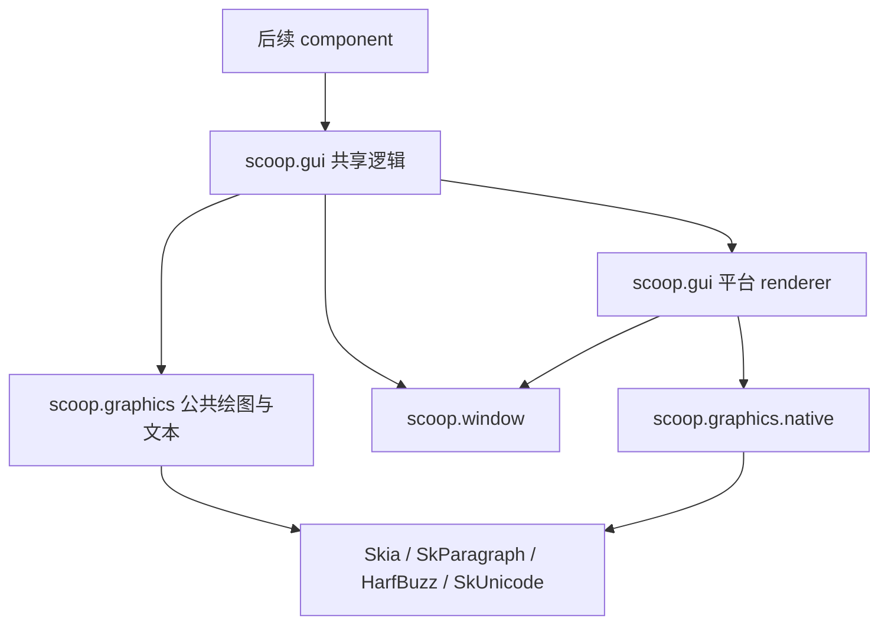
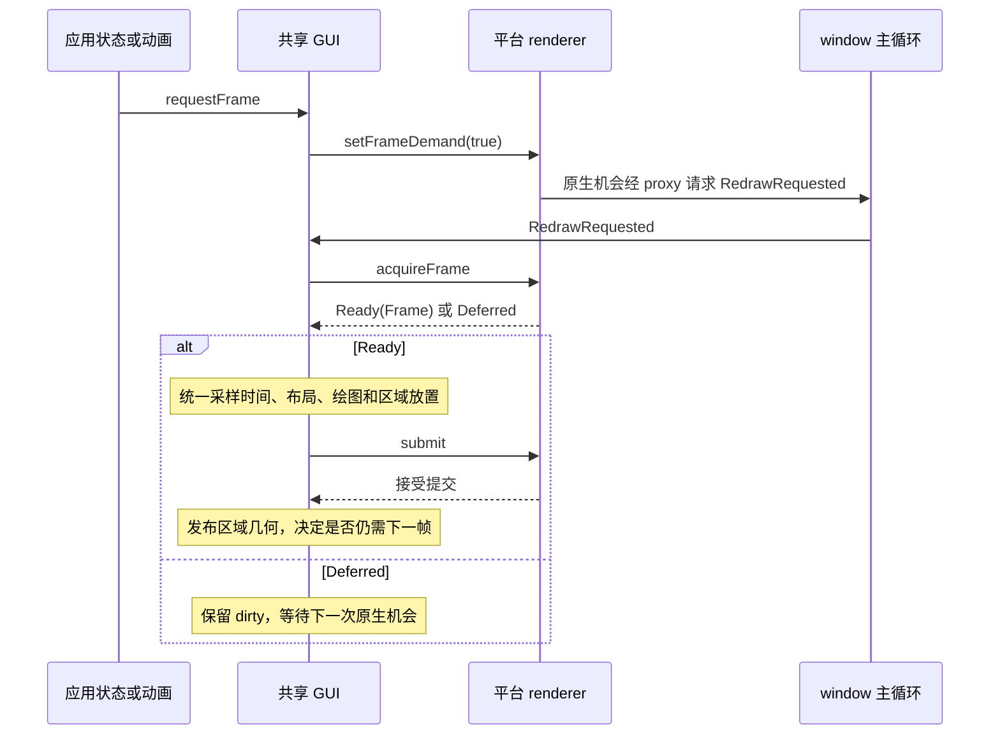

# GUI 基础架构与 macOS 设计

日期：2026-10-31。状态：第一期共享架构与 macOS 后端已实现。公共合同见 [GUI 基础库规范](../specs/SCOOP-GUI-SPEC.md)；window 的输入与生命周期合同见 [窗口库规范](../specs/SCOOP-WINDOW-SPEC.md)。实际交付、验证环境和未测边界见 [实施记录](PROGRESS.md)。

## 1. 本期决定

采用两个普通 Cone：`scoop.graphics` 提供绘图、路径、字体和段落布局；`scoop.gui` 把这些能力与窗口、帧、动画和输入区域连接起来。Skia 负责绘图，文本采用 SkParagraph + HarfBuzz + SkUnicode／ICU。第一期完成共享实现及 macOS 后端，后续平台分别实现 surface、帧通知和字体／窗口适配。

应用通过显式绘制回调使用这些能力，持久保存 Path、Image、TextLayout、Animatable 和 InputArea。每帧只生成绘图操作与区域放置结果；本期不要求组件树、响应式依赖图或自制 display list。后续 component 可以在这一层之上组织状态、测量、布局和生命周期。

| 第一阶段交付 | 本期边界 |
| --- | --- |
| Canvas、Path、基础形状／图像、变换、clip、透明度 | 不做 SVG／PDF 引擎、HDR、复杂滤镜系统 |
| 单调时间驱动的动画、easing、spring、改目标与取消 | 不做动画编辑器、通用时间线图或新协程调度器 |
| 字体、shaping、段落布局、测量、caret／selection 几何 | 不做完整 TextField、富文本编辑器或完整 OS 文档镜像 |
| 任意矩形／Path 区域的命中、hover、鼠标序列、滚轮、焦点与文本路由 | 不做组件事件系统、触摸手势竞争或全局鼠标锁定 |
| macOS Metal 呈现、DPI、现有主循环与有序关闭 | 本轮不实现 Windows／Linux renderer，不以其完成作为 macOS 交付条件 |

布局在这里首先指文本 layout。区域位置、尺寸和变换由调用方计算；容器测量、约束传递、弹性／网格布局留给 component 阶段。

## 2. 调研结论与取舍

| 参考 | 可复用的组织方式 | Scoop 本期采用方式 |
| --- | --- | --- |
| Flutter | framework 与 engine 分层；绘制、段落、帧时钟及命中路径是组件下面的独立能力 | 保留 Canvas／Paragraph／FrameClock／输入路由的边界，先实现这些基础；不复制 Widget／Element／RenderObject 全套树。当前 Flutter 已使用 Impeller，不能把其所有实现都归为 Skia |
| Slint 1.18.1 | 窗口系统 backend 与 renderer 分开；平台之外复用布局、动画和输入逻辑 | 把 surface／帧机会与 GUI 逻辑分开，按 target 独立实施。其当前 Skia renderer 使用共享 Parley 文本层，并非采用 SkParagraph；不将本设计的文本选型说成照搬 Slint |
| Jetpack Compose | composition、layout、draw 分阶段；Animatable 与向量转换支持通用值动画；输入序列保持命中路径 | 区分需要重新文本布局的变化与仅需重画的变化；动画改目标保持连续；组件和响应式 composition 本期不引入 |

HarfBuzz 是 shaping 引擎：把已确定字体、方向等信息的文字 run 转为 glyph 与位置。它本身不完成字体 fallback、Unicode 双向分析、分段断行、段落组合与 caret 规则。因此不能只包一层 HarfBuzz 就把结果称为文本 layout。

选择 SkParagraph 是为了直接使用与 Skia 字体／绘制配套的段落实现，同时满足 HarfBuzz 的选型。首期用 SkUnicode 的 ICU 后端。仓库现有文本 backend 使用 ICU4X 2.3.0，而本次检查的 Skia ICU4X 适配仍有未完成的 break iterator／word／sentence 通路；不能直接宣称两者可共用并替代成熟段落后端。先完成可用文本闭环，之后有实际依赖体积需求再评估替换。

各框架的事件传播规则不完全相同。本设计选择目标向父区域冒泡、Handled 停止的简单规则，不声称兼容 Flutter 的原始 pointer 分发或 Compose 的多阶段事件消费。

## 3. 现有 window 的基础与必要补项

| 能力 | 当前事实 | GUI 的使用／补充 |
| --- | --- | --- |
| 主循环、owner、跨线程通知 | Application、ApplicationProxy、Wait／Poll／WaitUntil 已存在 | 复用；GUI 只维护帧需求，不另建循环 |
| Surface 所需原生入口 | NativeWindowLease 提供 AppKit 的 NSWindow／NSView，并保证关闭前借用有效 | renderer 持有 lease，自己建立 Metal／Skia 资源 |
| 尺寸与 DPI | WindowMetrics 原子提供逻辑尺寸、物理尺寸和 scale | 转换一次；零尺寸不申请 drawable |
| 重绘 | requestRedraw 合并请求；prePresentNotify 不是帧时钟 | 平台 renderer 增加原生帧通知，复用 RedrawRequested 入口 |
| 鼠标、键盘与 IME | 有位置／按钮／滚轮／键盘、TextInputBatch、IME caret 矩形，已补鼠标取消与输入时间 | shared router 直接消费窗口归一后的输入 |
| 异步 I/O 接入 | runWithAsyncio 已复用窗口宿主与 EventLoopSession | GuiHost 使用同一 ApplicationHandler，不创建第二个 attachment |

GUI 所需的两项 window 前置能力已先行补齐，详见[规范第 11 节](../specs/SCOOP-WINDOW-SPEC.md#11-gui-基础层所需输入扩展)：

1. `PointerEvent.Cancelled`。失焦或原生跟踪中断后结束已按下的鼠标序列；滚轮 ScrollPhase.Cancelled 不能替代它。上层可以结束 drag／pressed 状态，无需等待永远不来的 Up。
2. 输入时间。PointerState 和 KeyEvent 增加同源单调时间及来源区别，供拖动速度、延迟判断和后续手势使用。原生事件时间能够可靠映射时用 Event；否则使用原生接收时的 Observed，不把业务 handler 的处理时刻冒充原始事件时间。

鼠标正常离开内容区不取消按下序列；“拖动期间继续接收本窗口的鼠标事件”也不同于 Confined／Locked cursor。AppKit 继续交付 mouseDragged，将窗口／应用失焦和菜单跟踪分别归一为取消。已有 Win32 后端同步共享 ABI，将 WM_CAPTURECHANGED／WM_CANCELMODE 转为取消，并区分正常 ReleaseCapture；本轮未在 Windows 执行验证。

native frame source、Skia context、dirty 管理、Area 命中、逻辑 focus、文本测量均属于 GUI／graphics，不应塞进 window。ApplicationHost 的 watch 接口目前服务 asyncio；macOS 的帧通知可以用现有主循环和 proxy 接通，不先增加通用外部调度器或多 attachment 框架。以后某个平台确实需要新的宿主等待能力时，再按真实句柄语义补窄接口。

代码依据：[指针模型](../../sysroot/src/scoop.window/src/input/pointer.scoop)、[窗口重绘](../../sysroot/src/scoop.window/src/window.scoop)、[native lease](../../sysroot/src/scoop.window/src/native/lifetime.scoop)、[AppKit 指针](../../sysroot/src/scoop.window/native/darwin/pointer.m)、[Win32 指针／捕获](../../sysroot/src/scoop.window/native/windows/input.c)、[asyncio 接入](../../sysroot/src/scoop.window.asyncio/src/application.scoop)。

## 4. 共享层与平台层

### 4.1 依赖方向



两个 Cone 都显式声明自己实际使用的 core／std／math／platform 依赖；几何变换、easing 和 spring 所需的三角、平方根及指数函数复用 scoop.math。graphics 不反向依赖 GUI 或 window；离屏绘图和文本测量不要求 Application 已运行。

| 内容 | 共享实现 | 平台独立实现 |
| --- | --- | --- |
| 几何、Path／Paint API、Canvas 状态 | graphics | Skia 的已有 target 适配 |
| 字体选择接口、段落布局、索引和查询 | graphics 文本层与 SkParagraph | 系统字体发现／读取；macOS 使用 CoreText font manager |
| dirty、动画、帧处理顺序 | gui | 帧机会来源、drawable／swapchain、提交与呈现 |
| 区域树、命中、事件路由、逻辑 focus | gui | 无；原生事件归一仍由 window 后端实现 |
| 原生窗口、IME 协议、DPI 快照 | window 的共享合同 | 各窗口系统 backend |

不把全库抽象成可注册插件系统。仅在存在实际调用边界的位置保留接口，创建函数和 native 源码按 target 选择。第一期只有 macOS renderer 的实现；后续平台可以分别加入，而不改动画、段落和区域算法。

### 4.2 主要对象与所有权

| 对象 | 职责与持有关系 |
| --- | --- |
| Canvas／RasterSurface | 回调内绘制与真实 CPU 离屏目标；RasterSurface 可供图形测试和离屏使用 |
| Path／Image／FontCollection／Paragraph／TextLayout | 可复用的图形或文本数据；原生资源由显式生命周期管理，派生结果独立保留所需引用 |
| GuiHost | 包装应用 handler，持有 WindowId 到 GuiWindow 的映射；macOS 可共享一个同 owner 的 Metal device／queue／Ganesh context |
| GuiWindow | 持有 lease、平台 renderer、dirty、动画集合、Area 状态与焦点；每个窗口有自己的 layer 和帧目标 |
| FrameContext | 一帧的时间、逻辑尺寸、借用 Canvas 与区域放置入口；不能跨帧保存 |
| InputArea | 稳定身份、处理器和交互状态；几何位置由每帧 placement 给出 |

GuiHost 是唯一的 ApplicationHandler 包装入口，可直接传给 `Application.run` 或 `Application.runWithAsyncio`。应用处理器仍决定 CloseRequested 是否销毁窗口；GuiHost 自动处理 Closing／Exiting。用户回调抛错时先关闭相关 GUI 资源再向既有应用异常通路传播，避免依赖业务代码补一次清理事件才能释放 lease。

`attach(window, painter)` 在 owner 调用，拒绝本 host 对同一窗口重复附着。调用方不得同时让另一个 renderer 修改该窗口的 layer。关闭 GuiWindow 可以只卸载绘制层并保留 Window；关闭 Window 则必定先结束 GUI 使用。这里不增加全局 surface 注册或跨库资源授权机制。

### 4.3 跨 Cone 的实际接入

gui 不能访问 graphics 的 internal Canvas 构造器。graphics 因此提供小范围的公开 Unsafe `native` 接入：构造／持有原生 RenderTarget，在绘制作用域借用 Canvas，取得当前几何快照，以及结束／中止绘制。普通应用绘制 API 只看 Canvas、Path、Image 和 TextLayout。

macOS 下，gui 的 Objective-C 薄层提供 device／queue／drawable texture 的不透明引用；graphics 的目标专用 native 接口把它们交给 Ganesh 并返回自有的 context／target 包装。Skia C++ 对象及 ABI 全部留在 graphics 的 C++ 薄层，不在两个 Cone 间传递 C++ class 或各自复制一份 Skia context 实现。

源码按以下职责组织；实际存在的模块以实施记录为准：

```text
sysroot/src/scoop.graphics/
  src/geometry/       Point, Size, Rect, Transform, Color
  src/drawing/        Canvas, Paint, Path, Image, RasterSurface
  src/text/           FontCollection, Paragraph, TextLayout
  src/native/         Public low-level target and canvas bridge
  native/shared/      Skia and paragraph C++ bridge
  native/darwin/      CoreText and Ganesh Metal bridge
sysroot/src/scoop.gui/
  src/host/           GuiHost, GuiWindow
  src/frame/          FrameContext, shared frame scheduling
  src/animation/      AnimationSpec, Animatable
  src/input/          InputArea, placement, routing, focus
  src/platform/darwin/  Platform renderer adapter
  native/darwin/      AppKit layer, Metal objects, display link
```

## 5. 绘图与文本

### 5.1 Canvas 和几何

graphics 自有 Point／Size／Rect／Transform，统一使用 Double 逻辑坐标；进入 gui／window 边界时显式转换 WindowMetrics 和输入位置。无需为了共享几个几何值类型再拆一个基础 Cone，也不能让离屏 graphics 依赖 window。

Canvas 提供 save／restore、translate／scale／rotate／concat、clipRect／clipPath、基本形状／Path／Image／TextLayout 绘制、saveLayer 组透明度。初期覆盖实用的 fill／stroke、端点／连接、纯色及线性／径向渐变；Image 至少覆盖自有 RGBA 数据与固定支持的 PNG／JPEG 解码，不引入可发现的 codec 插件框架。

PathBuilder 可变，build 后的 Path 不可变，可反复绘制、做 contains 或路径测量。命中只对显式提供的几何 shape 测试；可见描边不自动变成命中范围，调用方可以单独给更宽的矩形或 Path 作为拖动把手。

Canvas 的变换和 clip 同时服务绘制与命中。`FrameContext.place(area, shape, parent)` 从 Canvas 取得当前几何状态，DPI 根变换不计入 Area 的逻辑坐标；不能只在 FrameContext 记录 transform、却允许 Canvas 自身的变换绕开记录。clip 使用同一填充规则与有效交集，snapshot 保留所需 Path 引用。奇异矩阵可以绘制退化结果，但区域不可命中。

采用 Skia 本身的渲染命令与资源缓存。第一期整窗重绘、合并请求，按需复用文字和路径；不先自建图形 IR、damage region、BVH、分层合成器或通用缓存证明。以后确有重复复杂绘制成本时可接入 Skia Picture，不影响当前 Canvas 合同。

### 5.2 Paragraph 和 TextLayout

文本处理链为：字体与样式 run → Unicode 分析与 fallback → HarfBuzz shaping → 段落换行与定位 → TextLayout → Skia glyph 绘制。系统字体发现属于平台层，其余使用同一套段落实现。

Paragraph 保存自有 UTF-8 文字、样式 run 与段落设置；FontCollection 管理内置／应用字体和系统字体。TextLayout 是一次给定宽度下的完整结果：行尺寸与 baseline、字符范围、截断信息、位置命中、caret、选择范围的矩形集合。应用用同一个 TextLayout 绘制及响应点击，避免分别测量与绘制产生偏差。

宽度、字体、字号或文字变化要重新 layout；整体移动、缩放和透明度动画复用已有 TextLayout。native SkParagraph 对象自身可以重新 layout，但公开的旧 TextLayout 必须保持原结果，不能让后一次调用隐式改变前一份布局。

Scoop String 是 UTF-8，但常规 String 索引以 Unicode 标量计数；window 的编辑范围是 UTF-8 字节范围；SkParagraph 的不同查询可能返回 UTF-16 或 UTF-8 位置。桥接层须显式标出每个入口的索引单位，统一对外返回 Long 字节位置与 affinity，并保存对应映射。不能把三者的整数直接互传，也不能把一个 glyph 等同于一个用户字符。

首批测试使用随库测试资源固定的字体，覆盖中英文换行、阿拉伯文与混合 bidi、组合字符、emoji 序列、font fallback、ellipsis、空文本、零宽布局及 selection 多矩形。系统字体的具体 metrics 可以随 OS 和字体版本不同；不承诺跨平台系统字体逐像素相同。

## 6. 帧调度与平台协议

### 6.1 足够小的平台边界

共享层只使用一个内部 WindowRenderer 合同，平台创建函数按目标选择。当前实际需要的操作如下，接口名称在实施时可随现有语言习惯收敛，但语义须完整：

| 操作 | 合同 |
| --- | --- |
| configure(metrics) | 接受完整窗口配置；更新 drawable 尺寸，退休不再适用的待用目标 |
| setFrameDemand(required) | 表达有工作或无工作；合并原生通知，暂不可呈现时停止无效请求 |
| frameAvailable 通知 | 只提示 owner 可以尝试取帧；不调用应用绘制，不承诺已有画面显示 |
| acquireFrame() | 返回 Ready(Frame) 或 Deferred；Ready 自带该目标配置及 Canvas 借用入口 |
| Frame.submit／abort | 提交接受后才能发布几何；目标已失效时中止并保留 dirty；任一出口都结束借用 |
| close() | 停止通知、处理未用目标和实际 GPU 使用，按平台资源规则收尾 |

这里不要求所有平台提供 Metal 式 drawable，也不把交换链格式、display id、fence／fd 或等待句柄传入共享算法。未来平台适配可以把自己的原生机制映射成上述结果；不能用忙循环伪造一个“总是 ready”的实现。

### 6.2 从失效到提交



系统产生的 RedrawRequested 同样进入这个过程。尚无原生目标时只记 dirty 并请求下一次机会，不立即再 requestRedraw；否则会在没有 drawable 时反复唤醒主循环。没有 dirty 且没有运行中动画时停用帧通知。

帧在 acquire 成功后才执行用户 painter。一开始取走本轮 dirty；painter、动画完成处理或输入造成的新失效保留为下一轮 dirty。关闭／异常／目标失效时中止当前帧，不发布一半的 Area placement。第一期不在另一个线程重放绘制，owner 串行处理所有托管 GUI 状态；GPU 本身正常异步执行。

FrameClock 使用现有 MonotonicTimeSource，在 owner 开始本帧时采样一次。所有动画共用该 TimeMark。原生预测呈现时间可用于平台 present 策略，不拿来与来源不明的输入时间直接相减。

命中几何对应最近成功提交的一帧。异步 GPU 和显示扫描天然可能稍后才显示；本期不以等待 GPU 的方式强行保证输入对应屏幕上刚扫描的像素。需要离屏截图或明确 GPU 完成的测试使用显式读回路径。

## 7. 动画

AnimationSpec 覆盖 tween、easing／cubic Bézier、spring；Animatable 保存 value、target、status 和必要的 velocity。首批提供 Double、Point、Size、Color 的插值／向量转换，后续实际类型可实现同一小协议，不用先建通用属性系统。

动画归属 GuiWindow 的帧调度，支持启动、改目标、暂停／恢复、取消、反向及重复。以“当前单调时间减起点”求进度，spring 采用按经过时间求状态的实现；跳帧直接得到当前值，不补放所有中间帧，不让固定 dt 累积导致动画随帧率变慢。

改目标先采样当前值，再建立新运动；spring 继承当前适用速度，避免重启时不连续。动画完成后的状态改变排在安全回调边界；同轮新启动动画进入后续调度，不能递归不断推进时间线。

隐藏、完全遮挡、零尺寸时停止无效帧，时间轴默认继续；恢复时按当前时间求值。显式 pause 则记录暂停进度，resume 后排除暂停期间。取消与关闭结束业务通知，不把取消伪装成自然完成。

本期只要求调用方明确申请重绘或重排。颜色／透明度／位置变化通常只重画；改变段落宽度／字号等才重新 TextLayout。需要协程等待动画时后续复用现有 Job／取消合同，不在第一期发明 AnimationScope 任务树。

## 8. Area、事件路由和焦点

### 8.1 持久身份与每帧位置

InputArea 在帧外创建，稳定持有 handler、enabled、是否可聚焦等状态。FrameContext.place 记录 shape、父区域、当前矩阵、clip 与放置顺序；同一区域每帧至多一次，父区域先放置，避免构成环。位置和 parent 可以随帧变化，身份不因动画和重绘改变。

placement 随整帧提交发布。未再放置、显式注销或禁用的 Area 退出命中；若正在处理鼠标序列，发送 Cancel；若拥有焦点，清除焦点。旧帧几何引用在没有派发使用后释放，不把调用方已经关闭的资源包装当成仍可调用的 Path。

父区域表示传播关系，不自动把子区域裁剪在父 bounds 内。忽略自身命中不屏蔽子区域，而 enabled = false 使整个子树退出交互；真实 clip 来自 Canvas 状态。按逆放置顺序找到最上面的有效 shape，构造目标到祖先路径，命中本身不执行 handler。

### 8.2 鼠标序列与 hover

首次按钮 Down 选定目标与路径，后续按钮、Move、Up 沿用，直到最后一个按钮释放；Down 未命中则保留空路径，不在后续 Move／Up 改选目标。正常离开内容区仍保持 drag。每次交付按最新有效 placement 换算局部位置，同时保留窗口位置，方便实现拖动与边界判断。

回调从目标向父传播，Handled 终止；下方兄弟不会因为上方未消费就再次成为目标。当前事件路径固定，handler 引起的树变化在安全边界处理，已注销对象不继续获得业务回调。

收到窗口 Cancel、目标／必要祖先移除或禁用、窗口失焦时取消序列，不能合成正常 Up。已有 Button Up 正常结束后，不再因捕获释放补一个 Cancel。区域关系改变时，活动路径若已不成立则取消，而不是突然改送另一个父路径。

hover 独立按当前位置查询已提交几何。每次 Move 及新几何发布后都比较 hover 路径，产生 Enter／Leave；这样鼠标停着、按钮因动画移动到鼠标下面时仍能得到正确 hover。滚轮在没有鼠标按钮序列时按当前位置命中，序列内沿活动路径；PixelDelta 用该次事件的 scale 换算，LineDelta 交给上层解释。

### 8.3 键盘与文本

逻辑 focusedArea 与 OS 窗口焦点分别保存。窗口失焦使区域暂不活动，取消鼠标序列与组合输入；回到窗口时可恢复仍存在且启用的区域。移除或禁用焦点区域则明确清除，不自动猜测下一个控件。

Keyboard／ModifiersChanged 可用于快捷键与编辑命令；文本仅由 TextInputBatch 写入。文本区域注册自己是否接收 IME，并用 TextLayout 查询 caret，经 placement 变换为窗口逻辑轴对齐矩形，再调用 setImeCursorArea。布局、滚动变换或 DPI 改变后更新该矩形。

更换文本接收区域时，逻辑 focus 与原生输入接收者的切换分别处理：先关闭旧接收者的 IME，以 window 的 Disabled 通知作为旧输入会话结束边界，再设置新 caret 并开启新接收者；没有活动旧接收者时直接开启。结束前排队的 Edit 仍属于旧接收者；旧区域已经注销则丢弃，不能写进新区域。Enabled 先于新接收者的 Edit。复用已有通知顺序，不另加窗口专用编辑器对象或并行 IME 会话；测试须覆盖组合输入中切换区域。窗口关闭时直接结束接收状态，资源释放不等待这些业务通知。

本期提供输入路由和几何转换，不替应用保管文档、selection、marked range、撤销栈。已有 TextInputState 可辅助应用处理编辑批次；完整 surrounding 文档接入仍属于后续编辑器需求。

## 9. macOS 后端

### 9.1 技术选择与基线

绘图采用 Skia Ganesh Metal，段落采用共享 SkParagraph；系统字体用 Skia 的 CoreText font manager。选择 Ganesh 是为了先完成当前实际 Metal 接入，不同时实施 Graphite／Dawn 或另一套软件窗口 renderer。CPU RasterSurface 仍是 graphics 的真实离屏能力。

使用 CAMetalDisplayLink，它从 macOS 14 提供与 CAMetalLayer 关联的更新、drawable 及预测时间。本仓库当前[发行配置](../../scripts/release.toml)为 macOS 27.0.1／SDK 27.0，两个 Darwin target 都沿用该基线；不能由 API 最低版本推导 Scoop 已支持旧系统。

当前 SDK 声明已经核实：CAMetalDisplayLink 提供 addToRunLoop、paused、invalidate；Update 提供 drawable、targetTimestamp、targetPresentationTimestamp。Skia Metal backend 的 GrMTLHandle 是 `const void*`，可由纯 C++ 持有。这允许继续使用现有 `.m` + `.cpp` 构建边界。

### 9.2 创建和安装

1. owner 上取得 NativeWindowLease，读取 NSWindow／NSView；保存安装前的 layer 与 wantsLayer。
2. GuiHost 首次需要 GPU 时创建 Metal device、command queue 与 Ganesh context。每个窗口创建独立 CAMetalLayer，设置 device、BGRA8、sRGB、与窗口透明策略一致的 opaque／alpha 行为；允许 Skia 所需的 texture 用途，初期使用 framebufferOnly = false。
3. 在现有 NSView 安装 layer，不替换 contentView、输入 view 或 NSTextInputClient，不抢 first responder。lease 的 NSView 可以是 contentView 内的输入／呈现宿主，不能假定与 contentView 相同；测试记录安装前的窗口、contentView 和父视图，验证安装后层级不变。沿用原有坐标、IME 与窗口属性实现。
4. 用 WindowMetrics 的 physicalSize 设置 drawableSize，scaleFactor 设置 contentsScale，layer 几何跟随 view bounds；不能再自行按另一个 scale 计算一套像素尺寸。
5. 创建 CAMetalDisplayLink，加入主线程 NSRunLoop 的 common modes，初始暂停。现有 AppKit 主循环已经覆盖 tracking／modal modes；原生通知只记录帧机会并投递，不递归绘图。

任何步骤失败均回滚已经取得的资源并关闭 lease。GuiWindow 卸载时只恢复自己安装的 layer 状态；若调用方已经违反独占使用约定替换 layer，清理不能覆盖该新 layer。恢复原为空的 layer 与 wantsLayer=false 后，AppKit 可以随父视图的 backing 状态自动创建 NSViewBackingLayer；不能要求 view.layer 永久为空。验收分别覆盖无原层和有自定义原层，前者检查恢复 wantsLayer 并移除 CAMetalLayer，后者还检查原层身份。

### 9.3 帧通知、取帧和提交

共享层产生帧需求后解除 display link 暂停。delegate 在 owner 收到 Update，保留至多一个待用 drawable，合并后续通知；通过既有 ForeignCallback 进入内部通知，再经 ApplicationProxy 请求窗口 redraw。这里不调用用户 painter，也不依赖固定 16 ms timer。

RedrawRequested 到达时消费待用机会。尚无 drawable、目标已过期或尺寸不匹配则返回 Deferred，释放不再使用的引用，保留 dirty。隐藏／遮挡／零尺寸期间暂停有效帧请求并释放待用目标；恢复后的配置／可见性通知重新请求一帧。平台适配负责把可恢复状态通知共享层，不要求动画轮询窗口。

drawable texture 交给 graphics.native，包装为尺寸与格式一致、top-left origin 的 Skia surface。Canvas 根部施加一次逻辑到像素的缩放，之后用户绘制和 Area 使用逻辑坐标；不因 Metal texture 的坐标约定再次翻转 pointer 的 y。

绘图完成后 flush／submit Skia 工作；使用与 Ganesh 同一 Metal queue，在其已提交命令之后提交普通 presentDrawable，紧邻实际呈现调用前执行 Window.prePresentNotify。CAMetalDisplayLink 自行安排其 drawable 的呈现节奏，不能把 targetPresentationTimestamp 传给 atTime 或 afterMinimumDuration 变体；系统会拒绝该组合。drawable 及 texture 引用保留到相应 GPU 使用结束，FrameClock 仍按第 6 节定义。

普通帧不调用 waitUntilCompleted。现有 [Metal 示例](../../sysroot/src/scoop.window/examples/metal/renderer/native/metal.m)的 layer 安装和 lease 用法可参考，但其逐帧等待只是简单示例的做法，不成为正式 GUI 管线。GPU 完成回调只访问原生持有状态；需要报告业务错误时在仍运行期间排回 owner，关闭则在收尾过程中收集结果。

### 9.4 DPI、窗口状态与输入

GeometryChanged 原子切换尺寸与 scale，废弃旧配置的待用 drawable，申请新帧。当前显示器与刷新率由系统帧机制跟随；不把 Monitor 的可选刷新率快照作为固定 timer 周期。最小化、恢复、实时 resize、跨屏 DPI 变化及系统要求重画，都必须通过真实窗口验证。

macOS pointer 取消至少覆盖窗口／应用失焦导致已交付鼠标序列无法继续的情况；避免 native focus 通知与 GUI 兜底重复 Cancel。正常 mouseDragged／mouseUp 保持原序列，不把 mouseExited 当取消。原生侧可以确认的系统／嵌套跟踪中断映射为 CaptureLost，并以实际操作验收，不承诺报告 OS 未提供的中断原因。

时间在原生接收边界采样现有单调源。NSEvent.timestamp 不能未经证明就与仓库 CLOCK_MONOTONIC 的秒数直接比较；能够可靠归一时交付 Event，否则交付 Observed。第一批允许明确使用 Observed，后续转换须处理睡眠／唤醒等原点差异，不改变公开时间来源语义。

候选窗坐标继续由 window 的 NSView／NSWindow 转换处理；renderer 不另外实现一套屏幕坐标转换。CoreText 只为 Skia 提供系统字体，不能绕过共享文本布局、在 macOS 再独立测量一份字符串。

### 9.5 关闭

GuiWindow.close、Window.Closing 和 GuiHost.Exiting 进入同一幂等收尾。顺序为：停止／invalidate display link，退休帧通知；结束活动输入和动画；释放未用 drawable；提交或中止剩余图形工作并等待实际相关 GPU 使用结束；销毁窗口 surface、恢复 layer；最后关闭 NativeWindowLease。

如果 close 来自正在运行的 painter 或输入 handler，先标记 Closing 并停止新工作，实际销毁在该回调的 finally 收尾中、当前帧中止后执行。不能在 owner 上等待自己返回，也不能提前释放仍被借用的 Canvas／surface。

多窗口共享 context 时，关闭一个窗口只释放该窗口资源；最后一个使用者或 GuiHost 关闭后才释放共享 context／queue／device。等待只出现在资源收尾或显式读回，不进入普通帧路径。GPU 收尾不得依赖主线程再次执行某个业务闭包才能完成。

迟到的 proxy 通知检查 GuiWindow 状态后退出；它不是释放资源的必经入口，因为 proxy 关闭后可能拒绝或丢弃已接受业务工作。清理中取消仍有效的区域并退休处理器，此后不再调用已关闭对象的业务代码。清理异常记录并继续释放其余资源，最终遵循 ResourceUseException。

## 10. 原生边界与构建

纯值几何、Paint 描述不需要 native close；持有 Skia／字体／图像／段落等资源的对象使用 Closeable／use。TextLayout、已提交 clip／shape 快照及 GPU 工作各自保留必要的原生引用，关闭一个公开包装不能留下悬空指针。Canvas 是回调范围内的借用，结束后拒绝使用。

第一期 graphics 原生持有对象在创建线程串行使用和关闭；GUI 中即窗口 owner，离屏使用则不要求是主线程。纯值可以复制传递；布局结果逻辑上不可变，不意味着其 Skia 内部缓存可由多个线程同时访问。需要后台 I/O 时先加载自有字节数据，再回到资源所属线程创建图像／字体。

native 只保存复制的数据、原生引用或已有 ForeignCallback 的有效句柄，不保存托管对象的裸地址。C++ 和 Objective-C 薄层在 C ABI 边界转换异常／错误。GC release 不负责 UI 操作、GPU 等待、宿主注销或托管业务投递；这些均由 owner 显式关闭。

采用[语言规范 12.2](../specs/SCOOP-SPEC.md)与[实现规范 2.7／2.8](../specs/SCOOP-IMPL-SPEC.md)已经支持的 native C++、Objective-C、framework 和传递链接：

- graphics 的 `.cpp` 封装 Skia／SkParagraph，按 target 增加 Metal／系统字体适配；gui 的 `.m` 管 AppKit、QuartzCore、Metal 对象，通过 C ABI 接通。Cone 当前不支持 `.mm`，本设计不要求新增；Skia 自身的源码构建可由其原生构建工具处理 `.mm`。
- 新依赖按固定 Skia revision 及其配套 DEPS 准备 HarfBuzz、ICU 和实际启用的图像 codec，不另取浮动的最新 HarfBuzz 与它拼接。维护脚本显式构建并发布每目标库、头文件和许可。
- 普通应用只消费预编译 graphics／gui Cone 与已声明的目标原生资源，不自动运行 GN／Ninja、联网或安装工具。已有缓存命中流程保持“先判断更新，再做需要的准备”，不加入 GUI 专属缓存校验。
- 只为当前 Darwin 两目标准备 GUI 原生资源；未实现的平台不发布一个调用后报“尚未支持”的空 GUI 包。后续按各目标补资源、实现和验收。

第一期 GPU device 丢失或确定的呈现失败直接报告 GraphicsException，并有序关闭受影响的 GUI 资源；不自动切 CPU renderer 或循环重建 context。Deferred 仅表示可恢复的暂不可绘制，不能用来吞掉真实错误。

## 11. 实施顺序与验收

| 批次 | 可交付结果 | 关键验证 |
| --- | --- | --- |
| 1. 原生依赖与绘图闭环 | 固定 Skia 输入、graphics C ABI、RasterSurface、Canvas／Path；一个 macOS Skia 窗口 | 真实 Skia 绘制和读回、Metal 颜色／alpha、lease／layer 回滚，不先搭空组件框架 |
| 2. GUI 宿主与帧 | GuiHost／GuiWindow、平台协议、CAMetalDisplayLink、DPI 与关闭 | 空闲无周期绘制；持续动画由原生机会推进；隐藏恢复／零尺寸／多窗／异常和关闭；run 与 runWithAsyncio 两入口 |
| 3. 共享文本 | FontCollection／Paragraph／TextLayout、UTF 索引转换和查询 | 固定字体的 CJK／RTL／emoji、fallback、换行、ellipsis、caret／selection、重复布局结果独立 |
| 4. 动画与输入区域 | Animatable、Area placement、命中／传播／focus；window Cancel 与 InputTime | 变帧率和跳帧、改目标连续性；变换／clip／重叠／移动 hover；拖出窗口释放、失焦取消、区域移除和 IME caret |
| 5. 基础使用示例 | 一份自绘演示：路径、动画、段落、可拖动区域、文本输入接收 | 证明这些能力无需 component 即可组合；明确示例只实现所需编辑行为 |

上述能力已分批交付。后续平台可以沿同一共享合同分别推进，其 GPU 实现不属于本轮 macOS 验收范围。

graphics／gui 的纯值和路由行为归所属 Cone 的 scoop.test；窗口与 GPU 行为使用真实 AppKit／Metal 的 Cone 测试及示例；需要独立进程的启动／退出和链接验证使用独立测试 Cone。本次实施不使用 fixture。共享动画求值直接传入采样时间测试，不因测试需求增加假的平台 renderer 或生产用时钟工厂。

桌面验证覆盖窗口缩放、系统模态循环、外部窗口焦点变化、拖到内容区外释放、文本输入与候选窗位置、多窗口关闭与 GPU 使用结束。协议调用、自动桌面操作和人工观察分别记录，不互相冒充。两种 Darwin 目标分别编译／运行，x86_64 使用 Rosetta。跨屏混合 DPI 需要不同缩放的多块显示器；本机只有一块 2× 显示器，该硬件场景保留为未测项。

两目标的真实接入已验证 CAMetalDisplayLink → 现有 proxy／redraw 的时序、Ganesh flush 与 present 的队列顺序，以及普通 run、asyncio 和 painter 异常下的关闭。CAMetalDisplayLink 提供的 drawable 使用普通 presentDrawable，由 display link 控制节奏；不使用显式呈现时间、固定帧 timer 或普通帧的 GPU 等待。

## 12. 调研来源

调研日期为 2026-10-31。Slint 使用 1.18.1 标签；Skia 基线 `f326a1e25fc736704063922b9ce76b527b1c5efe` 已写入发行配置，配套 DEPS、启用模块和部署补丁见 [vendor 说明](../../sysroot/vendor/skia/README.md)。

- Flutter：[架构概览](https://docs.flutter.dev/resources/architectural-overview)、[TextPainter](https://api.flutter.dev/flutter/painting/TextPainter-class.html)、[Ticker](https://api.flutter.dev/flutter/scheduler/Ticker-class.html)、[输入与手势](https://docs.flutter.dev/ui/interactivity/gestures)。
- Slint：[backend 与 renderer](https://github.com/slint-ui/slint/blob/v1.18.1/docs/astro/src/content/docs/guide/backends-and-renderers/backends_and_renderers.mdx)、[Skia renderer 的 Parley 文本调用](https://github.com/slint-ui/slint/blob/v1.18.1/internal/renderers/skia/itemrenderer.rs)。
- Jetpack Compose：[阶段划分](https://developer.android.google.cn/develop/ui/compose/phases?hl=en)、[值动画](https://developer.android.google.cn/develop/ui/compose/animation/value-based?hl=en)、[输入命中与传播](https://developer.android.google.cn/develop/ui/compose/touch-input/pointer-input/understand-gestures?hl=en)。
- HarfBuzz：[职责与不承担的工作](https://github.com/harfbuzz/harfbuzz/blob/main/docs/usermanual-what-is-harfbuzz.xml)。
- Skia：[Paragraph API](https://github.com/google/skia/blob/f326a1e25fc736704063922b9ce76b527b1c5efe/modules/skparagraph/include/Paragraph.h)、[HarfBuzz shaping](https://github.com/google/skia/blob/f326a1e25fc736704063922b9ce76b527b1c5efe/modules/skparagraph/src/OneLineShaper.cpp)、[ICU4X 适配](https://github.com/google/skia/blob/f326a1e25fc736704063922b9ce76b527b1c5efe/modules/skunicode/src/SkUnicode_icu4x.cpp)、[Metal context](https://github.com/google/skia/blob/f326a1e25fc736704063922b9ce76b527b1c5efe/include/gpu/ganesh/mtl/GrMtlBackendContext.h)、[Metal 句柄](https://github.com/google/skia/blob/f326a1e25fc736704063922b9ce76b527b1c5efe/include/gpu/ganesh/mtl/GrMtlTypes.h)。
- Apple：[CAMetalDisplayLink](https://developer.apple.com/documentation/quartzcore/cametaldisplaylink)、[CAMetalDisplayLinkUpdate](https://developer.apple.com/documentation/quartzcore/cametaldisplaylinkupdate)、[CAMetalLayer](https://developer.apple.com/documentation/quartzcore/cametallayer)。API 形状另以本机 Xcode 的 macOS SDK 头文件复核。
