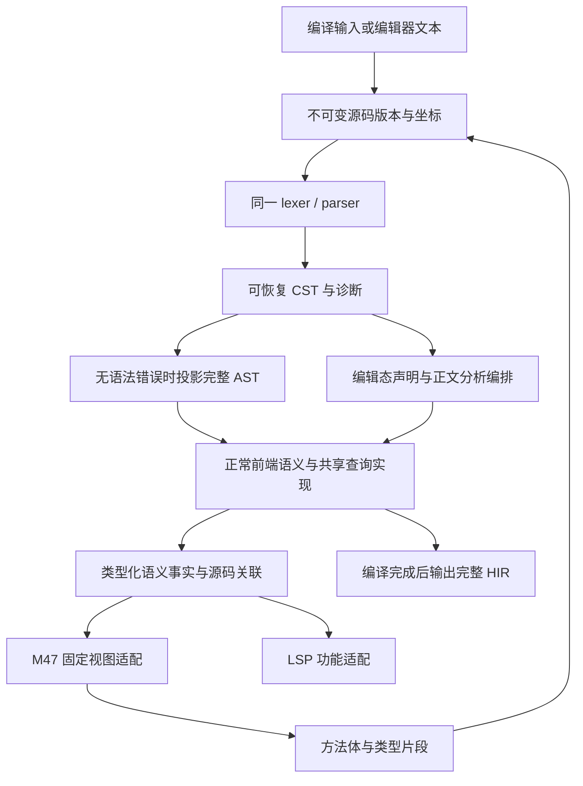

# 可恢复语法、M47 与 LSP 的公共基础

状态：实施中。设计日期：2026-10-21；实施起始：2026-10-22，基线 `033dd9e1d`。原调研基线：`4de3ae9e8`。外部资料、依赖候选与功能清单见[调研](INVESTIGATION.md)；阶段目标合同见[实现规范 2.20](../specs/SCOOP-IMPL-SPEC.md#220-可恢复语法与语言服务公共基础设计合同待实施)。各项实际交付、验证与剩余范围见[实施记录](PROGRESS.md)，未闭合的批次不视为已经实现。

依据：[语言规范](../specs/SCOOP-SPEC.md)的语法、名称、类型与文档规则，[实现规范](../specs/SCOOP-IMPL-SPEC.md)2.1、2.2、2.7、2.11、2.20，[M47 设计](../milestone47/DESIGN.md)及[同步查询协议](../milestone47/PROTOCOL.md)。运行时继续遵守[运行时规范](../specs/SCOOP-RUNTIME-SPEC.md)，本设计没有 runtime 变更。

## 1. 设计决定

公共基础分成源码、语法和语义查询三个边界，由编译 driver 与语言服务分别编排。M47 使用固定编译视图，LSP 使用可更新的编辑视图；它们共享事实与算法，不共享会话生命周期。

1. 保留 Scoop 的一套 lexer／递归下降 grammar。新增保留全部源码的 CST，明确表示缺失项与错误文本；现有紧凑 AST 继续作为成功语法的编译输入。
2. 源码、byte range、行索引和诊断不依赖 LSP。源码版本、语法定位与语言实体身份分别表达。
3. 共享查询契约放在现有 HIR 数据通道，实现在 hir-lower 中复用原有语义规则；不在 HIR/meta 里复制名称解析、子类型或重载算法。
4. 编辑态保留局部已知事实以及明确的不可用原因。完整的类型、签名与正文仍由完整类型的数据结构表达；错误恢复状态不能进入成功 HIR。
5. 新源码必须正常解析与绑定。查询、源码位置关联和 generator 返回的文本均不能绕过访问域、重载或 effect 检查。
6. 先交付按文件更新和保守语义失效，再根据实际编辑延迟细化。M47 不等待完整 LSP、局部重解析或通用增量数据库。

## 2. 模块与数据流

下图表示数据流；stage 之间仍只通过数据通道通信，编排层才调用 stage 实现。



| 模块 | 责任与依赖边界 |
| --- | --- |
| 新 `scoop-source` | 从 `scoop-ast::source` 提取通用 byte range／诊断，增加不可变文本与行索引；依赖必要的 identity 数据，不依赖 syntax、HIR 或协议。原公开类型可重导出以分批迁移 |
| 新 `scoop-syntax` | rowan 树、SyntaxKind、语法节点视图、错误／缺失项和解析结果数据。只保存语法，不依赖 parser 实现、HIR、项目图或 LSP |
| `scoop-parser` | 原 lexer／grammar、三个完整入口、错误恢复、CST 构造及向现有 AST 的语法投影；依赖输入／输出数据 crate，不调用 hir-lower |
| `scoop-ast` | 现有紧凑编译 AST、完整源码集合与文档语法数据；不加入绑定实体或用缺失表达式伪造合法语句 |
| `scoop-hir` | 共享查询的输入／结果、typed 引用、源码关联与可用性数据；保持纯数据与只读契约 |
| `scoop-hir-lower` | 共享名称、类型、成员、候选和 effect 算法；在实际绑定时记录来源；固定编译视图和编辑态分析使用这些实现 |
| 新 `scoop-analysis` | 首个编辑态调用方出现时加入；编排 parser／hir-lower，持有工作区输入、查询视图和更新索引。它是 driver 同层的编排库，不是另一套 type checker |
| `scoopc`／`scoop-generator-protocol` | M47 配置、子进程、固定视图查询及源码结果接收；lowerer 不依赖这两个实现 |
| 新 `scoop-lsp` | 首个可运行 LSP 批次加入；stdio、capabilities、文档通知和编辑器功能投影，调用 `scoop-analysis`；不直接修改 lowerer arena |

`scoop-source` 与 `scoop-syntax` 分别解决真实的跨调用方坐标和错误语法需求。查询契约先留在 `scoop-hir`，不额外建立通用服务注册器、查询插件层或平行 IR。JSON-RPC 采用现有库的消息／分帧组件；没有必要仅为两种协议另建一套传输框架。

M47 的钩子可直接借用 lowerer 的查询视图，无须为一次同步编译创建语言服务器或可变分析宿主。编辑态才需要保存多个输入版本和失效状态。

## 3. 源码、版本与位置

### 3.1 各种身份的用途

| 数据 | 含义与生命周期 |
| --- | --- |
| `SourceIdentity` | 已归属 Cone 的普通源码身份；沿用完整 logical path，编辑文本不改变此身份 |
| `SourceId` | 输入宿主分配的本地源码句柄，可定位普通文件、未归属 Cone 的编辑 buffer 或生成片段；不是持久声明身份 |
| 文本 revision | 某个 SourceId 的一份不可变文本；普通输入、编辑输入和生成片段都可有自己的版本 |
| 分析 revision | 本次源码集合、文本版本、目标／用途和依赖语义视图的组合；任一实际输入变化会更新它 |
| LSP 文档 version／URI | 协议侧的文档引用，映射到宿主输入；不作为语言身份，不要求内部 revision 等于客户端 version |
| `SyntaxPtr` | 指向指定源码版本的语法节点／token。可以由节点种类与范围等实现，只用于该版本，不能作为全局 DeclId 或跨版本稳定引用 |

不为缺少项目归属或尚未写完签名的文本构造虚假的 Cone／持久声明 ID。其语法服务仍可工作；取得真实声明身份后再关联普通 typed 引用。重名、alias 与同形签名不能由文本或 span 相等替代正常绑定。

生成正文由 driver 保存原文并分配本地 SourceId，另保存“该片段属于哪个待填方法、关联哪条 GenerateWith”的编排数据。原方法的作用域不从片段路径取得；公共源码层不需要依赖 MethodId。生成片段不进入普通目录扫描。

### 3.2 不可变输入与坐标转换

一份源码版本持有共享 UTF-8 文本、长度和可复用行索引，语法及诊断引用同一版本。初版可使用 `Arc<str>`，只保留当前和仍被请求引用的版本；无需复制整个工作区或建立磁盘源码镜像。

内部语法范围继续为半开 UTF-8 byte range。现有 `u32` Span 的表示上限应在文本接入时检查，不能截断 `usize`。这是实际数据表示的边界，不是通用内存或解析成本预算。

行索引提供 byte 与 UTF-16／UTF-32 列之间的转换；LSP 适配层选择协商编码并处理零基行列、超出行长时归到行尾等协议规则。LF、CRLF、CR 按 LSP 的行定义处理，不能切开 CRLF。输入修改涉及的 byte 边界必须落在 UTF-8 字符边界；半个代理对不能变成合法 byte 编辑。

CLI 的一基显示行列与持久 SourcePointRecord 继续按各自合同使用。LSP 行定义不改变 lexer 对换行和语句边界的判断；不能为统一显示坐标而归一化原文或改变 Scoop 的换行语义。

### 3.3 诊断与编辑

公共诊断保留现有 severity、message、主位置与 related notes。新的语法诊断可增加供具体修复使用的诊断代码和 byte edit；不依靠匹配英文 message 来决定 code action，也不要求一次性重编所有历史诊断编号。

与源码有关的诊断和编辑必须绑定相应文本版本；无源码的工具／配置错误使用独立分支。M47 的注解关联位置、LSP 的 relatedInformation 与 CLI 的 notes 都由同一来源事实投影。

LSP 将同版语法诊断与普通声明、签名及完整正文检查的诊断合并。正文查询与其他语义功能共用缓存，坏正文旁的完整函数仍检查；附注分别按实际 SourceIdentity 和该快照文本换算位置。输入变化后重新发布受影响的打开文档，旧 revision 的结果不发布，修复及上下文失效会清除旧结果。

声明和签名遍历在实际声明边界接受宿主取消信号，取消与源码失败使用不同结果。源码依赖的完整 Export HIR 分析同样在阶段和正文边界取消；表达式、语句和试探共用正文取消状态。编辑态丢弃未完成状态，普通编译沿同一实现使用不会取消的入口；不引入逻辑工作量或时间配额。

公共 edit 只表示范围替换，不写文件。LSP 对打开文档返回版本化 TextDocumentEdit；对已变化的延迟 completion／code action 数据重新计算或返回失效结果，不能把旧范围套到新版本。

首批具体 code action 使用 grammar 已记录的缺失固定标点，按请求范围提供插入编辑；名称、类型、表达式与模式需要用户输入，不生成猜测内容。动作及 resolve 复用同一语法版本的缺失项，源码变化后旧动作失效；客户端只改变协议 version 时，编辑随最新 version 返回。能力按客户端的 literal／documentChanges 与 resolve 支持协商。

## 4. 可恢复语法结果

### 4.1 一套 grammar，两个消费边界

解析结果始终含一个与入口种类匹配的根和结构化诊断。公共实际入口为完整文件、带大括号的普通函数体、一个完整类型；空文件仍有文件根，错误片段仍有对应根及错误记录。源码取得失败与无法表示的长度属于输入错误，不包装成成功语法。

编辑器读取 CST 的节点视图，缺失 name、type 或 body 是合法的语法观察结果。编译适配要求没有 Error 级词法／语法诊断，再投影现有完整 AST；`parse`／`parse_all`／`parse_current_cone` 的严格输出合同可以保持。M47 的正文与 interface 字符串使用相同入口和严格适配，要求消费至 EOF。

CST 到紧凑 AST 是语法投影，不重新 lex／parse。完整文件、片段、编译与编辑器不能分别维护语法分支。分批迁移期间，某个已迁移 production 的语法只判断一次，不能长期保留两套独立 parser 用差分测试维持一致。

实施时在同一次 grammar 调用中记录 CST 事件并同步构造紧凑 AST 投影，保留现有 production 的语法决定；结果只在没有错误时开放完整 AST。这样无需将既有 grammar 复制为一套遍历 token 的 AST reader。事件构树只负责按已决定的节点边界组织 lexer 保存的原文，不推断新的语法结构。

### 4.2 CST 的必要信息

- 所有原文各出现一次，包括空白、普通／文档注释、字面量原始拼写和非法字符；按顺序输出实际 token 文本即可还原原文。
- 多余或无法归属的实际文本放入 `ERROR` 节点；缺失语法项保存 expected kind 和零宽位置，输出原文时不产生字节。
- 零宽缺失项不持有伪造的标识符、字面值、TypeId 或默认正文。语法节点视图允许缺失孩子，编译 AST 与 HIR 的必要字段不因此改成 Option。
- 保留括号、分隔符、换行事实、实参类别及文档边界。M60 文档片段从同一 lexer／树取得，完整声明的附着规则不变；错误声明附近的文档不跨边界漂移。
- 提供 token-at-offset、祖先、子节点、范围与声明遍历。两个 token 之间及 EOF 的位置允许左右邻接结果，由调用功能按语法上下文选用，不能默认把末尾光标丢弃。

可用事件流解耦 grammar 与树构造，但只实现当前树构造和 AST 投影需要的事件，不建立任意 parser 插件接口。原有 speculative probe 在回退时必须一起撤销新增事件、诊断、局部编号与文档附着；不能仅恢复 token cursor。

### 4.3 恢复策略

| 语法位置 | 恢复行为 |
| --- | --- |
| package／import／顶层声明 | 保留文件头顺序诊断；同步到当前层的合法起点，不将损坏 body 内部的声明误升为顶层 |
| 成员与块内语句 | 在同层的分号、允许的换行、下一项起点或当前结束括号处停止；结束符留给所属结构消费 |
| 参数、实参、类型参数／实参、tuple、annotation 数组 | 单项失败时保存缺失／错误项，尝试后续同级项；只在当前规则的 follow 边界补缺失分隔符或结束符 |
| 类型与表达式 | `receiver.` 保留 receiver 和缺失名称；操作数缺失保留已有结构；不补 Any、Unit 或数字零 |
| when arm、模式、控制体与 lambda | 使用各自分隔符和上下文；保留普通 arm／case、guard、箭头、控制体与尾随 lambda 的分界 |
| 字符串、f-string 与注释 | 沿现有词法状态恢复；保留插值层级及原文；无法离开未终止 token 时自然结束于 EOF |

缺失项只在当前 grammar 已确定的预期位置形成。每个恢复循环必须消费至少一个实际 token，或者结束当前项／推进到下一个语法步骤；不得在同一位置反复插入同一缺失项。同步时考虑括号层级，不用简单的“扫到下一个关键字”替代结构。

保留现有泛型实参与比较、匿名函数、上下文关键字等消歧。输入不完整时可以形成缺失语法视图；完整输入必须按同一 grammar 得到原有含义。词法错误引起的重复语法诊断按实际错误范围和恢复上下文抑制，后续独立错误仍须报告。

## 5. 共享语义查询

### 5.1 上下文与结果

共享查询接收由前端建立的语义上下文：当前 Cone／源码、词法 owner／scope、binder、receiver 和相关 flow／effect 事实。M47 适配器从实际 MethodId 取得它；分析服务从当前 SyntaxPtr 与绑定记录取得它。对端不能提交一组“期望可见性”来改变上下文。

可用性按问题区分，不以一个 `Option<T>` 同时表示所有失败：

| 问题 | 结果边界 |
| --- | --- |
| 已知类型、签名、成员或引用 | 已完成的完整 typed 数据 |
| 名称查找 | 已解析目标／真实候选集／确定未找到／因输入不完整而无法确定；空列表不能代替最后一种 |
| 编辑态表达式类型 | 完整类型，或因缺失语法、失败推断、未分析、依赖不可用而无法提供；未知不是 Any 或 Nothing |
| 正文内容 | 沿 M47 的 Available／PendingGeneration／NotPublished／NoBody；编辑态若连该语义事实都未完成，先返回分析不可用，不冒充上述四种之一 |
| 取消或过期执行 | 查询执行结果，与正常“没有成员”或“没有正文”分开 |

M47 v1 的固定视图仍只接收其已定义的结果。编辑态新增的不可用状态不自动进入 generator wire；若未来确需改变 wire，再按 M47 的普通版本规则处理。

### 5.2 查询面与实际调用方

| 共同查询／数据 | M47 | LSP |
| --- | --- | --- |
| `describeTypes`／`describeMembers`／`typeRelation` | 类型形状、companion、构造和实际接口关系 | hover、类型导航、成员补全、实现关系 |
| `describeAnnotations`／`describeDefaults`／`describeBodies` | 普通注解、默认模板和既有 typed body | 声明说明、签名默认值、依赖语义读取 |
| `lookupExport`／声明来源 | 定位普通 core／依赖声明 | import 导航、跨 Cone 声明候选 |
| 当前语法位置、声明与 scope | 片段诊断；方法上下文由任务直接提供 | 大纲、光标上下文、局部名称与遮蔽 |
| 引用绑定与表达式／期望类型 | 按已有语义读取生成所需事实 | definition、typeDefinition、hover、补全排序 |
| 当前调用候选及实参映射 | 现有前端算法继续用于生成正文的正常检查 | signatureHelp、命名参数与参数位置补全 |
| 文档与源码签名 | 必要时读取普通声明事实 | 复用 M60 的 hover／文档链接 |
| 反向引用及继承／实现索引 | 无生成特有需求 | references、rename、workspaceSymbol、implementation |

最后四类按相应编辑器功能出现时增加，不预先给 M47 v1 填入全部 IDE 查询。语义核心不返回 CompletionItem、Markdown 页面或 codec 计划；LSP 和 generator 分别组织呈现及算法。

成员描述继续同时保留 declarationType 与 appliedType；alias、泛型 binder、property／backing field、构造参数和 interface requirement／实现方法的身份不能合并。补全还需要普通访问域、扩展可见性、receiver 和候选适用性，不能把 describeMembers 返回的全部 metadata 直接当成可调用列表。

不完整调用的候选集合可用于 signatureHelp，但不能声称已经完成重载选择。候选计算复用现有参数映射、约束和延期实参机制，未获足够输入时返回候选与缺失原因，不靠假参数触发一轮成功调用绑定。

实参固定点计算与完整调用求解分开：前者保留已检查表达式、延期输入和真实失败，partial bindings 仅为期望类型提示；后者才完成所有泛型边界与输入的检查。普通编译顺序执行这两步，编辑态不能把尚可继续变化的提示当作已完成的类型应用。

半成品调用保留真实语法槽位，包括缺失表达式及其命名／spread 前缀。候选查询在实际作用域中使用已给实参映射，记录缺参及未检查输入；未知操作之后不沿用先前 flow。显式实参或宿主应用已固定的类型若与已检查输入发生刚性关系冲突，沿普通约束关系排除候选；未固定的推断提示不充当完整约束证明。签名显示在候选各自 binder 中使用普通类型名称格式化，应用后仍含调用方参数的类型按其原参数身份显示；私有推断类型不会跨候选解释，显示文本不用于身份或绑定。

调用可以将损坏的 lambda／匿名函数正文关联到其真实实参槽位。候选固定点已经取得的 hints 与私有类型状态一起保留；当前查找层只剩一个候选、此前实参均检查成功且必要参数／receiver 类型已知时，正文沿该期望上下文查询，结果类型可以仍待推断。多个候选或未定上下文不强行选择，未知实参之后不继续传播 flow，也不按类型显示文本合并身份。具名调用给直接 lambda 提供原隐式标签，显式标签保持优先；恢复不构造成功调用或完整 callable HIR。

尾随 lambda 使用原调用 grammar 的实际前缀与独立实参槽位；`call { ... }` 没有括号参数表，`call(...) { ... }` 则保留实际括号和前序实参。恢复数据与签名帮助都显式保留这一区别，不合成括号或空实参。调用在原尾随 production 完成后才决定是否保留恢复输入，完整调用不发布重复恢复项；显式分组调用函数结果、safe receiver、泛型、标签和 suspend 的原消歧保持不变。

局部具名函数的完整头部与损坏正文保持实际声明 owner 和所在块。普通 lowering 与恢复查询共用局部签名、泛型约束、重复声明、默认参数接口、参数绑定和内部作用域；声明前不可见，自身声明在签名完成后可见。正文使用自己的返回、标签、suspend、context 和捕获规则，不借用外层循环目标；未知前缀或失败头部不建立可查询的内部绑定。恢复只消费真实头部，不伪造完整函数正文。已知接收者类型同时保留原 SourceContextId 与对应 binder，类型描述复用完整正文的上下文读取，避免局部泛型在退出作用域后被外层同名参数误解。

类型限定的半成品调用复用普通调用的限定目标选择，区分嵌套构造器、enum variant 与 object／companion 接收者；同名局部值仍按原规则遮蔽类型命名空间。variant 的构造签名来自原声明与默认参数信息，不要求把类型名伪装成值 receiver，也不为显示候选执行一次完整构造。源码与已载入 Export HIR 的限定名均复用普通静态绑定与构造声明；透明别名保留自身模板参数映射和固定应用，泛型 companion 按实际宿主应用取得 receiver。variant 构造不要求访问或初始化 companion，查找失败不能回退到被遮蔽的其他名字。

while 的恢复输入保留实际条件、循环标签和块／单语句入口。条件尚未完成时仅查询其中已经取得的输入；条件完整且通过原 Boolean 检查后，循环体使用其真分支事实与原词法作用域。未知回边不能沿用进入循环前的可变 binding 收窄和相关 Boolean／别名关系；不可变 binding 的已有事实、地址逃逸状态及每轮条件重新建立的事实继续保留。循环控制目标在条件和循环体中均有效，嵌套 callable 仍遵守原控制边界；未知循环语句之后不发布恢复事实。

for 的恢复输入保留完整 binding pattern、iterable 和实际 body 入口，iterable 未完成时只查询原外层作用域中的已有输入。普通编译与编辑态共用迭代头部计算，按原 operator 规则选择 iterator，检查唯一的 core `Iterator<T>` 应用，并读取真实 next／Option 元素类型。模式绑定使用原不可反驳模式检查，与该轮 body 共享词法作用域；失败不留下部分 binding。iterable 位于自身循环控制区之前，body 中的标签与跳转沿原规则处理。未知回边的 flow 边界与 while 一致，不从类型名称推测元素，也不合成空循环来取得这些事实。

do-while 区分损坏 body 与完整 body 后的损坏条件。查询 body 时不提前应用后置条件；只有 body 完整且通过普通语句检查时，条件才可使用该轮直接声明的 binding。条件入口复用普通编译对正常出口、continue、finally 及跳过初始化的分析，不能按源码先后顺序假定某个局部已初始化。body 与条件共享原词法和循环控制区，未知 body 之后的条件保持不可用；未知回边的可变 flow 边界沿用 while。

when 的恢复输入按原 grammar 保留完整 subject、依次出现的 arm 条件／guard 和实际 body 入口。subject 尚未完成时只查询外层已有输入，不提前建立其声明。普通编译与恢复查询共用 subject 求值、模式绑定、条件真假路径与 guard 检查；每个 arm 使用原分支作用域，失败 body 不改变其他 arm 的入口事实。未完成 guard 可以使用已完成 primary 的真分支和模式 binding；逗号条件中的未完成输入只继承此前条件均不匹配的实际路径。条件或 guard 未知后不推测后续 arm 的 flow，语义失败的头部不发布分支事实；恢复查询不证明整个 when 的穷尽性或构造成功 when HIR。

try 的恢复输入保留实际 try／catch／finally 块及完整 catch 头部，完整块与未知块入口明确区分。try body 的已知前缀沿原外层上下文查询；catch 参数使用普通 Throwable 子类型与声明顺序检查，并只在该 handler 的作用域中建立不可变 binding。完整前置区域用原异常与 finally flow 计算入口；未知区域之后移除可能改变的可变 binding 事实，保留不可变 binding 和既有地址逃逸状态。catch 的已知参数及独立 handler 不因另一个 body 尚未完成而消失，失败头部不产生参数。finally 不继承 try／catch 内部局部名，完整前置区域的返回、异常与循环跳转仍按原出口合并；查询不构造成功 try HIR，也不从不完整块推测完整出口。

lambda 与匿名函数的损坏正文保留原完整头部、实际标签和块入口，沿普通内部 callable scope 进入查询。显式参数、不可反驳解构、receiver 与捕获使用原实现；已完成的初始化注记或返回上下文可以提供期望函数类型和隐式 `it`，未取得必要信息时不借用外层同名变量。内部 callable 使用自己的 return／suspend／安全边界，不继承外层循环目标；正常退出和取消都恢复外层状态，正文未知时不发布合成 callable 或完整函数类型。

完整调用的应用签名与实参位置由原参数组装和表达式检查记录。签名帮助复用这些事实，以真实语法括号、逗号和实参范围定位当前参数；命名实参与 vararg 按实际映射选中形参，函数值参数没有声明名称时只显示类型。读取不会重复选择重载或检查默认值。

### 5.3 源码到语义的关联

关联在声明收集、名称绑定和表达式检查发生时记录，至少覆盖声明／引用 token、语法节点范围、实际 typed 目标与完整类型。位置查询先定位语法，再读这个版本的关联；不能用最近的 HIR span、同名符号或机器符号反查。

局部绑定、类型参数、lambda、accessor 和构造参数保留各自 owner 与 typed 局部引用。泛型导航定位源声明，不将多个 monomorphized 实例列成多个定义；运算符、property 读写和脱糖结构关联其实际源码操作及语义目标，不把内部 temporary 暴露为用户符号。

类型名称沿普通查找记录名义声明、typealias、注解或类型参数目标。限定路径逐个关联实际声明名称，package 段保持命名空间用途；透明别名引用保留别名身份。结构类型与泛型实参沿原递归解析取得关联，显式 import alias 仅记录实际选中该导入层的使用。声明分配记录原名称位置，完整正文检查成功后发布正文关联；失败试探和取消均不提交。类型显示文本及文档签名链接不参与引用认定。

类型名称的 definition 与应用类型的 typeDefinition 分开：后者使用值、property、完整调用结果或已完成的函数结果签名；类型语法在原解析成功时记录完整应用，透明别名按实际参数展开。`this` 以真实语法 token 定位，并复用已取得的 receiver 类型用于 hover 与类型定义导航；不将关键字伪装成具名局部 binding。名义类型来源与 M47 查询共用，类型参数及依赖于参数的 companion 指向原参数；无独立声明的结构类型不任取内部类型。没有完整类型或源码时不生成导航位置。

类型实现索引直接读取原接口闭包和 class 基类链，按名义声明身份合并直接／间接关系；子接口、抽象类型和 object 保留真实声明，泛型应用不重复列出。实际类型名称和精确 import 绑定选择查询目标，透明别名沿已完成应用展开。关系索引不依赖无关函数正文，也不重做签名匹配；宿主合并所选项目的源码 Cone，并沿相同输入版本与取消边界复用结果。

方法及 property 的实现关系复用原重写边与接口实际选择，依赖中间声明沿既有 slot／property 引用连接。抽象声明参与传递关系，具体源码声明、默认实现和继承提供方作为导航结果；声明自身已有实现时也可返回。getter／setter 指向原 logical property，泛型实例与内部 adapter 不产生新定义，待生成方法不成为实现结果。索引与引用查询共享普通声明身份，声明关系不触发无关正文或生成器，源码使用位置继续由实际绑定选择目标。

该关联是正常语义计算产生的只读来源数据，与 M47 禁止的“generator 提交绑定旁表”不同。生成正文仍以普通名字重新绑定，不能凭查询返回的 ID 指定调用目标。

文档 hover 复用 M60：源码版本缓存真实附着注释的标准化结果，前端沿原声明上下文绑定 Markdown 符号和标签。编辑态文档只保存已完成事实，不要求先完成无关正文或生成成功模块；参数直接注释与 `@param` 的优先级沿原规则。源码依赖的已绑定文档随其内存接口一同复用。展示保留普通 Markdown 内容，符号链接使用实际来源；缺少源码或对应多个定义时保留可读标签。

依赖只读取所需的 Export HIR／已有 metadata，不启动 LLVM 或生成机器实例。源码依赖使用普通前端完成的 Export HIR 及实际依赖选择；普通编译再从同一结果继续具体化，语义宿主直接消费内存声明，不借助临时产物或序列化回读。宿主按选中项目保存产物接口，按当前 Cone 的实际依赖源码版本保存完整依赖接口；当前文本编辑不重读未变化的依赖，依赖变化则保守重建受影响分析。外部源文件可用时由宿主正常提供文本与位置映射；不可用时仍可返回签名和文档等已有事实，明确缺少可导航的源码，不伪造 `line = 0` 或猜测同名本地文件。完整源码不因此写入 `.slib`。

## 6. 错误源码的语义边界

CST 恢复只提供语法结构。要让下面的 `user.` 得到成员补全，还须保存参数绑定和完整 User 类型：

```scoop
fun other(): Int = 42

fun editing(user: User) {
    user.
}
```

编辑态分析应能查询 `other`、`editing` 的已知签名和 `user` 的类型；当前文件的编译仍然失败。通过删除 `user.` 再编译整文件，会改变控制流和错误上下文，不能作为公共实现。

前端逐步拆出以下实际计算边界：

1. 从可恢复语法收集声明边界、名称和作用域。完整语法项复用已有 AST／声明路径；缺失项留在编辑态视图中，禁止构造假 AST 值来调用正常 lowering。
2. 独立解析可以确定的声明签名、import 和类型关系。失败记录归属相应声明；不受其影响的其他声明仍可查询。
3. 按请求检查正文，复用现有局部 binding、表达式、约束和 flow 算法。记录实际可确定的表达式／scope 事实，错误依赖阻止相应结果，而不是整个项目都变成空视图。
4. 普通编译继续完成全部必要正文、默认值、effect、完整性检查及生成步骤，然后才封装成功 HIR。

恢复正文沿实际父块进入普通嵌套块，并保留初始化式、return／throw 的值表达式入口及完整前置语法。注记和 return 标签仍通过原检查，初始化式不提前声明其新变量。if 的完整条件由原条件检查器检查一次，两个分支分别使用该条件实际产生的真／假类型事实；块分支与无花括号的单语句分支均进入原有词法作用域，分支内的失败与局部写入不影响另一分支。未完成条件中的查询只使用进入条件前已成立的上下文，不向未知分支传播收窄。其他尚未取得必要上下文的控制结构、内部 callable 和未知操作后的 flow 不能套用外层上下文。

这些边界是对现有 hir-lower 的整理，不增加一套“简化类型检查器”。编辑态适配可消费 syntax／AST 这类输入数据，但不能调用 parser 实现；语法生产与分析编排由上层完成。

文件的 package 与 import 完整性分别保留。文件头损坏时，该文件不具有可查询的声明／正文上下文；其他文件仍沿普通声明流程分析，来源表和文件编号保持不变。损坏文件中 grammar 已取得的名称、类别、修饰符和可见性继续作为不可用声明参与查找：package 已知时使用原包，未知时保守阻塞可能属于当前包的同名候选，不能假设根包或删除这些声明后选择较低优先级目标。引用索引记录整个不可用文件，部分查询结果不表示工作区已完整；修复文件头后按新版本重新取得真实上下文。核心合同诊断只消费实际来源范围，不要求为错误文件制造完整语法头。

函数签名首先成为独立的 AST 数据：普通函数声明持有完整签名与正文，恢复结果通过原 grammar 的事件将已完成签名直接关联到声明索引。签名的词法／语法错误阻止该签名发布，正文的错误不影响先前完成的签名；块、表达式及省略正文形式保持区分，供原签名规则判断结果推断与正文要求。语法试探回退同时撤销这些数据，不在 CST 上重跑 grammar，也不按相近范围配对声明。其他尚未完成的声明仍保留原有语法名称和不可用性。

class／struct／interface／enum／object／companion 的完整声明头与成员输入同样分离：普通 AST 和恢复结果借用相同的头部、完整成员及原方法签名，沿普通名义声明、类型参数、继承和成员登记流程分析。方法正文损坏不丢弃所属类型或相邻完整成员；嵌套声明逐层保留真实 owner，方法恢复继续使用该 owner 的 receiver、泛型参数及成员访问规则。每个成员输入由原 nominal body production 关联到其声明，不能把初始化块或未知成员中的局部函数提升为方法。struct 的表示字段、默认值与构造器语法保持完整，不能用方法正文的恢复掩盖缺失字段或构造器。interface 的实际省略／默认正文形式决定抽象槽位与默认实现，沿原接口继承和 conformance 选择；正文恢复不改变槽位身份或已选提供方。enum 的全部 variant、字段、默认值及整数常量保持原语法与顺序，方法正文恢复不改变表示或匹配穷尽性；缺失的 variant 信息不能被省略。object 与 companion 的完整头部、单例成员和恢复方法沿同一声明路径登记；companion 保持所属宿主及其泛型参数绑定，不能提升成顶层 object。声明中的构造器、未知字段初始化或初始化块仍阻止该恢复输入成立；方法正文恢复不跳过普通单例初始化、继承与成员规则。尚不能取得完整成员签名或必要表示信息时，受影响的名义声明仍不可用；不删除未知成员来构造一个较小的成功类型。恢复输入不进入普通完整 HIR 发布路径。

必须保留两种依赖影响：

- 名称已出现但签名不完整的声明仍可能遮蔽外层名称或参与重载；保留其语法占位和阻塞原因，不能先删除它再错误地选择另一个候选。尚不能生成持久身份的声明以本版本语法定位表示。
- 未完成声明沿原 grammar 保留已知类别、receiver 形式及 operator／infix 修饰符，按实际查找角色参与候选。同层的正常值不受已确定的非值声明影响，扩展调用只受可能的扩展候选影响；普通访问域、源码用途与作用域优先级继续适用。
- 未知语句可能改变赋值、控制流与 smart cast。后续确定无依赖的事实可以保留，但不能跨过未知操作继续使用已无法证明的流事实。推断结果类型、默认值、常量或约束参与其他声明时，将不可用性传给实际依赖方。

上一版的完整结果只属于上一版快照，不用来冒充当前源码的正确语义。M47 在正常编译生成点取得的声明与签名依旧完整；只读查询不启动 generator，待生成方法只暴露签名与 PendingGeneration。

## 7. 工作区输入、更新与执行

### 7.1 输入由宿主提供

工作区加载复用 manifest、Cone 依赖、源码选择、target 和 Production／Test 规则，不在语言服务器重写一套包解析器。只整理实际共享的发现／配置代码；公共语义查询消费已经选好的输入，不自行搜索磁盘。

LSP 打开文档的客户端文本覆盖该文档的磁盘版本；didChange 按通知内顺序应用，完成整条通知后发布新输入。didClose 释放该覆盖，后续按普通磁盘输入处理。文件监听不能覆盖打开的 buffer。配置／manifest 若作为编辑输入参与项目分析，也遵守相同版本规则。

未归属项目的文件先提供语法服务；若采用既有 single-file 规则进行语义分析，须明确其 core 与目标配置，不自动合并邻近文件。缺失 sysroot、依赖或不合法 manifest 形成明确配置诊断，已经可用的语法服务继续工作。编辑器查询不隐式准备 sysroot、执行 native build 或启动 generator。

多根工作区及同一源码在不同 target／用途下的分析按选中配置区分。URI 是适配层引用，ConeIdentity 与 SourceIdentity 沿现有规则；不能因为物理路径相同就混用两份不同配置的语义结果。

### 7.2 从保守更新逐步细化

首版对变化文件完整 lex／parse，其他文件复用原语法结果。语义可以使该 Cone 及实际受影响依赖方保守失效；必须明确这只是文件级语法复用，不能宣称已经具备正文级增量类型检查。

后续按实测成本细分声明表面、签名、正文、默认模板、常量和反向引用。显式签名且不影响外部事实的正文修改可只更新该正文；推断返回值、property 类型、常量或默认值的变化需传播到相应调用方。import、可见性、继承、泛型约束、所选依赖或 target 变化须更新实际受影响的查询。

局部重解析先选择词法状态与分隔边界确定的区域；跨字符串／插值／注释边界、改变换行语义或消歧条件时退回完整文件解析。用编辑序列对照完整解析的结构与诊断；rowan 节点共享本身不证明重解析结果等价。

公共 API 不固定 Salsa、rope 或自建查询图。若实测表明现有缓存与更新粒度不足，再选择维护中的库；不为假想调用方先搭通用数据库。查询命中直接使用已有结果，不完整重放语义或布局检查。

反向引用索引记录源声明与实际绑定位置，并按输入变化移除旧记录；不按文本搜索认定引用，不索引每个具体化实例。references 应说明当前可查询的工作区范围；rename 只在所需引用与冲突检查完整时返回编辑，不能对缺失分析的候选静默漏改。

精确 import 分别记录目标名和显式 alias 的来源。alias 的声明及实际经过精确导入层的使用在本次索引中形成独立 typed 目标，原声明引用同时保留其 alias 来源；选择 alias 时查询该 alias，选择原声明时仍可找到实际消费位置。同名 alias、重载集合及转导出不能通过比较名称拼写简化成原声明；静态宿主限定调用、局部遮蔽与隐式成员继续沿实际查找路径区分。跨 Cone 编辑还须取得实际转导出绑定与所需源码覆盖，不能仅凭最终声明 ID 改写所有导入拼写。

定义导航直接消费已完成来源：import 目标名与 alias 名称读取其原解析结果，重载保留多个源定义，无需先检查所有无关正文；命名实参沿实际调用目标及形参序号定位原参数。宿主只为所选项目中实际可取得的源码返回位置，依赖只有 metadata 时不构造虚拟文件。完整声明与已组装的恢复名义输入均在原 grammar 的声明索引中记录其实际来源范围，以精确定位名称；它与 CST 节点范围分开保存，包含注解或修饰符时也不靠近似匹配。

workspaceSymbol 先使用各源码版本的声明索引，覆盖已选配置的顶层及名义成员，排除 callable 内部局部声明。同一文件只输出当前配置的一份记录；坏签名旁已经确定的声明名称仍可导航。该索引只回答声明搜索，不赋予尚未绑定的语法名称语言实体身份，引用与编辑继续使用实际语义关联。

进程内分析复用不接管 `scoop` 的构建缓存。普通构建仍先判断实际输入是否更新再读取源码、探测工具或准备链接，命中不检查产物内容；本设计不增加索引收据、输入封存或来源审计。

### 7.3 一致视图与取消

每个请求绑定一个分析 revision，查询看到同一批文本、配置与依赖。更新输入后可以取消旧计算，但不能把新旧 arena、SyntaxPtr、类型和诊断拼成一个结果；无需让 M47 的借用视图也支持并发变更。

LSP 的传输循环在分析期间仍能接收 didChange 和 cancel。优先使用标准传输组件与一个可取消的分析 worker，按真实工作再扩展并发。取消检查放在文件／声明／正文及已有长循环的自然边界，不建立按查询、哈希或节点计费的预算系统。

发布前比较结果依赖的文本及分析 revision。旧诊断不覆盖新诊断，错误修复后发布空诊断集以清除旧内容；取消请求仍返回响应。对可重算的过期请求重算，对无法继续的请求按该 LSP 请求允许的取消／内容变化语义响应。completion／code action 的 resolve 同样携带并检查其来源 revision。

## 8. 实施顺序与完成条件

批次名称只用于本设计，不另分配里程碑编号。M47 继续按原四批交付；A 的固定视图和片段入口可先供它使用，B～E 不成为 M47 的前置。

| 批次 | 实际交付 | 完成条件 |
| --- | --- | --- |
| A：共同源码与固定查询 | 提取坐标／诊断；完整类型和函数体片段入口；M47 共享上下文与只读查询接入 | 普通文件和生成片段同样定位；真实 generator 可按原协议查询并提交正文；成功 HIR 完整 |
| B：可恢复语法 | 保留 trivia 的 CST、错误／缺失项、局部恢复、严格 AST 投影 | 错误文本仍可遍历，合法程序和正式 CLI 行为保持；没有第二套 grammar |
| C：首个 LSP | 独立 `scoop-lsp` stdio，生命周期、文档同步、语法诊断、大纲、折叠与选择范围 | 真实客户端／stdio 交互可用，Unicode／版本／关闭重开正确，错误文件不使服务退出 |
| D：编辑态语义 | 在 hir-lower 中拆出实际声明／正文分析，源码关联、hover、定义、补全与签名帮助 | 错误函数旁的正常声明可用，点号和半成品调用得到有依据的结果；与普通编译共享语义 |
| E：索引与编辑闭环 | 工作区引用／实现索引、prepareRename／rename、具体 code action；按实测优化更新 | 重名与遮蔽处理正确，跨文件编辑有版本与冲突检查；旧索引消失，取消和过期结果正确 |

semanticTokens、inlayHint、格式化、call／type hierarchy 等按[需求表](INVESTIGATION.md#4-lsp-的功能分层)独立安排。未实现的能力不在 initialize 中声明，也不以返回占位错误的 handler 视为交付。

## 9. 验收与风险闭合

| 范围 | 必需覆盖 |
| --- | --- |
| 语法原文与局部恢复 | 空文件、Unicode、反引号名称、CRLF、注释、缺失／多余分隔符、坏参数／成员／语句、EOF、未终止字符串／插值／块注释；正确和错误输入都逐字节还原 |
| 进度与 probe | 删除／插入 token 的编辑序列、连续缺失项、嵌套错误、泛型／比较消歧；回退不残留节点／诊断／编号；输入不导致无进度循环或 panic |
| 语言组合 | 复用 M12／M26／M35／M37／M55／M60 的相关 fixture，覆盖控制体、尾随 lambda、when、要求块、注解与文档；严格编译仍拒绝相同非法语言规则 |
| M47 片段 | 一个完整 body／type、前后注释、额外声明、尾随垃圾、错误正文、多个独立错误、中文片段及 GenerateWith 关联；普通名称／类型／effect 检查不变 |
| 局部语义 | 错误文件／成员旁的正常声明、已知 receiver 后缺失名称、未知声明的遮蔽、推断签名依赖、错误后的 flow 事实撤销、泛型原声明与应用类型 |
| 位置与文档同步 | UTF-8／16／32、emoji／组合字符、LF／CRLF／CR、EOF、零宽范围、多项顺序修改、版本跳号、undo／redo、打开／保存／关闭与文件监听 |
| 更新与配置 | 变化文件重解析，未变化文件复用；实际 import／签名／推断结果／依赖／target／用途变化更新；保留源码和工具，以调用与查询结果验证复用 |
| 导航与编辑 | 局部遮蔽、同名跨 Cone、alias／re-export、property／accessor、构造参数、泛型实例、依赖无源码；rename 不漏掉必须修改的引用或误改同名符号 |
| 生命周期与并发 | 分段 stdio、连续帧、initialize／shutdown／exit、分析中编辑和取消、旧诊断晚到、空诊断清除、resolve 时版本变化；取消请求均有响应 |

编译器内部数据和查询使用 Rust 测试；普通 Scoop 库行为放入所属 Cone 的 scoop.test 测试。编译失败／诊断、产物／链接、CLI 和外部进程控制使用相应 fixture，普通 fixture 仅用 release 并共享预编译 sysroot 与 Cone cache。只为少量恢复／投影案例保存小型语法树或 typed 断言，不给每个语言 fixture 添加整棵 CST／HIR 快照；LSP 用真实 stdio 测试，不为测试另建语义后端。

修改代码后按 AGENTS.md 先格式化和 lint，再运行相应 Rust／fixture runner／正式 CLI 验收。仅语法与语言服务改动不要求 GC stress；真正影响产物、ABI 或生成正文时再补对应组合。原始日志与性能记录放仓库外。

性能记录区分首次打开、单字符修改、补全、诊断、引用查询及峰值内存，使用实际项目和编辑序列。重点比较 CST 带来的编译开销、现有 Lowerer 的失效范围与取消延迟；没有测量前不承诺固定延迟，也不用任意耗时或内存配额决定源码是否合法。

主要实现风险是完整 AST 投影遗漏既有语法信息、错误声明被错误跳过而影响名称选择、正文未知区域泄漏 flow 事实，以及无源码依赖的位置无法精确转换。以上分别由语法组合、局部语义、数据流和导航验收闭合，不用扩大身份验证或产物校验来代替。
