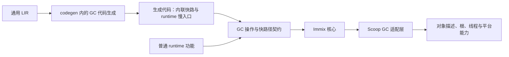

# M44 设计：GC 引用更新优化与实现边界隔离

状态：已完成。日期：2026-10-14。调研代码基线：`dcb8e529329e`；实施起点：`4f3ec3be`（M43 三目标验收完成）。实际工作见[实施记录](PROGRESS.md)，逐项验收见[验收核对](ACCEPTANCE.md)。

依据：[语言规范](../specs/SCOOP-SPEC.md)、[运行时规范](../specs/SCOOP-RUNTIME-SPEC.md)、[编译器与产物规范](../specs/SCOOP-IMPL-SPEC.md)与[路线图](../ROADMAP.md)。本文保留 M44 的目标、实现边界、实施顺序和验收出口；各批已按第 6 章先修订对应 spec，再实现并验证，完成证据见验收核对。

## 0. 目标与范围

M44 减少现有 GC 的无效引用更新，并把 Immix 策略、编译器 GC 代码生成和 Scoop runtime 适配收拢到明确边界，使后续堆管理优化能够局部演进。

| 优先级 | 必须交付 | 完成后的行为 |
| --- | --- | --- |
| P0 | 无搬迁时跳过引用更新 | 本轮没有对象改变地址时，不再为 relocation 重扫 roots、remembered set 和存活对象 |
| P0 | 精简实际发生的引用更新 | 同一引用的对象定位结果在本次访问内复用；地址改变时才写回；无托管引用对象省去出站引用扫描工作 |
| P1 | 编译器 GC 代码生成收拢 | TLAB 策略、card/page-map 操作、GC 状态位和 poll 快路径集中实现；通用 LIR 表达完整语义 |
| P1 | runtime 与 GC 的最小接口 | GC 核心通过 Scoop 适配层访问根、对象扫描与线程协调；普通 runtime 功能通过具体 GC 操作访问堆 |

测量与回归是上述四项的共同交付要求，不能只完成文件搬移就宣称性能改善或独立演进。

本期沿用 STW 下的分代 Immix、现有并行 mark、串行搬迁/更新、直接对象指针、16-byte 对象头及既有语言/FFI 语义。32 KiB block、1 MiB nursery、128-byte line 和 512-byte card 的默认值不随模块整理改变。M44 不引入第二种 collector、运行期 GC 插件、MMTk 迁移、并发 mark/moving、read barrier 或新的指针表示。

M44 依赖已经存在的精确根、分代收集、多 region、并行标记、FFI/pin/release 和产物契约；不以 M42 全部完成或 M43 的 `scoop test` 落地为前置。使用现有 runtime tests、正式 fixture runner 和 benchmark 工具。

## 1. 已核对的实现与性能依据

| 当前事实 | 本期处理 | 依据 |
| --- | --- | --- |
| 普通 full 可以不搬迁，但收集尾部无条件执行引用更新 | 在完成规划/复制后，按实际搬迁结果选择 update 路径 | [collector.c](../../runtime/src/gc/collector.c)、[evacuation_plan.c](../../runtime/src/gc/evacuation_plan.c) |
| 同一个引用分别经过对象起点、代际与 forwarding 查询 | 复用一次对象定位得到的 block、word index 和相关状态 | [heap_objects.c](../../runtime/src/gc/heap_objects.c)、[evacuation.c](../../runtime/src/gc/evacuation.c) |
| 首次标记的存活集合已经保存全部存活对象，含无引用对象 | 继续复用此集合；区别存活/搬迁处理与出站引用扫描 | [mark.c](../../runtime/src/gc/mark.c)、[mark_objects.c](../../runtime/src/gc/mark_objects.c) |
| 调研基线的 Immix 普通对象上限位于 LIR runtime ABI 文件；codegen 多处分散生成 GC 细节 | 移动策略实现与完整快路径生成职责至 GC 模块，复用现有 ABI 数据目录 | [runtime_abi.rs](../../compiler/lir/src/runtime_abi.rs)、[GC 代码生成](../../compiler/codegen/src/function/gc/)、[heap.rs](../../compiler/codegen/src/function/instruction/heap.rs) |
| GC 直接理解线程状态、stackmap、image registry；普通 runtime 直接调用 GC 私有锁/查询 | 提取当前实际使用的适配和操作接口 | [gc_internal.h](../../runtime/src/gc/gc_internal.h)、[collector_roots.c](../../runtime/src/gc_binding/collector_roots.c)、[boxing.c](../../runtime/src/boxing.c) |
| 分配快路已有每线程 TLAB，nursery 容量仍全局共享，refill 每次领取一个 block | 记录当前分配行为作为回归基线；容量与批量 refill 后续单独决定 | [allocation.c](../../runtime/src/gc/allocation.c)、[thread.h](../../runtime/src/thread.h) |

四级页表是 GC 自己的稀疏地址索引，不是操作系统页表。当前 64-bit 地址按位移 52/40/28/16 分成四级 12-bit 索引，末级覆盖 64 KiB chunk 并指向 region/large mapping；再由地址计算 block 和对象位置。M44 保持此结构，先消除同一次引用访问中的重复查找。region 仅按 chunk 对齐，不能直接用 16 MiB 掩码推导 region metadata。

[M34 性能报告](../milestone34/PERFORMANCE.md)和[Linux、4 worker 原始记录](../milestone34/measurements/m34-mark-on-4-linux-gnu.json)提供优先级依据：每个图有 7 次进程运行、每次 5 次主动 full，下表为 35 次收集的中位数，单位 ms。

| 图 | pause | mark | reference update | copy |
| --- | ---: | ---: | ---: | ---: |
| wide | 8.908 | 1.478 | 6.110 | 0 |
| array | 15.032 | 1.956 | 11.699 | 0 |

两组记录的 `copy_ns` 均全部为零。它们说明无复制的收集仍可能把大量时间花在 update 上，但不是 M44 的当前版本基线，也不能把两列中位数相减当作已经实现的收益。实施前按第 7 章重新测量；优化判断使用本轮实际搬迁数量，不能使用计时值为零作为条件。

## 2. 无搬迁时省去引用更新

### 2.1 分支条件与收集流程

现有 `moved_objects` 在每次 heap collection 开始时归零，只有完成目标对象登记并发布 forwarding 后才递增。M44 复用这个本轮事实，在搬迁规划、预留回退和实际复制全部结束后，决定是否执行 relocation。

| 结果 | 后续行为 |
| --- | --- |
| `moved_objects == 0` | 跳过用于 relocation 的 roots、remembered set 和存活对象扫描 |
| `moved_objects > 0` | 更新本轮所有可能持有旧地址的根与引用，然后才能退休旧副本 |
| minor 预留失败 | 按既有协议从完整原图转 full，以最后完成的收集及其搬迁结果选择分支 |

不能用 planning 函数返回成功、选择了 source、进入 full，或某个历史累计计数代替实际搬迁结果。普通 full 没有收益合适的 source、预留回滚、全部对象受 pin 约束等情况均按最终结果处理。失败预留不得发布部分 forwarding；已发布搬迁的收集不能退回无搬迁分支。

两条路径共享后续必要工作：存活统计、代际/晋升处理、死亡对象 release、block/line 回收、card 清理、nursery 重置、分配状态失效、临时 pin 解除、VM 归还与线程恢复。它们不能随 relocation 一起跳过。无搬迁只意味着引用地址无需修正，不意味着本轮无需回收。

mark 产生的存活集合保留至规划、必要的更新和验证结束；继续使用该集合，不为了判断是否需要更新再追踪一次可达图。

### 2.2 验证与 scanned 状态

当前 `verify_heap_object` 要求每个存活对象都被 relocation 设置过 scanned 状态。M44 需要解除“执行了 relocation 才能验证堆”的依赖。

- 存活性由 mark 结果和实际搬迁关系决定，不能由 scanned 位定义。
- 无搬迁路径在显式验证模式下仍检查精确 roots、当前存活对象与引用合法性，但不要求这条路径执行过 relocation，也不为满足该断言伪造 scanned 位。
- 有搬迁路径保留对需要扫描的当前副本的覆盖检查；无托管引用对象无需出站引用扫描。存活清单唯一性等重型交叉检查放在已有验证模式或专测中，不在正常路径完整重放标记。
- `SCOOP_GC_VERIFY_HEAP` 与 moving stress 的必要检查继续有效；有 eligible movement 的 stress 仍验证发生了应有的移动。

正常构建的零搬迁路径不执行整轮 reference update。诊断不为该路径累计未执行的更新工作；若保留分支选择本身的计时，明确它不代表扫描耗时。

## 3. 必须执行的引用更新

### 3.1 一次定位，复用结果

引用访问按以下次序处理：

1. null 直接结束。
2. 在当前稳定堆视图中定位对象，复用已有的 block/word index 表示。非堆地址按现有 immortal/external 对象规则分类，非法 managed reference 保留明确失败出口。
3. minor 遇到旧代目标时保持原引用；其余目标复用同一定位结果检查 mark、pin、source 状态和 forwarding。大对象使用其现有专用 metadata。
4. 得到最终地址；仅在它与原地址不同时写回槽位。

内部 helper 接受已解析的位置，避免调用链重新按相同地址查四级索引。该结果只在本轮稳定 metadata 的访问区间内使用，不形成持久 handle、全局地址缓存或第二份 page map。对象副本需要独立定位时按实际地址执行，不能以省查表为由混用 source 和 target metadata。

这种复用限于已经成立且数据未变化的事实。对象起点、合法稳定对象、有效 forwarding、source/target 生命周期等必要检查保留；无需在后续 helper 重新完整验证同一份位置。

forwarding helper 共用一个私有函数体，内联方式由平台层的编译期选择提供。实际对照后，x86-64 使用普通内联以消除逐引用调用，AArch64 保留原外部调用以保持已验证的 marking 布局；通用 GC 不直接判断架构。两种方式保留相同检查、算法与 ABI，依据见 [Darwin](PERFORMANCE.md#最终平台调用策略)和 [Linux](PERFORMANCE-LINUX.md#内联-forwarding-的-gnu-验证)记录。

### 3.2 区分存活对象与需要扫描的对象

无托管引用对象继续进入 mark 存活清单、统计、搬迁计划和回收处理。其扫描描述为空时，在 update 路径省去为扫描出站引用所做的定位/claim/descriptor 解释工作。

有搬迁时，遍历范围仍覆盖可能持有旧地址的全部来源：

- full：精确 roots、稳定 external payload 和本轮含引用的存活对象；
- minor：精确 roots、相关 remembered 区域与年轻存活对象的当前副本；
- 未移动对象可能引用已移动对象，同样属于相应扫描范围；pin 不会使其出站引用自动稳定。

更新原地修改真实槽位，不能把根复制进临时列表后只更新临时副本。interface 只更新 object 分量，itab 保持 metadata；含引用 struct/tuple、tagged/niche enum、`MaybeUninit` 和数组继续使用现有精确 scan。

M44 不改变 forwarding 表的存储方式，不引入对象头 forwarding、last-region 缓存或并行 update。纯引用数组的专用连续扫描快路在本轮优化后的 profile 中仍有明确热点时另行落地，不作为本期必交付项。

## 4. 编译器与 runtime 的 GC 边界

### 4.1 职责与依赖方向

这是当前唯一 Immix 实现的模块边界。接口只覆盖当前已有调用，使用普通静态函数、共享数据声明和已有 slot visitor；不建立 collector 工厂、动态 vtable、配置注册平台或仅供假实现使用的接口。

建议模块落点为 codegen 内的 `function/gc/`、runtime 的 `gc/` 核心与独立的 `gc_binding/` 适配目录。具体文件可按实际职责拆分，不要求单独新建 crate、动态库或独立仓库；改变目录名本身不构成完成条件。

### 4.2 编译器 GC 代码生成

通用 LIR 保留完整的托管分配、字段/数组写入、值复制、原子引用操作、`ManagedPoll` 和 `PublishReleaseReady` 语义，附带现有类型、布局、GC effect 与 live set。根活跃度、statepoint relocation、异常控制流和调用 ABI 继续由现有阶段负责，stage 仍只经 IR crate 通信。

| 当前散落的实现 | M44 的归属 |
| --- | --- |
| `REGULAR_MANAGED_OBJECT_MAX_SIZE`、TLAB 资格/边界判断、分配登记调用 | GC 分配代码生成 |
| 四级 page map、region prefix、card 地址计算和原子置脏 | GC 写入代码生成 |
| object header 中 ready 等 GC 位的偏移、掩码和原子操作 | GC 发布代码生成 |
| poll 的共享快路径布局、原子读取与慢分支连接 | GC 协作代码生成，复用现有线程握手 |

该模块负责完整托管写操作，包括真正执行 store/copy/atomic 的位置；通用指令发射器传入实际地址、值、类型/scan 和原子内存序等已有数据。不能只把写后 `card_mark` 搬进模块，而让所有写入仍散落在调用方。当前实现仍只发射现有写入及 card 屏障，不预加空的 SATB/pre-barrier 接口。

必须覆盖字段、数组、含引用 aggregate copy、构造、clone 和各原子引用写路径；runtime/native 实现的对应写入通过同一契约的运行时入口执行。AtomicRef 的失败 CAS 不标脏，成功 CAS/store/exchange 保留屏障和语言内存序；地址计算、写入与屏障之间仍无 safepoint。GC-free 写入沿正常值操作处理。

普通对象上限等算法选择从通用 LIR 实现中移出。实际 runtime 符号、size/alignment、target/backend 数据和兼容性摘要仍由现有 IR 数据结构与 ABI 目录表达，不能为了隔离而建立第二套 registry 或丢掉产物验证所需的共享合同。

generated code 的分配、单槽屏障和 poll 快路继续静态内联，慢路复用 C ABI 入口。当前 runtime C 编译使用 `-fno-lto`，不能把每个槽位操作包装成外部 C 调用后假设链接器会消掉成本。生成 LLVM 与机器码需证明没有因模块拆分增加热路调用、重复 TLS 查询或改变必要内存序。

### 4.3 Scoop runtime 适配层

| 适配内容 | 具体职责 |
| --- | --- |
| 对象信息与扫描 | 复用 TypeDescriptor、对象布局和现有扫描解释器，提供大小/对齐所需信息、是否含引用及实际槽位访问；不建立第二套类型元数据 |
| 精确根 | 把 stackmap、compiler/caller/native root frames、static/failure roots、Context、external payload 转成对真实可更新槽位的访问 |
| 世界停止与恢复 | 复用线程状态机、epoch 和 registry 生命周期，向 GC 提供本轮稳定的根/线程视图 |
| 线程分配状态 | attach/detach、TLAB 失效与分配统计通过实际生命周期操作接入 GC 的 mutator 状态 |
| pin、handle 与 release | 根帧/语言表示由 runtime 解释，固定与保活机制由 GC 维护；ready/hook 执行遵守原合同 |
| 平台操作 | 复用现有 arch/OS/image 与 ThreadVmOps 职责，不在 GC 新建平台探测或加载器 |

现有 `ScoopGcRootVisitor` 和递归 scan 是起点。扫描解释器归适配层；GC 可请求对象/数组范围扫描，适配层访问实际引用槽，保留并行 marker 已有的大数组分段能力，不要求 GC 理解 Scoop 的类型系统或扫描描述编码。必要的标量视图和访问器可以静态内联。

GC 核心不再直接解析 LLVM stackmap、image registry、异常记录或 `ScoopThreadState` 私有字段。GC 保有 region、block、代际、mark/forwarding、分配与回收策略；线程的 block 所有权等放入 GC 管理的 mutator 状态。generated code 必需的 TLAB `cursor/limit` 和 poll 布局保留为明确的快路径数据契约，普通线程业务不直接解引用 `ScoopGcBlockMeta`。

普通 runtime 中的 boxing、数组、初始化、异常和 Context 等功能改用完成实际操作所需的 GC/适配入口，堆锁及私有查询组合收进该边界。模块整理保持检查与锁语义；把锁藏进函数不等于拆箱去锁，拆箱正常路径的成本优化另列后续。

### 4.4 生命周期与同步

适配层复用现有冻结视图，不为每次 collection 复制整个线程/根/类型目录。根槽、对象 metadata、worker 所持指针均限定在原有有效区间：

- collector 等待线程停稳时不持 heap/roots 锁；保留现有 registry/world、heap、roots 的锁序。
- 全部目标停稳后才暴露可扫描线程字段；NativeSafe 返回、pending 激活和连续 epoch 的握手保持。
- mark worker 不注册为 mutator、不执行用户代码；coordinator 持独占状态时，worker 使用已有 STW reader/atomic marker 接口，不反向获取其锁。
- region/page-map metadata 只在 worker 结束、TLAB/局部位置失效且引用更新完成后退休，局部解析结果不跨该边界。
- 完成根回写和分配状态更新、释放 heap/roots 锁后，才允许发布 RUNNING；恢复线程继续按原协议 reload。
- pin frame 的临时固定、显式 pin 计数、handle、release-ready 及一次性 hook 规则不因适配层拆分改变。

接口整理不增加逐分配或逐引用的通用验证、计费、全局统计 RMW，也不引入第二套线程状态。

## 5. 编译产物与兼容性

M44 的独立演进按源码职责验收。已经生成的 `.o` 可能包含 TLAB、card/page-map、poll 和对象头位操作的机器代码；改变这些共享布局或协议，通常需要重新生成相应 Scoop 产物，不能只替换一个 GC 库就假定兼容。

本期优先保持现有公开及 generated-code ABI。单纯移动模块或改变 collector 内部 update 路径，不自动升级 wire/runtime ABI。若实施中确有共享布局、数据合同或原型变化，按实现规范 2.5～2.8 使用现有 target/backend/runtime 指纹与缓存规则迁移，同步 producer、consumer 和 runtime；不预设空的 GC profile 或另建版本协商体系。

现有 Scoop ABI native 的写后范围屏障继续有效。将来若采用需要旧值的写前屏障、并发 moving 或 read barrier，必须一起升级有关编译代码和 native 接口契约；本次模块边界不承诺这些算法可以无协议变更地替换。

## 6. Spec 先行与文档一致性

| 文档位置 | 对应实现前需要明确的内容 |
| --- | --- |
| 运行时规范 3.7、3.9 | 以实际搬迁为条件执行引用更新；有搬迁时的完整更新集合；无引用对象处理；验证与 relocation 覆盖状态的区别 |
| 运行时规范 2.1～2.2、3.1～3.6、3.8 | 共享对象/快路径契约与 GC 私有策略的归属，适配层的根、线程、pin/release、统计和生命周期职责；保留现有数值布局与同步语义 |
| 运行时规范 3.5、3.9 | 停稳、STW 主体、RUNNING 发布和恢复观测的计时定义；既有诊断字段的含义与新增观测的范围 |
| 实现规范 2.4～2.5 | 通用 LIR 的完整语义、GC 代码生成模块、托管写操作归属、静态快路及实际 ABI 数据合同 |
| 实现规范 2.6～2.8 | 仅在实际共享协议变化时同步产物/缓存兼容规则；纯内部重组不新增格式 |
| 语言规范 9.1.6、13.11、14.1～14.3 | 复核 release、借用、pin/handle、native roots 与写屏障的引用一致性；本期不新增语言行为或 GC API |

设计阶段只登记这些修订点；按批修订权威 spec 后再改实现。若发现现有 spec 把某项可省略的遍历写成无条件要求，在对应优化前先修订它。共享布局与必要验证不能仅因被称为“私有”而绕过已有 ABI 合同。

## 7. 测量设计

### 7.1 基线与对照

实施前记录实际 commit、target、LLVM/C 工具链、profile、worker 数、GC 配置和机器环境。在同一主机交替运行基线与待验版本，计时期间不同时编译、运行其他套件或清理构建目录。沿用已有 benchmark 工具和真实 Scoop 程序；新增用例只补实际缺少的移动与停顿场景。

| 场景 | 重点指标与用途 |
| --- | --- |
| wide/array/chain 的无搬迁 full | 搬迁数量、更新路径是否执行、阶段时间和总暂停；chain 保留为图并行性较低的对照 |
| 年轻引用图与 old→young、pin 的 minor | 更新槽范围、晋升、remembered 工作量与暂停 |
| 多 region 选择性 evacuation | 实际 source/target、移动对象/字节、含引用的未移动对象、update 时间与回收收益 |
| moving stress 与预留失败 | 正确性及故障分支；与普通策略性能样本分开报告 |
| 多线程分配与停稳 | 分配吞吐、GC 频率、refill 竞争的定位证据、停稳等待和恢复延迟 |
| 分配/字段与数组写入/poll 微基准 | GC 模块整理前后快路机器码和运行成本；兼顾无 GC 的正常路径 |

优先复用 [parallel](../../tests/benchmarks/parallel)、[parallel-allocation](../../tests/benchmarks/parallel-allocation)、[poll-response](../../tests/benchmarks/poll-response)、[regions](../../tests/benchmarks/regions)及现有 allocation/old-graph 用例。

同一比较保持输入、存活图、分配量、worker 配置和输出一致。每组采用多次进程级交替运行，至少保留与旧报告可比较的 7 次运行；记录每次收集及样本数，报告中位数、p95、最大值和运行间波动。小样本不作为稳定尾延迟的证明。补充吞吐、映射字节、当前/峰值 RSS 和必要代码大小；不把不同主机的绝对时间相互计算加速比。

### 7.2 停顿时间的完整口径

现有 `stop_wait_ns` 从请求进入 `scoop_thread_begin_collection` 前计到它返回，`pause_ns` 从返回后计到 `record_pause`；后者不包含此前的停稳等待，也不覆盖后续解锁及 RUNNING 发布。等待取得 collector 权限的时间也不能一概当成本轮所有线程已经停顿的时间。

在现有诊断/基准观测通道补齐同一轮收集的三个边界：

| 边界 | 定义 |
| --- | --- |
| T0 | 本轮 collector 发布 STOPPING |
| T1 | 确认全部目标停稳并发布 COLLECTING |
| T2 | 完成更新并释放 heap/roots 锁，发布 RUNNING |

分别报告 T1−T0 的停稳等待、T2−T1 的 world 停止阶段，以及 T2−T0 的请求到允许恢复区间。该区间不等于每个 mutator 的实际停顿时长。专用多线程基准另测线程从停止推进到恢复推进的延迟，包含 OS 调度影响，并与 collector 阶段分开解释。

保留既有 `pause_ns`、`stop_wait_ns` 字段语义，新增观测不能悄悄改写历史指标。优先在 collection 边界和基准记录时间，不给普通分配、每次 card 标记或无请求的 poll 增加计时。对累计 `ScoopGcMetrics` 做前后差分时明确字段范围，沿用当前 plan 扣除 copy、reclaim 扣除 VM 归还的计时规则。worker CPU 与墙钟时间分开报告，mark 工作与根生产可能重叠；各阶段之和也不能替代整体计时，后者还包含准备、验证与恢复等工作。

### 7.3 收益判定

- 无搬迁优化以实际零搬迁及 relocation 扫描被省去为确定性证据，并用同机阶段时间和整体暂停确认收益。
- 局部查询优化以相关代码路径/专测证明一次定位结果被复用，再比较有搬迁样本的 update 与整体耗时；测试专用工作量观测不变成 release 的逐引用原子计数。
- 模块整理以相关 LLVM/机器码、分配/写入/poll 微基准和 GC 组合用例证明行为及成本保持；不把优化提交的收益归到目录调整。
- 不预先承诺固定倍数。对超出运行波动的退化必须定位并修正或撤回对应性能改动，不能以单个有利样本替代完整对照。

实际测量后再创建本目录的 PERFORMANCE/ACCEPTANCE 等记录，保留命令、原始数据和适用范围，不预写成功结论。

## 8. 实施批次

| 批次 | 工作 | 完成条件 |
| --- | --- | --- |
| M44-1 | 当前基线、必要的计时观测与 spec 修订 | 三个时间边界和现有字段口径明确，代表场景可复现；后续变更有同条件对照 |
| M44-2 | 零搬迁 update 分支、验证职责调整 | 普通 full/minor、pin、回滚/转 full 正确；零搬迁正常路径没有全量 relocation |
| M44-3 | 引用定位复用、条件写回、无引用对象扫描省略 | 有搬迁的完整引用集合仍更新，必要检查保留；移动场景的工作量与耗时完成对照 |
| M44-4 | codegen GC 模块与共享快路径契约收拢 | 通用指令发射器委托完整 GC 操作；所有现有写入类别接入，机器快路未增加成本 |
| M44-5 | runtime GC 操作、Scoop 适配层与 mutator 私有状态 | GC 核心和普通 runtime 不再越界读取彼此私有实现；root/线程/FFI 生命周期验证通过 |
| M44-6 | 组合回归、三 target 与产物消费、性能报告 | 四项交付全部闭合；实际共享契约变化完成兼容迁移；同条件性能证据和限制完整 |

M44-2、M44-3 不等待整个模块隔离完成才交付收益。性能改动与机械迁移分开提交和测量；M44-4/5 可以按实际依赖小步交错，但最终须完成双方边界，不能只新增包装函数并留下旧私有访问入口。

## 9. 验收矩阵与完成条件

| 范围 | 必须覆盖 |
| --- | --- |
| 零搬迁 | 无 source 的 full、有死亡对象的非移动回收、没有可移动对象的 minor、pin 阻止移动、source 预留回滚；连续两轮避免复用历史搬迁计数 |
| 分配/回退 | minor 晋升失败转 full、既有目标 block 空洞复用及回滚、TLAB 失效/refill、nursery 清理与计数；不把竞争误报 OOM |
| 引用更新 | roots→移动对象、移动对象→移动对象、未移动对象→移动对象、old→young、共享引用与环、大对象及跨 region；新旧地址不同时实际写回 |
| 精确表示 | interface 的 object/itab、含引用 struct/tuple、nested enum/Option/MaybeUninit、引用数组与 GC-free 数组、GC-free 对象仍存活或正确回收 |
| 根与 FFI | stackmap、compiler/caller/native slot/region roots、静态/初始化失败根、Context、external exception payload、native 返回结果和 callback |
| pin/release | 显式重复 pin、作用域 pin frame、handle 保活/移动、ready/unready、回滚后 release 不重复、移动旧副本不重复释放 |
| 多线程 | attach/detach、NativeSafe 返回、NativeBorrowed safepoint、pending 激活、连续 epoch、单/多 marker、worker 失败退回及 shutdown |
| 写入与发布 | 字段/数组/aggregate copy、构造/clone、runtime/native 写入、AtomicRef 初始化/store/exchange/成功与失败 CAS、发布内存序 |
| 校验模式 | 正常构建、SCOOP_GC_VERIFY_HEAP、moving stress 都适用；保留非法地址/无效 forwarding 等既有必要失败检查 |
| 代码生成 | 分配、单槽/范围屏障、poll、ready 操作的代表 LLVM/机器码；无新增热路调用、重复 TLS 查询或错误的 safepoint/内存序变化 |
| 产物与目标 | 真实 provider/consumer 分离编译、保持源码和工具存在的 `.slib` 消费及独立链接；Darwin/AArch64、Linux/amd64 GNU/musl 的适用组合 |

复用并定向扩展现有 [moving collector](../../runtime/tests/moving_collector_test.c)、[evacuation fallback](../../runtime/tests/evacuation_fallback_test.c)、[nursery](../../runtime/tests/nursery_test.c)、[parallel mark](../../runtime/tests/parallel_mark_test.c)等测试。新增独立 fixture 锁定本期改动，再用少量真实程序覆盖组合；普通功能验证运行和诊断，只有 GC/ABI/codegen 专测保留必要精确结构断言，不复制全套 IR 快照。

| 实际修改阶段 | 验证要求 |
| --- | --- |
| 仅设计 Markdown | 差异、链接、章节引用和跨文档语义检查；不运行编译器构建或 runtime 测试 |
| 每批 Rust/C 实现 | 先按仓库规则格式化/lint，再运行受影响模块测试、独立回归和相关正式 fixture；不重复运行未变化的完整套件 |
| GC/codegen 共享路径集成完成 | 完成工作区测试、fixture runner 公共规则与正式 CLI 全量覆盖；三 target 执行适用的 GC/ABI/产物组合及回归，记录实际选择和结果 |
| benchmark/runner 的 Python 实现变更 | 先按 AGENTS.md 的固定版本 ruff 处理实际变更，再运行对应工具测试和正式选择集 |

M44 的最终完成标准同时包含：零搬迁路径省去更新、移动路径正确且减少重复工作、双侧模块边界实际收拢、必要同步/ABI 合同保持、性能测量和适用回归闭合。未运行的目标或未完成的项如实记录，不能由其他平台通过推定。

“独立演进”的具体审阅标准是：调整 block 阈值、page-map/card 实现或 forwarding 细节时，修改集中在 GC 核心、对应 GC 代码生成与共享契约/适配中，不需要改变通用 LIR 语义、boxing 业务逻辑或线程业务状态机。M44 不通过增加假 collector 来证明这一点。

## 10. 后续事项

| 方向 | 后续工作所需依据 |
| --- | --- |
| nursery 容量、批量 refill | 当前已有每线程分配快路；根据活跃线程、minor 频率、refill 锁竞争和尾部浪费决定策略。共享 nursery 不等于可独立进行每线程 GC |
| 增大 block | 对照 32/64/128 KiB，联动普通/大对象阈值、pin 粒度、尾部浪费与 cache/RSS；block 增大本身不减少四级查表或线性 side metadata 比例 |
| 连续引用数组扫描、局部 region 缓存 | 基于 M44 后剩余热点选择；先明确扫描形状与缓存失效范围 |
| 并行更新/搬迁 | 先处理任务分配、扫描位图/槽位访问所有权和终止条件，再判断剩余串行时间是否值得并行化 |
| 对象头 forwarding 或重做地址索引 | 明确与 pin/ready/对象头其他状态的共存、mapping 对齐和产物契约；不能只替换一次查表 |
| 并发 mark | 单独设计写屏障、根快照/remark、对象发布、并发槽访问与 minor 搬迁协调，并覆盖 C runtime/native 写入及全程锁的拆分 |
| 拆箱正常路径去锁/去重复验证 | 在明确合法对象、类型匹配、NoGC 区间与必要检查边界后单独优化；GC API 收拢本身不算收益 |

这些事项不增加本期隐藏验收条件，也不要求为未来算法预建未使用的字段、入口或多套平行实现。
