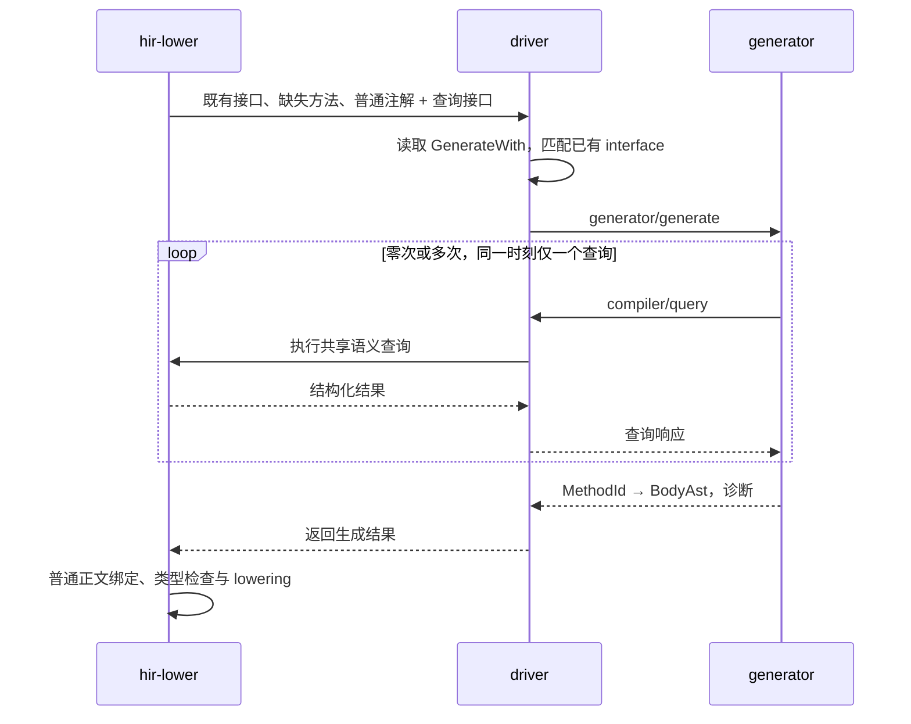

# M47：同步 generator 协议与语义查询

状态：设计完成，待实施。日期：2026-10-15。本文配套[主设计](DESIGN.md)，定义独立 generator 与 `scoopc` 之间的 v1 合同。首个调用方为承接 M46 的 codec generator；这里的消息和查询本身不含序列化策略。driver 的扩展职责只有选择指定 interface 的缺失实现、提供只读语义查询和接收方法体 AST。

## 1. 一条线性会话

每个子进程处理一批任务。driver 启动程序，建立 stdin／stdout 管道；stderr 继承 driver 的日志目标，不作为第三条待处理的协议流。generator 先读任务，再发起零次或多次查询，最后提交一次生成结果并退出。



driver 的调度等价于下列伪代码：

```rust
send_generate(tasks)?;
let result = loop {
    match receive()? {
        Incoming::Query(request) => {
            let response = queries.execute(request.context, request.query);
            send_query_response(request.id, response)?;
        }
        Incoming::Generated(result) => break result,
        Incoming::Failed(error) => return Err(error),
    }
};
finish_child()?;
return Ok(result);
```

`execute` 返回后才写查询响应；发送完整消息并 flush 后才等待对端。generator 的 `query()` 则封装“发送一个请求、等待对应响应”。它不能在等待期间再发第二个查询；driver 不向 generator 发起其他嵌套任务。

外层 generate 尚未返回，不妨碍 driver 在这个循环中回答查询。实现不需要 `async`、select/poll、多个 pending query、工作线程或全双工并发调度。子进程异常退出、中断和清理由已有进程管理能力处理，不增加协议级调度器或通用执行预算。

## 2. 编码和消息种类

### 2.1 帧与版本

v1 使用 JSON-RPC 2.0，stdio 采用 LSP 相同的 Content-Length 分帧：

```text
Content-Length: <UTF-8 payload byte length>\r\n
\r\n
<one JSON-RPC object>
```

Content-Length 计算 UTF-8 字节数，不能使用字符数或一次 read 的返回长度。收发处理短读、短写和多个连续帧；完整读到声明的 payload 后再解码。沿用标准头字段处理，允许可选 Content-Type；长度错误、数值溢出、截断和无效 JSON 都是协议错误。分帧边界不附加查询耗时、树遍历或节点分配计费。

`generator/generate` 参数显式携带 `protocolVersion = 1`。版本不相容时返回协议错误并退出，不猜测旧字段。协议 crate 发布自己的显式消息与 AST／HIR 投影 schema；Rust enum 内存布局、Debug 输出、arena dump 和 `.slib` bytes 都不是这个协议。

请求编号使用 String，只承担响应配对；两个方向分别维护自己的编号。它与 MethodId 等编译实体引用完全独立。JSON-RPC 是消息外壳，不要求引入 LSP 的 initialize／document notification 等生命周期。

### 2.2 两个请求入口

| 请求 | 方向 | 参数 | 正常结果 |
| --- | --- | --- | --- |
| `generator/generate` | driver → generator | 版本、generator 名称、编译上下文、任务列表 | 一组生成正文与结构化诊断 |
| `compiler/query` | generator → driver | 本次方法上下文、一个语义查询 | 对应的结构化查询结果 |

首版不提供流式 AST 补丁、逐方法提交、异步 notification 或 generator 链式调用。常用数据通过一个查询返回一组类型／成员，减少往返；这是一条请求中的批量数据，不是并行发起多个请求。

JSON-RPC 的 method-not-found、invalid-request、invalid-params 等错误沿标准外壳返回。正常的“没有某个成员”“方法正文尚未生成”是查询结果中的明确分支，不以进程失败或空 HIR 代替。

### 2.3 任务数据

以下是逻辑结构，字段引用种类见第 3 节：

```text
Generate {
    protocolVersion,
    generator,
    currentCone,
    coreCone,
    tasks: [ImplementationTask]
}

ImplementationTask {
    owner: AppliedNominalRef,
    bindings: [{ interface: AppliedInterfaceRef, origin: SourceLocation }],
    methods: [PendingMethod]
}

PendingMethod {
    method: MethodId,
    requirements: [AppliedRequirementRef],
    signature: CompleteMethodSignature,
    origin: SourceLocation
}

Generated {
    bodies: [{ method: MethodId, body: BodyAst, origins: NodeOrigins }],
    diagnostics: [Diagnostic]
}
```

生成绑定的逻辑键是 `(实现类型, 完整 interface application)`，值是 generator 名称。GenerateWith 本身是参数为 `String` 与 `Array<String>` 的普通 annotation class；driver 在普通注解绑定完成后解释配置，按 interface 数组顺序将各个字符串匹配到 owner 已有的接口应用，才形成这里的 typed 任务引用。这个结果不反写为新的 annotation 值，也不新增继承。同一注解的全部接口一起交给同一轮 generate，不按元素拆成多轮；同一批次只包含同一个 generator 名称的任务。同一个 owner 可以在不同 generator 的批次中出现，每批只能填充该批绑定所覆盖的缺失方法。

owner 是实际实现类型，如 `User.Companion` 或带开放 binder 的 `BoxCodec<E>`。bindings 保存它显式选择的完整 interface application，origin 定位到对应注解数组元素，按注解应用及元素顺序保留。bindings 不能为空；空 interface 数组不建立任务。为同一 owner、同一 generator 合并任务时保留全部 bindings，再将其覆盖的缺失方法取并集、按 MethodId 去重。requirements 保留方法实际满足的 interface 声明、完整应用和 method slot，不能为空；它们与用户选择的 interface application 区分，因为选定接口也可能包含继承的 requirement。现有 bindings 列表已经能表达一次生成多个接口，无需再增加逐接口请求或另一种任务消息。

同一 MethodId 不会分配给两个 generator。绑定重叠先由编译器按主设计中的规则合并或诊断，再启动进程。字段／结果的目标数据类型从完整方法签名及 requirement 取得，不增加只适用于 Encodable 的 task 字段。

`CompleteMethodSignature` 保存实际 receiver、各参数的独立引用与名称、完整参数／结果类型、泛型 binder／bound、上下文参数和已有 effect 信息。generator 不返回这份签名，只引用它所对应的方法。

`currentCone` 和 `coreCone` 用于定位既有语义命名空间；两者在编译 core 时可以相同。源码展示位置采用已有 SourceIdentity 与范围，宿主绝对路径由 driver 的 source locator 负责，不借路径重新构造实体身份。

wire 上的 bodies 用有序数组表示 typed 映射，不能将 MethodId 转成无类型的 JSON object key。空数组是合法返回；缺失的必要实现由普通完整性检查报告。重复 MethodId、非本批方法或已有实现的覆盖均拒绝。

## 3. 跨进程的实体与类型引用

查询和 AST 使用 `scoop-identity` 已有的 typed source／declaration／application／binder 身份及其组合。MethodId 在本文表示待填充的实际方法声明引用，不是方法名称、requirement 名称或当前函数 arena 下标。requirement 与其实现方法始终是两种引用，不能互换。

| 对象 | 表达方式 |
| --- | --- |
| 名义声明、字段、property、variant、annotation、参数 | 各自的 typed declaration identity |
| 开放名义类型 | 声明身份与有序 TypeRef 实参；类型参数引用其真实 binder／parameter 身份 |
| tuple、函数、指针等结构类型 | 完整结构 TypeRef；类型相等由编译器已有规则回答 |
| callable | 区分源码声明／泛型模板／已应用 callable，保留 owner 和实际类型实参 |
| interface requirement | 声明 method slot 与完整 interface application |
| default | 已绑定的参数默认模板引用及其实际 owner／binder 关系 |
| 已有 HIR 正文中的局部实体 | 正文 owner 与类型明确的局部引用组合；不当作全局类型或声明 ID |

复用已有静态描述中的 `SourceNominalId`、`StaticFieldIdentity`、callable origin 等语义，不能设计一个任意转换成所有种类的 `EntityId`。全局信息始终保留全局唯一的 typed identity；不通过 FQN 或对端发送的整数去索引宿主 arena。

名义引用允许延迟读取其详情，递归类型只传递引用，不展开无限嵌套的字段树。开放类型保持 binder，不为传输而伪造 concrete／monomorphized identity。请求期间形成的已知类型应用可由 compiler 普通缓存复用，客户端不复制类型实参替换或子类型算法。

二进制 identity 在 JSON 中使用 schema 指定的固定长度十六进制字符串和明确的字段／variant 种类。可能超出通用 JSON 精确整数范围的常量使用十进制字符串；Float／Double 常量保留规定宽度的位模式，避免客户端 JSON 数值转换改变精度。AST 字面量可保留现有无损字面量表示。

名称可用于展示、生成 wire 名和在正常命名空间中首次查询声明。`lookupExport(provider, path, kind)` 返回后，调用、annotation 比较和类型关联都使用实际 typed 引用；查找失败不能转而以同名声明代替。

## 4. 共享语义查询

### 4.1 上下文与固定视图

`compiler/query` 指明当前生成的 MethodId。driver 将它映射到现有 owner、词法范围、binder 和 effect 上下文，再调用共享查询模块；generator 不自行提供另一套可见性或类型参数解释。

共享 Rust API 接收普通语义上下文，外层 generator 适配器才通过 MethodId 取得它。未来 LSP 可从源码位置取得自己的语义上下文，复用相同的查询和结果类型；这里不把“必须属于生成任务”写成所有语义查询的通用约束。

同一 Cone 的各 generator 读取相同的声明／已有正文视图。查询是读取或计算已有语义事实，不重新解析源码、不修改重载集合、不触发方法生成。对相同上下文和相同输入，查询结果不因已经查询过其他类型而改变。

生成前普通源码正文已有完整类型；待生成方法可以查签名，查正文得到 `PendingGeneration`。这些状态属于查询结果，不能进入成功 HIR 的表达式类型或方法实现字段。

### 4.2 v1 查询表面

查询是一个有明确 variant 的数据类型，由 `compiler/query` 统一承载。只读描述支持成组读取，保留声明顺序；查询没有 serializer 特殊模式。

| 查询 | 返回的数据 | 本期用途 |
| --- | --- | --- |
| `resolveType` | 普通 TypeRef AST 在指定词法上下文中的已绑定类型或正常解析诊断；沿现有名称、实参和 bound 规则 | driver 选择已有接口时复用；查询本身不读取 GenerateWith 或添加 conformance |
| `describeTypes` | 完整类型表达式、种类、binder／bound、实际名义声明、直接父类型、companion 关联 | 结构分类、递归引用、取得普通 companion |
| `describeMembers` | 字段、logical property、variant、构造器和方法；独立身份、顺序、storage 类别、可变性、访问域、来源 | 选择参与字段、检查 class 形状、取得构造参数关系和依赖成员 |
| `describeAnnotations` | 实际 annotation 声明、target／use-site、正规化后的普通参数值及来源，数组保留每个元素及其来源 | driver 读取 GenerateWith 的 `String` 与 `Array<String>`，generator 解释 Serialize；不重复执行 annotation default |
| `describeDefaults` | 参数与模板身份、定义处 binder、前参关系、已有绑定正文或其引用，以及指定 callable application 下的类型／引用视图 | generator 组合缺失值分支；查看 default 是否直接引用实际 None variant |
| `describeBodies` | 已完成的 typed HIR 逻辑正文及引用，或明确的不可用原因 | 按实际绑定表达式读取信息；保留 generator 访问 HIR 正文的能力 |
| `typeRelation` | 指定上下文中的类型相等／子类型关系，使用完整类型实参和 bound | 判断普通依赖成员／companion 是否满足所需 interface |
| `lookupExport` | 已有 provider 命名空间内的 typed 声明或未找到结果 | 按正常库 API 定位 core 的 Serialize、Option、普通 codec helper 等声明 |
| `sourceLocation` | SourceIdentity、源码范围及必要的关联定义位置 | 在字段／注解／继承处报告诊断 |

`resolveType` 是普通前端语义查询，Rust API 接受 owner 等已有语义上下文。driver 对 interface 数组的每个字符串调用 parser 的通用类型片段入口，得到普通 TypeRef AST 后请求绑定；generator 的线上查询则继续由 MethodId 取得上下文。parser 不识别注解名称或参数含义，hir-lower 不依赖 parser 实现，也不解释 GenerateWith 配置。

成员描述必须同时保留以下两组类型，不能只返回 substitution 后的结果：

```text
declarationType: 原成员在定义处绑定、透明 alias 展开后的类型
appliedType:     当前 owner application 替换后的完整类型
```

例如 `Box<T>.value: T` 应返回原 binder T 与当前实际类型；`Box<T>.value: T?` 则在原类型中已包含真实 Option 声明。generator 由第一组事实决定 M46 的缺省／省略资格，由第二组事实选择完整字段 codec。编译器不提供 `isSerializable`、`shouldOmitNone` 或 `isOptionForSerialization`。

logical property 与 backing field 保留各自的实际 target，不能丢失 use-site 或复制为两个参与字段。构造参数映射、storage／computed／delegated 区分、enum 的命名／位置 payload 和基类关系都沿静态描述返回，generator 决定哪些形状属于本次策略。

访问元数据不授予源码访问能力。返回的 private 信息可供诊断和结构判断，生成正文若真正访问它，仍执行当前方法上下文的普通字段／property／constructor 访问检查。

### 4.3 默认值与正文

`describeDefaults` 返回已绑定语义，不返回要求 generator 重新解析的源码片段。default 的真实引用、前参关系和定义处 owner 与跨 Cone 模板保持一致，generator 能从已绑定表达式中辨认直接 variant 值。模板引用只用于继续读取正文，不能作为可执行的 BodyAst 节点返回。

按指定 callable application 读取 default 时，类型和外部 callable／member 引用沿编译器已有替换规则提供应用后的视图，同时保留定义处 binder 关系。查询不求值 default、不按实际字段缺失情况选择分支，也不把 default 复制到待生成方法中；generator 负责后续 AST 组合。

`describeBodies` 是 HIR 的只读逻辑投影，包含节点类别、每个表达式的完整类型、局部绑定、控制流和实际 callable／member 引用。它不暴露 Rust 地址、缓存内部状态、LLVM 数据或物理布局。正文按显式的查询 schema 编码，不能通过把 `Debug` 文本塞进 JSON 宣称支持 HIR。

正文可用性是封闭分支：

- `Available`：当前已有的完整 typed body／default 模板。
- `PendingGeneration`：本批尚待填充的实现。
- `NotPublished`：依赖产物没有提供该正文，仍可读取已有签名。
- `NoBody`：该声明本来没有可读取的普通正文，例如抽象 requirement。

合法查询不得触发寻找上游源码或执行第二轮生成来填补这些情况。core 与依赖的必要 default 模板应沿现有产物合同可用；若 codec 试点所需事实在现有静态描述中确实缺失，实施时补齐通用描述及其必要产物数据，不恢复专用 codec 计划。

### 4.4 复用原有语义

子类型等查询目前依赖 Lowerer 的完整类型应用和父关系，适配器调用原有算法。整理模块时可提取公共的输入视图与算法，但不能让 generator 自行遍历父类猜测 conformance，也不能在 HIR/meta crate 复制一套语义验证器。

同一事实在当前编译或依赖读取边界已经检查过，查询直接使用结果。只有新的生成 AST 才接受正常正文检查；不为了回答每次查询重复验证整份 HIR、默认模板或布局。

## 5. 返回 BodyAst，而非源码文本或 HIR 补丁

### 5.1 普通 AST 与已绑定引用

BodyAst 复用 `scoop-ast` 的 block、表达式、控制流、局部绑定、lambda、普通调用及构造等结构。输出单位是函数正文，外层没有 type／interface／method 声明，所以没有通过签名重新声明参数或向包追加成员的入口。

AST 不承担完整类型推导结果，hir-lower 照常为新表达式定型。读取 HIR 不意味着可以把一个客户端声称已经 typed 的 HIR 节点直接装进编译输出。

AST 名称引用使用普通词法名称或明确的已绑定引用。后者结构化保存查询得到的实体选择，避免别名、重载和泛型 binder 在代码组合后被重新按名称解释；它与普通节点共用 lowering，不是访问检查豁免：

| 引用形式 | 含义 |
| --- | --- |
| 类型引用 | 查询得到的 TypeRef，用于类型参数、限定接收者或局部显式类型 |
| 参数／receiver 引用 | 指向任务签名中的实际参数或 this，不依赖参数的显示名字 |
| 成员／callable／variant 引用 | 保留实际声明与应用；读写、调用、构造和模式仍按普通规则检查 |

引用种类由 AST 数据契约表达，不能编码成特殊字符串变量、注释、Span 偏移或猜测的 FQN。AST／identity crate 保存这些纯数据；不能为了一个叶节点让 AST 依赖 hir-lower 或 driver。

正文中新建局部变量、局部函数、局部类型与 lambda 使用独立的词法绑定；generator SDK 分配正文内唯一的局部标记，接收端按方法 owner 重映射为正常 AST／HIR 局部身份。它们与既有全局声明引用分开，避免同名参数、字段、core helper 或用户 import 捕获生成代码。局部声明只具有普通方法体允许的范围，生成主体之外的包级／owner 成员注入仍不可表达。

### 5.2 默认值由 generator 组合为普通 AST

M46 的 decoder 需要先读取所有已提供字段、完成 container 检查，再为缺失字段按声明序求 default。generator 查询已有默认值正文，在自身进程中将其表达式、语句和局部声明转换、组合为普通 AST；不要求 driver 为它执行 default 展开，也不返回要求编译器解释的序列化构造计划。

组合时保留外部声明和调用的已绑定选择，类型采用查询返回的应用视图；前参引用连接到先前求得的局部值，default 内的局部绑定按每个复制位置重新分配。HIR 到 AST 的结构转换在 generator 端完成，不把 HIR 节点直接写回，也不复制编译器的类型推导／重载选择算法。BodyAst 没有 `DefaultRef`、`expandDefault` 或改变词法访问域的节点。

概念上生成的顺序为：

```text
provided[i] = readPresentField(i)
container.end()
value[0] = if provided[0] is present then provided[0].value else <default 0 的普通 AST>
value[1] = if provided[1] is present then provided[1].value else <引用 value[0] 的 default 1 AST>
...
return constructor(value[0], value[1], ...)
```

这只是 generator 内部 AST 构造的示意，不是协议操作。每个可能缺失的字段对应自己的补值分支；不枚举所有字段存在性的组合。default 内的副作用只在该字段缺失时执行一次，最终只有一次普通构造。缺失但可直接补 None 的分支使用实际 None variant 引用。

原 callable／constructor 和 default 中外部引用的普通访问规则仍适用。语言规范 8.5 已要求默认值引用的外部实体覆盖 callable 的全部合法调用位置；这不是 M47 新授予的访问权。默认值携带的局部声明仍按复制后的普通局部作用域处理，不能借源位置或绑定 ID 放宽外部引用的可见性。

生成 AST 若使用普通的省略实参调用，仍沿编译器已有默认参数规则处理。对 M46 的动态字段缺失，则使用上述显式分支；driver 和公共查询不识别两者背后的 codec 策略。验收必须包含带前参、副作用、局部函数与跨 Cone 绑定的 default，证明普通 AST 组合保留原有行为。

### 5.3 接收端检查与生效

1. 协议边界解码消息、节点和 typed 引用，报告畸形数据。
2. 核对目标 MethodId、唯一性和 task 映射；正文不能替换手写、继承或 default 已选定的实现。
3. 在原方法上下文中解析普通局部作用域、校验绑定引用、执行访问／类型／effect 检查。callable 应用和参数关系使用已有调用路径，不能把指定了 ID 视为可以跳过检查。
4. 全部必要正文完成后，沿现有完整性检查形成成功 HIR；失败不发布含部分填充方法的产物。

已经绑定的引用不在消费时重新按名字挑选另一 overload；它仍必须满足实际签名、访问域、泛型约束与调用形式。整个生成结果不会重新进行已完成源码的名称解析或重载决议。

## 6. 诊断和源码关联

生成诊断采用现有 severity、message、主位置和 notes 的结构化模型。字段错误优先定位到字段／Serialize 应用，缺失 codec 定位到实际字段并关联生成请求，任务级失败定位到 GenerateWith 应用，必要时关联实际继承位置；配置错误定位到 generator 参数或 interface 的实际数组元素。重复接口或跨 generator 方法冲突关联前后两个配置元素。

BodyAst 的节点来源关联到任务或查询返回的 SourceIdentity／范围。接收端保存这些关联，使普通类型检查产生的错误能够说明出错表达式和对应来源；无具体字段来源的节点使用生成请求位置。必要时附带已有声明的 definition note，不把临时进程路径显示为用户源码。来源只影响诊断，不选择名字解析上下文、改变访问域或跳过检查。

generator 的日志写 stderr，正式错误通过结果的 diagnostics 或协议错误返回。结果携带 error 诊断时本组失败，即使进程退出码为零；warning 不把正常正文丢弃。写完成功结果但随后非零退出，也按子进程失败处理。没有完整结果就 EOF、非法帧或程序崩溃时，driver 报生成失败，不以空结果继续。

generator 提交最终响应后关闭协议输出并退出；driver 顺序检查输出已结束和进程退出状态，最终响应后的额外字节属于协议错误。失败时沿既有进程管理路径关闭管道、终止并回收子进程。这仍是一条同步流程，不需要并发等待读写。

请求来源映射是普通诊断数据，不是来源凭证。driver 不执行 generator 要求的文件写入、消息发送或其他任意宿主 RPC。

## 7. 与 LSP 的复用范围

LSP 与 generator 可共用语义查询的数据模型、只读查询实现，以及 JSON-RPC 编解码／stdio 分帧组件。LSP 将源码位置映射成语义上下文，再把结果转换为 hover、补全、定义位置等；generator 直接从任务中的 typed 引用出发。

文档版本、编辑中不完整源码、索引更新和取消属于未来 LSP 适配层。M47 查询使用当前编译的固定视图，不为了共用消息格式引入这些调度。在本功能的声明约束下，通常的签名和成员查询也不需要先执行 generator 才能回答。

## 8. 协议验收与兼容性

协议测试使用真实管道和独立可执行程序，至少覆盖一次任务、多次串行查询、正常 AST 返回、空／部分返回、查询的未找到／正文不可用结果、错误版本、未知方法、引用种类错误、重复方法、无效 AST、短读／短写、截断、stderr 输出及退出失败。测试关注消息边界和必要引用，不保存整份查询 transcript 作为普通功能 golden。

codec 端到端测试必须经正式注册和 driver 启动，使用普通 core／依赖 HIR 查询。验证一条含多个接口的 GenerateWith 只产生一次 generate，各接口的缺失方法共同返回，共享 requirement 对应的方法只生成一次；空数组不启动进程。增加普通用户 interface 的实现用例，验证这一协议没有 Encodable／Decodable 的硬编码分支；无需为测试专门建立第二套编译器或语义工厂。

协议 v1 与 Scoop AST／HIR 查询 schema 一起版本化。后续不兼容的数据或行为变化递增版本，不能依据可执行程序文件名或编译器版本文本猜测 schema。现有 single-Cone machine protocol 仍采用自己的编码和版本，只传递工具配置；`.slib` 消费保持普通方法和普通 metadata 合同。
