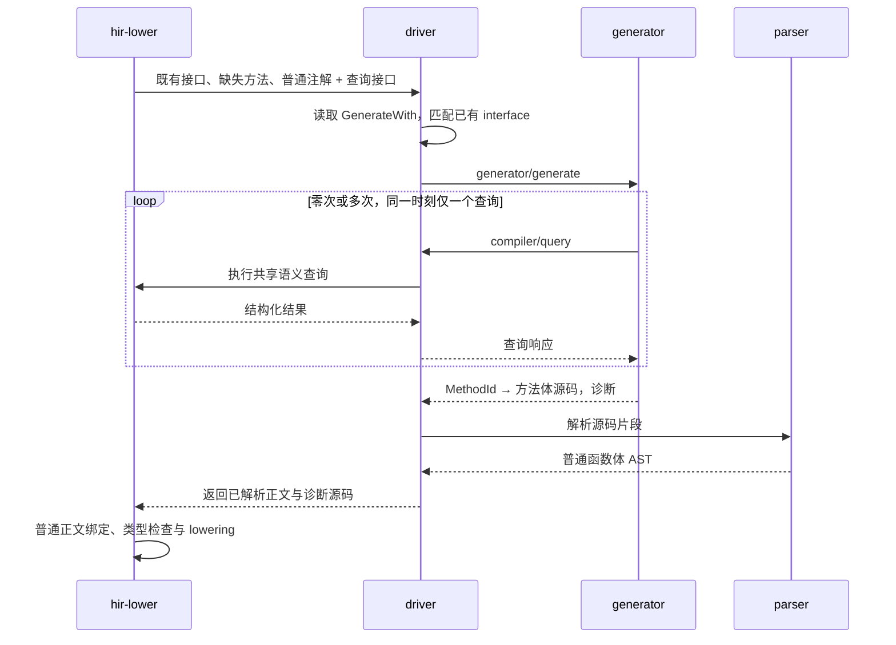

# M47：同步 generator 协议与语义查询

状态：通用查询与同步协议已实现，codec 迁移待实施。初稿：2026-10-15；公共基础修订：2026-10-21。本文配套[主设计](DESIGN.md)及[可恢复语法／LSP 公共基础](../language-service/DESIGN.md)，只定义通用 HIR 查询与独立 generator 的同步交互。计划中的首个生产调用方为承接 M46 的 codec generator；消息和查询本身不含序列化策略。generator 返回可读的方法体源码文本，driver 使用同一 parser 的严格片段适配和正常 HIR lowering 填充指定 interface 的缺失实现，不扩展 AST 的绑定能力或编译器语义。真实 generator 的协议与产物闭环验证见[公共基础验收](../language-service/PROGRESS.md)。

## 1. 一条线性会话

每个子进程处理一批任务。driver 启动程序，建立 stdin／stdout 管道；stderr 继承 driver 的日志目标，不作为第三条待处理的协议流。generator 先读任务，再发起零次或多次查询，最后提交一次生成结果并退出。



driver 的调度等价于下列伪代码：

```rust
send_generate(tasks)?;
let result = loop {
    match receive()? {
        Incoming::Query(request) => {
            let response = queries.execute(request.context, request.query);
            send_query_response(request.id, response)?;
        }
        Incoming::Generated(result) => break result,
        Incoming::Failed(error) => return Err(error),
    }
};
finish_child()?;
return parse_body_fragments(result);
```

`execute` 返回后才写查询响应；发送完整消息并 flush 后才等待对端。generator 的 `query()` 则封装“发送一个请求、等待对应响应”。它不能在等待期间再发第二个查询；driver 不向 generator 发起其他嵌套任务。

外层 generate 尚未返回，不妨碍 driver 在这个循环中回答查询。实现不需要 `async`、select/poll、多个 pending query、工作线程或全双工并发调度。子进程异常退出、中断和清理由已有进程管理能力处理，不增加协议级调度器或通用执行预算。

## 2. 编码和消息种类

### 2.1 帧与版本

v1 使用 JSON-RPC 2.0，stdio 采用 LSP 相同的 Content-Length 分帧：

```text
Content-Length: <UTF-8 payload byte length>\r\n
\r\n
<one JSON-RPC object>
```

Content-Length 计算 UTF-8 字节数，不能使用字符数或一次 read 的返回长度。收发处理短读、短写和多个连续帧；完整读到声明的 payload 后再解码。沿用标准头字段处理，允许可选 Content-Type；长度错误、数值溢出、截断和无效 JSON 都是协议错误。分帧边界不附加查询耗时、树遍历或节点分配计费。

`generator/generate` 参数显式携带 `protocolVersion = 1`。版本不相容时返回协议错误并退出，不猜测旧字段。协议只定义消息与 HIR 查询投影 schema，生成结果是 String，不定义输出 AST schema。Rust enum 内存布局、Debug 输出、arena dump 和 `.slib` bytes 都不是这个协议。

请求编号使用 String，只承担响应配对；两个方向分别维护自己的编号。它与 MethodId 等编译实体引用完全独立。JSON-RPC 是消息外壳，不要求引入 LSP 的 initialize／document notification 等生命周期。

### 2.2 两个请求入口

| 请求 | 方向 | 参数 | 正常结果 |
| --- | --- | --- | --- |
| `generator/generate` | driver → generator | 版本、generator 名称、编译上下文、任务列表 | 一组方法体源码文本与结构化诊断 |
| `compiler/query` | generator → driver | 本次方法上下文、一个语义查询 | 对应的结构化查询结果 |

首版一次提交完整源码结果，不提供逐方法修改、异步 notification 或 generator 链式调用。常用数据通过一个查询返回一组类型／成员，减少往返；这是一条请求中的批量数据，不是并行发起多个请求。

JSON-RPC 的 method-not-found、invalid-request、invalid-params 等错误沿标准外壳返回。正常的“没有某个成员”“方法正文尚未生成”是查询结果中的明确分支，不以进程失败或空 HIR 代替。

### 2.3 任务数据

以下是逻辑结构，字段引用种类见第 3 节：

```text
Generate {
    protocolVersion,
    generator,
    currentCone,
    coreCone,
    tasks: [ImplementationTask]
}

ImplementationTask {
    owner: AppliedNominalRef,
    bindings: [{ interface: AppliedInterfaceRef, origin: SourceLocation }],
    methods: [PendingMethod]
}

PendingMethod {
    method: MethodId,
    requirements: [AppliedRequirementRef],
    signature: CompleteMethodSignature,
    origin: SourceLocation
}

Generated {
    bodies: [{ method: MethodId, source: String }],
    diagnostics: [Diagnostic]
}
```

生成绑定的逻辑键是 `(实现类型, 完整 interface application)`，值是 generator 名称。GenerateWith 本身是参数为 `String` 与 `Array<String>` 的普通 annotation class；driver 在普通注解绑定完成后解释配置，按 interface 数组顺序将各个字符串匹配到 owner 已有的接口应用，才形成这里的 typed 任务引用。这个结果不反写为新的 annotation 值，也不新增继承。同一注解的全部接口一起交给同一轮 generate，不按元素拆成多轮；同一批次只包含同一个 generator 名称的任务。同一个 owner 可以在不同 generator 的批次中出现，每批只能填充该批绑定所覆盖的缺失方法。

owner 是实际实现类型，如 `User.Companion` 或带开放 binder 的 `BoxCodec<E>`。bindings 保存它显式选择的完整 interface application，origin 定位到对应注解数组元素，按注解应用及元素顺序保留。bindings 不能为空；空 interface 数组不建立任务。为同一 owner、同一 generator 合并任务时保留全部 bindings，再将其覆盖的缺失方法取并集、按 MethodId 去重。requirements 保留方法实际满足的 interface 声明、完整应用和 method slot，不能为空；它们与用户选择的 interface application 区分，因为选定接口也可能包含继承的 requirement。现有 bindings 列表已经能表达一次生成多个接口，无需再增加逐接口请求或另一种任务消息。

同一 MethodId 不会分配给两个 generator。绑定重叠先由编译器按主设计中的规则合并或诊断，再启动进程。字段／结果的目标数据类型从完整方法签名及 requirement 取得，不增加只适用于 Encodable 的 task 字段。

`CompleteMethodSignature` 保存实际 receiver、各参数的独立引用与源码名称、完整参数／结果类型、泛型 binder／bound、上下文参数和已有 effect 信息。generator 使用这些普通参数名与类型参数名编写正文，不返回或重新声明这份签名；结果的 MethodId 只指定要填充的方法。

任务中的 owner 和 binding.interface 沿完整 Type 编码；requirement 为 `{interface: Type, slot: DispatchSlotId}`，完整接口应用已经包含实际名义声明。slot 使用原 typed dispatch identity，不以方法名称、声明序号或实现方法的 MethodId 代替。方法 origin 指向选择它的配置位置，signature.origin 保留原方法定义位置。

`currentCone` 和 `coreCone` 用于定位既有语义命名空间；两者在编译 core 时可以相同。源码展示位置采用已有 SourceIdentity 与范围，宿主绝对路径由 driver 的 source locator 负责，不借路径重新构造实体身份。

wire 上的 bodies 用有序数组表示 typed 映射，不能将 MethodId 转成无类型的 JSON object key。空数组是合法返回；缺失的必要实现由普通完整性检查报告。重复 MethodId、非本批方法或已有实现的覆盖均拒绝。

## 3. 跨进程的实体与类型引用

任务和 HIR 查询使用 `scoop-identity` 已有的 typed source／declaration／application／binder 身份及其组合。MethodId 在本文表示待填充的实际方法声明引用，不是方法名称、requirement 名称或当前函数 arena 下标。requirement 与其实现方法始终是两种引用，不能互换。这里的类型描述属于 HIR 语义数据，不是输出 AST；这些引用不能直接嵌入生成源码以跳过名称解析。

| 对象 | 表达方式 |
| --- | --- |
| 名义声明、字段、property、variant、annotation、参数 | 各自的 typed declaration identity |
| 开放名义类型 | 声明身份与有序 TypeRef 实参；类型参数引用其真实 binder／parameter 身份 |
| tuple、函数、指针等结构类型 | 完整结构 TypeRef；类型相等由编译器已有规则回答 |
| callable | 区分源码声明／泛型模板／已应用 callable，保留 owner 和实际类型实参 |
| interface requirement | 声明 method slot 与完整 interface application |
| default | 已绑定的参数默认模板引用及其实际 owner／binder 关系 |
| 已有 HIR 正文中的局部实体 | 正文 owner 与类型明确的局部引用组合；不当作全局类型或声明 ID |

复用已有静态描述中的 `SourceNominalId`、`StaticFieldIdentity`、callable origin 等语义，不能设计一个任意转换成所有种类的 `EntityId`。全局信息始终保留全局唯一的 typed identity；不通过 FQN 或对端发送的整数去索引宿主 arena。

名义引用允许延迟读取其详情，递归类型只传递引用，不展开无限嵌套的字段树。开放类型保持 binder，不为传输而伪造 concrete／monomorphized identity。请求期间形成的已知类型应用可由 compiler 普通缓存复用，客户端不复制类型实参替换或子类型算法。

二进制 identity 在 JSON 中使用 schema 指定的固定长度十六进制字符串和明确的字段／variant 种类。可能超出通用 JSON 精确整数范围的查询常量使用十进制字符串；Float／Double 查询常量保留规定宽度的位模式，避免客户端 JSON 数值转换改变精度。生成源码中的字面量使用普通 Scoop 拼写和转义，沿现有 parser 处理。

类型、声明引用、来源及注解常量的具体字段见 [JSON 数据编码](JSON.md)。编码实现位于 `scoop-generator-protocol`；它读取共享查询返回的真实数据，不给 HIR 增加 JSON 字段或重新解释语言规则。具有开放 binder 的签名必须随所属声明／默认值／正文上下文传递，depth／index 仅引用该上下文中的真实参数，不是请求内 arena 下标。

名称可用于展示、生成 wire 名和在正常命名空间中首次查询声明。`lookupExport(provider, path, kind)` 返回后，后续查询、annotation 比较和类型关联使用实际 typed 引用；查找失败不能转而以同名声明代替。输出正文则使用普通名称或限定名，hir-lower 按源码上下文重新进行正常绑定；协议不提供从源码名称到实体 ID 的绑定旁表。

## 4. 共享语义查询

### 4.1 上下文与固定视图

`compiler/query` 指明当前生成的 MethodId。driver 将它映射到现有 owner、词法范围、binder 和 effect 上下文，再调用共享查询模块；generator 不自行提供另一套可见性或类型参数解释。

共享 Rust API 接收普通语义上下文，外层 generator 适配器才通过 MethodId 取得它。LSP 经公共分析服务，从当前源码版本的语法位置及实际绑定记录取得上下文；编译器内部也可直接调用同一接口。上下文与查询核心不要求存在进程会话或生成任务，不将编辑器位置、URI 或版本字段塞入生成任务。

同一 Cone 的各 generator 读取相同的声明／已有正文视图。查询是读取或计算已有语义事实，不重新解析源码、不修改重载集合、不触发方法生成。对相同上下文和相同输入，查询结果不因已经查询过其他类型而改变。

生成前普通源码正文已有完整类型；待生成方法可以查签名，查正文得到 `PendingGeneration`。这些状态属于查询结果，不能进入成功 HIR 的表达式类型或方法实现字段。

### 4.2 v1 查询表面

查询是一个有明确 variant 的数据类型，由 `compiler/query` 统一承载。只读描述支持成组读取，保留声明顺序；查询没有 serializer 特殊模式。

八类请求的具体字段、数组对应关系、未找到及正文可用性结果见[查询请求与结果](QUERY-JSON.md)。协议适配接收 driver 已解析的普通方法上下文，引用查找、默认模板选择及应用约束仍由共享前端完成。

| 查询 | 返回的数据 | 本期用途 |
| --- | --- | --- |
| `describeTypes` | 完整类型表达式、种类、binder／bound、实际名义声明、直接父类型、companion 关联 | 结构分类、递归引用、取得普通 companion |
| `describeMembers` | 字段、logical property、variant、构造器和方法；独立身份、顺序、storage 类别、可变性、访问域、来源 | 选择参与字段、检查 class 形状、取得构造参数关系和依赖成员 |
| `describeAnnotations` | 实际 annotation 声明、target／use-site、正规化后的普通参数值及来源，数组保留每个元素及其来源 | driver 读取 GenerateWith 的 `String` 与 `Array<String>`，generator 解释 Serialize；不重复执行 annotation default |
| `describeDefaults` | 参数与模板身份、定义处 binder、前参关系、已有绑定正文或其引用，以及指定 callable application 下的类型／引用视图 | 查看 default 依赖及是否直接引用实际 None；不执行或转移模板 |
| `describeBodies` | 已完成的 typed HIR 逻辑正文及引用，或明确的不可用原因 | 按实际绑定表达式读取信息；保留 generator 访问 HIR 正文的能力 |
| `typeRelation` | 指定上下文中的类型相等／子类型关系，使用完整类型实参和 bound | 判断普通依赖成员／companion 是否满足所需 interface |
| `lookupExport` | 已有 provider 命名空间内的 typed 声明或未找到结果 | 按正常库 API 定位 core 的 Serialize、Option、普通 codec helper 等声明 |
| `sourceLocation` | SourceIdentity、源码范围及必要的关联定义位置 | 在字段／注解／继承处报告诊断 |

GenerateWith 的 interface 数组由 driver 在建立任务前解释：每个字符串经 parser 的普通类型片段入口解析，再交给 hir-lower 已有类型绑定入口，匹配到现有继承。这个编排不增加远程 AST 输入格式或 generator 专用解析规则；parser 和 hir-lower 仍通过既有 AST 数据通道通信。

成员描述必须同时保留以下两组类型，不能只返回 substitution 后的结果：

```text
declarationType: 原成员在定义处绑定、透明 alias 展开后的类型
appliedType:     当前 owner application 替换后的完整类型
```

例如 `Box<T>.value: T` 应返回原 binder T 与当前实际类型；`Box<T>.value: T?` 则在原类型中已包含真实 Option 声明。generator 由第一组事实决定 M46 的缺省／省略资格，由第二组事实选择完整字段 codec。编译器不提供 `isSerializable`、`shouldOmitNone` 或 `isOptionForSerialization`。

适配器投影 declarationType 与原 bound 时使用该声明的实际 binder 上下文，投影 appliedType 时使用应用所处的上下文。名义宿主与方法自身的参数保持签名中的层级；查询方法中同名的类型参数不能替代原声明参数。此处只描述已有绑定，不改变生成方法的词法访问权限。

logical property 与 backing field 保留各自的实际 target，不能丢失 use-site 或复制为两个参与字段。构造参数映射、storage／computed／delegated 区分、enum 的命名／位置 payload 和基类关系都沿静态描述返回，generator 决定哪些形状属于本次策略。

访问元数据不授予源码访问能力。返回的 private 信息可供诊断和结构判断，生成正文若真正访问它，仍执行当前方法上下文的普通字段／property／constructor 访问检查。

### 4.3 默认值与正文

`describeDefaults` 返回已有绑定语义，default 的真实引用、前参关系和定义处 owner 与跨 Cone 模板保持一致。generator 能从中辨认直接 variant 值；模板引用只用于继续查询，不能作为可执行的源码标记或编译器操作返回。

按指定 callable application 读取 default 时，类型和外部 callable／member 引用沿编译器已有替换规则提供应用后的视图，同时保留定义处 binder 关系。查询不求值 default、不选择缺失字段分支，也不把 default 复制到待生成方法中。正文如何用现有源码表达由 generator 决定；M46 默认值迁移中的真实缺口按主设计 5.2 核对，不预设 HIR 转源码的语义保持能力。

适配器复用共享的默认值应用视图：映射以 definition root 的宿主／callable binder 为准，继承后的参数接口只提供实际类型实参。局部泛型函数的签名保留新引入的 binder 层，应用实参中的开放参数相应提升层级；不能将局部参数替换为默认值提供方的参数。原声明引用及定义投影继续可读。

`describeBodies` 是 HIR 的只读逻辑投影，包含节点类别、每个表达式的完整类型、局部绑定、控制流和实际 callable／member 引用。它不暴露 Rust 地址、缓存内部状态、LLVM 数据或物理布局。正文按显式的查询 schema 编码，不能通过把 `Debug` 文本塞进 JSON 宣称支持 HIR。

正文可用性是封闭分支：

- `Available`：当前已有的完整 typed body／default 模板。
- `PendingGeneration`：本批尚待填充的实现。
- `NotPublished`：依赖产物没有提供该正文，仍可读取已有签名。
- `NoBody`：该声明本来没有可读取的普通正文，例如抽象 requirement。

合法查询不得触发寻找上游源码或执行第二轮生成来填补这些情况。core 与依赖的必要 default 模板应沿现有产物合同可用；若 codec 试点所需事实在现有静态描述中确实缺失，实施时补齐通用描述及其必要产物数据，不恢复专用 codec 计划。

### 4.4 复用原有语义

子类型等查询目前依赖 Lowerer 的完整类型应用和父关系，适配器调用原有算法。整理模块时可提取公共的输入视图与算法，但不能让 generator 自行遍历父类猜测 conformance，也不能在 HIR/meta crate 复制一套语义验证器。

同一事实在当前编译或依赖读取边界已经检查过，查询直接使用结果。新收到的源码是本次要编译的输入，沿普通 parser／HIR 检查；不为了回答每次查询重复验证整份 HIR、默认模板或布局。

## 5. 返回可读的源码片段

### 5.1 source 字段

每个结果只有目标 MethodId 和 source 文本。source 解码后必须是可读的 Scoop 源码，v1 统一为一个带大括号的普通函数体代码块；前后可以有空白或普通注释，解析后必须到达输入结尾。它不包含外层方法签名、package／import 或额外顶层声明。

例如，任务中的方法为 `fun sum(left: Int, right: Int): Int` 时，source 可以是：

```scoop
{
    val result = left + right
    return result
}
```

协议只负责传递这个 String。源码中的标识符、字符串、数值和控制结构都使用现有语法；不附加 AST 节点、绑定旁表、默认值指令或含有特殊语义的注释。generator 可自行选择文本构造工具，不需要使用 Scoop AST SDK。

### 5.2 普通解析与语义上下文

源码到 AST 只做词法与语法解析，不查询 HIR、类型或依赖库。当前 parser 已有函数体代码块解析，实施时仅包装通用片段入口并要求完整消费输入；不把生成片段伪装成新类或新方法后重新注册声明。

可恢复语法基础接入后，文件、函数体和类型仍共用同一 lexer／grammar。生成片段可以保留错误语法以显示诊断，但只有没有词法／语法错误的完整 AST 能交回 lowerer；M47 不接受缺失节点或错误节点作为方法实现。后续编辑器使用同一语法结果，不另维护生成器专用 parser。

driver 将 parser 产出的现有函数体 AST 交给 hir-lower，在目标方法原有的 package／import、owner、receiver、参数、泛型与访问域中处理。片段中的名称按普通规则解析，调用正常参与重载与类型检查。generator 必须用普通名称、限定名和显式类型实参表达意图，不能要求引用查询中的某个 ID 就直接选定 callee。

查询中的实体身份与输出源码的名字是不同层次的数据。既有 AST 也只保存语法，不天然固定查询时选定的声明；本设计不新增固定绑定能力。生成局部变量、函数、类型与 lambda 同样遵守普通作用域和命名规则，不配置额外的卫生标记或绑定重映射协议。

普通省略实参调用继续使用已有默认参数机制。读取 default 的 HIR 不意味着将它打印后重新解析就一定等价；codec 迁移必须验证定义处绑定和求值顺序，实际缺口见主设计 5.2。

### 5.3 接收与填充

1. 解码响应，检查 MethodId 属于当前任务、没有重复或覆写已有实现；结果不携带新的声明或签名。
2. 保存各方法的原始源码片段，调用普通 parser；词法错误、语法错误或代码块外剩余输入定位到该片段。
3. 将普通 AST 交回已有方法正文入口，执行正常名称解析、重载、访问、类型、泛型和 effect 检查；不另写一套验证器。
4. 沿原有接口完整性检查输出完整 HIR。未返回的必要实现仍报缺失；失败不发布部分填充的产物。

新生成正文需要正常绑定，已完成的用户源码正文不重新解析或选择重载。后续 MIR／LIR／codegen 接收到的都是普通 typed HIR。

## 6. 诊断和源码关联

生成诊断采用现有 severity、message、主位置和 notes 的结构化模型。字段错误优先定位到字段／Serialize 应用，缺失 codec 定位到实际字段并关联生成请求，任务级失败定位到 GenerateWith 应用，必要时关联实际继承位置；配置错误定位到 generator 参数或 interface 的实际数组元素。重复接口或跨 generator 方法冲突关联前后两个配置元素。

结果中的诊断编码为 `{severity: "error" | "warning", message: String, location: SourceLocation | null, notes: [{message: String, location: SourceLocation}]}`。没有主位置的任务错误使用该批首个生成请求位置；显式位置保留原 SourceIdentity 和 UTF-8 byte range。来源只按当前／已选依赖的普通 provider 引用解析，路径及范围检查只承担格式职责，不读取路径指向的外部源码。`compiler/query` 的语义错误使用 JSON-RPC `-32000`，data 为 `{diagnostics: [Diagnostic]}`；格式错误与未知方法仍使用标准错误码。查询失败不终止合法会话，生成器可以继续查询或返回自己的结果。

driver 将每个 source 原样保存在本次编译的诊断源码中，以目标方法关联其展示位置。parser 产生的 byte span 直接对应这段文本；词法、语法与 HIR 诊断显示片段中的行列和内容，并附注对应的 GenerateWith 应用。无需 generator 返回 AST 节点来源表，也不将所有生成表达式的错误压到注解的同一个位置。

调试导出沿现有源码／dump 入口保存可读片段，展示路径由 driver 管理；生成文件不参与普通源码发现或声明收集。诊断位置与语义上下文分开：改变显示文件名、注释或字符串内容不能切换到另一词法作用域或取得额外访问权。这里不要求新增源码映射协议或调试器功能。

generator 的日志写 stderr，正式错误通过结果的 diagnostics 或协议错误返回。结果携带 error 诊断时本组失败，即使进程退出码为零；warning 不把正常正文丢弃。写完成功结果但随后非零退出，也按子进程失败处理。没有完整结果就 EOF、非法帧或程序崩溃时，driver 报生成失败，不以空结果继续。

generator 提交最终响应后关闭协议输出并退出；driver 顺序检查输出已结束和进程退出状态，最终响应后的额外字节属于协议错误。失败时沿既有进程管理路径关闭管道、终止并回收子进程。这仍是一条同步流程，不需要并发等待读写。

请求来源映射是普通诊断数据，不是来源凭证。driver 不执行 generator 要求的文件写入、消息发送或其他任意宿主 RPC。

## 7. 与 LSP 的复用范围

共同基础包括源码／byte range／诊断、同一 parser 的可恢复语法及严格片段适配、语义上下文、typed 查询与实际源码关联。共享查询契约属于 IR 数据通道，算法由 hir-lower 复用原有规则；JSON-RPC 消息与 stdio 分帧使用成熟组件，不把传输库当作语义基础。

LSP 的 URI、位置编码协商、文档 version、initialize／shutdown、请求取消及结果呈现属于适配层。不可变文本、语法恢复、编辑态局部语义、引用索引、分析失效与计算中的合作式取消属于公共源码／分析能力。LSP 从当前语法位置取得上下文，再组织 hover、补全、定义或编辑；generator 从任务中的 typed 引用出发。详细边界与分批验收见[公共基础设计](../language-service/DESIGN.md)。

M47 查询使用当前编译的固定视图，保留串行同步会话。它不接收文档通知，不要求分析宿主或增量数据库，也不增加 LSP 的生命周期字段。通常的签名与成员查询不启动 generator；查询待生成正文仍返回 PendingGeneration。

编辑态的缺失语法、失败推断、未分析和依赖不可用不能映射成 M47 的四类正文状态，更不能伪造完整类型。本协议 v1 保持固定视图的既有结果范围；可恢复 CST 与 LSP 的交付不自动修改 generator wire 或 `.slib`。两种适配器只复用已经实现且有实际调用的查询。

## 8. 协议验收与兼容性

协议测试使用真实管道和独立可执行程序，至少覆盖一次任务、多次串行查询、正常源码返回、空／部分返回、查询的未找到／正文不可用结果、错误版本、未知方法、引用种类错误、重复方法、源码语法错误、块外声明、短读／短写、截断、stderr 输出及退出失败。源码传输覆盖中文、换行和字符串转义；诊断范围与实际片段对应。测试关注消息边界和必要引用，不保存整份查询 transcript 作为普通功能 golden。

codec 端到端测试必须经正式注册和 driver 启动，使用普通 core／依赖 HIR 查询。验证一条含多个接口的 GenerateWith 只产生一次 generate，各接口的缺失方法共同返回，共享 requirement 对应的方法只生成一次；空数组不启动进程。增加普通用户 interface 的实现用例，验证这一协议没有 Encodable／Decodable 的硬编码分支；无需为测试专门建立第二套编译器或语义工厂。

协议 v1 对消息和 HIR 查询 schema 版本化，不将 Rust AST 结构变动作为输出协议的一部分。生成源码使用当前编译器支持的语言语法；消息或查询发生不兼容变化时递增协议版本。现有 single-Cone machine protocol 仍采用自己的编码和版本，传递工具配置、实际使用输入和必要诊断原文；`.slib` 消费保持普通方法和普通 metadata 合同。
