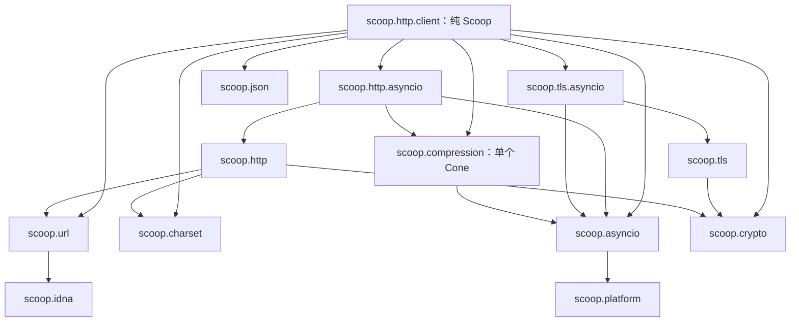

# M54 设计：统一 HTTP client 与配套基础库

状态：实施中。日期：2026-10-18。本文规定 M54 的完整实施与验收目标，已完成项与实际验证范围见[进度](PROGRESS.md)；未完成的条目不因写入设计而视为已交付。

依据：[语言规范](../specs/SCOOP-SPEC.md)第 11.9、11.13、11.18、12～14 节／章、[运行时规范](../specs/SCOOP-RUNTIME-SPEC.md)、[实现规范](../specs/SCOOP-IMPL-SPEC.md)、[库 API 风格](../specs/SCOOP-API-STYLE.md)、[M49](../milestone49/DESIGN.md)、[M51](../milestone51/DESIGN.md)、[M52](../milestone52/DESIGN.md)与 [M53](../milestone53/DESIGN.md)。本期是普通库工作，不改变语言语义、GC 合同、runtime ABI、stage 职责或编译缓存行为。

## 0. 范围与决定

1. 提供统一的 `scoop.http.client`，建立在 M53 协议库之上，自动选择 HTTP/1.x／HTTP/2，对外使用同一请求、响应、body 和策略接口。客户端本身为纯 Scoop；native 与系统缺口在各自基础库补齐。
2. 所有网络等待、池等待、文件操作、重试等待及需要等待外部结果的用户回调充分支持 suspend。流式上传、下载和 duplex 保留背压、实际进度、取消与显式关闭，不能只是把阻塞实现改成 suspend 签名。
3. `scoop.idna` 为独立库。IDNA 需要 Unicode 数据与规范化能力，但不要求 ICU；本期选择 libidn2／libunistring，并明确实际 IDNA 数据版本。
4. `scoop.url` 为独立库，负责解析、拼装、相对引用、百分号／表单编码及网络 origin。使用 uriparser 的 RFC 3986 路线和独立 IDNA，不复制浏览器全部容错规则。
5. `scoop.compression` 为一个独立 Cone，同时交付内存、同步流和异步流。通用压缩默认 zstd；gzip／deflate／Brotli 也必须支持，以满足现有 HTTP 互操作。各格式共享自己的同一后端，异步包装不另造第二个 Cone。
6. 增加独立 `scoop.charset`，承接响应文本和字段参数的实际字符集缺口，使用 libiconv；不把 native 编码转换或 ICU 加入纯 Scoop 的 std。
7. 本期完成连接池、超时／取消、重定向／重试、Basic／Bearer／Digest、mTLS、代理、Cookie、私有响应缓存、multipart、下载续传、SSE 与 HTTP/1.1 WebSocket。详见功能与验收矩阵。
8. **HTTP/3 留待后续。HTTP/2 WebSocket 和高级连接能力本期不做。** 高级连接能力在本文具体指跨 origin H2 连接合并、证书固定／对端证书链检查接口、TLS 会话恢复控制／0-RTT、主动 H2 PING 保活。正常池管理、GOAWAY／SETTINGS 和 WebSocket Ping／Pong 不属于排除项。
9. 不引入 libcurl、OkHttp 或其他完整客户端作为隐含第二套传输实现；参考它们的公开语义，继续消费 Scoop 已有的 asyncio、TLS 和 HTTP。基础库缺陷不能通过 client 私有 parser、native shim、同步 I/O、无限缓冲或协议降级掩盖。

## 1. 规范入口

| 文档 | 权威范围 |
| --- | --- |
| [HTTP client 规范](../specs/SCOOP-HTTP-CLIENT-SPEC.md) | 统一 API、请求生命周期、版本／连接池、超时／取消、策略与长连接使用 |
| [IDNA 规范](../specs/SCOOP-IDNA-SPEC.md) | IDNA2008／UTS #46、DNS 标签与名称校验、Punycode、native 依赖 |
| [URL 规范](../specs/SCOOP-URL-SPEC.md) | URL／IRI、相对解析、origin、组件与编码 |
| [压缩规范](../specs/SCOOP-COMPRESSION-SPEC.md) | gzip／zlib／raw DEFLATE／Brotli／zstd、增量、同步／异步流 |
| [字符集规范](../specs/SCOOP-CHARSET-SPEC.md) | 字符集名称、完整与增量转换、错误／BOM／字节序 |
| [HTTP 规范](../specs/SCOOP-HTTP-SPEC.md)与[消息工具补充](../specs/SCOOP-HTTP-MESSAGE-SPEC.md) | 扩展方法、字段／日期／Cookie／PSL／multipart、SSE、WebSocket、切换 |
| [asyncio 规范](../specs/SCOOP-ASYNCIO-SPEC.md)第 9 节 | 文件／目录、地址族竞速、SOCKS5 和实际 native work 等待 |
| [crypto 规范](../specs/SCOOP-CRYPTO-SPEC.md)第 8 节、[TLS 规范](../specs/SCOOP-TLS-SPEC.md)第 8 节 | 摘要、证书 bundle、客户端身份、系统信任及异步验证 |

旧 M49／M51／M53 的验收记录只说明当时的实现，不将 M54 的目标追记为已完成。遇到本文与领域规范的表述差异，先修订为同一合同，再实施。

## 2. 分层、依赖与纯 Scoop 边界

图省略各库对 core／std 和既有平台 buffer 的直接依赖；实现中的 manifest 仍须声明实际直接使用的 Cone。依赖不循环：HTTP 内存引擎不依赖 compression 或 asyncio，WebSocket 压缩组合位于 HTTP asyncio；compression 不依赖 HTTP。URL／IDNA 不依赖 TLS，crypto 保持不依赖 platform，std 仍只依赖 core。

| 组成 | 本层拥有的实现 | 本层不能代做的事 |
| --- | --- | --- |
| http.client | 调用、路由选择、池、策略、响应资源和 convenience 组合 | URL／IDNA／字符集算法、TLS／HTTP framing、socket native、私有 worker |
| http／http.asyncio | HTTP 消息与协议、长连接协议、流与切换所有权 | 连接 TCP、选择信任源、Cookie jar／缓存存储策略 |
| url／idna | URL 结构、编码、origin／DNS 名转换 | DNS 查询、连接、TLS 校验、公共后缀政策 |
| compression／charset | 格式处理、增量状态和所属流适配 | HTTP 协商、文件目的地、网络重试 |
| tls／tls.asyncio／crypto | 握手、验证、身份、密码与证书输入 | HTTP header、重定向、池键选择 |
| asyncio／platform | 真实 I/O、定时器、文件、DNS、native 工作生命周期 | HTTP 语义、证书或 Cookie 业务策略 |

纯 Scoop client 的可行性不依赖新增编译器能力：现有泛型、interface、Context、Job、continuation、NativeByteBuffer 和 AsyncCloseable 已可表达这些组合。若实际合法源码暴露编译器／runtime 缺陷，先在所属层修复并建立独立 fixture；不在 client 维护特殊类型、隐藏调用约定或替代运行时。

## 3. 已有能力与必须补齐的缺口

| 项目 | M54 前基线 | M54 责任与完成条件 |
| --- | --- | --- |
| URL／IDNA | 无完整公共库 | 独立 idna、url；Unicode、A-label、组件／origin、相对引用各自独立验收 |
| 内容压缩 | 无公共压缩流 | 单一 compression Cone 完成五种格式的内存／同步／异步及 WS 消息边界 |
| 非 UTF-8 文本 | 主要为 UTF-8／ASCII 工具 | charset 完成常用编码和增量转换；client 只选择编码 |
| 扩展 HTTP 方法 | H1 发送和响应上下文也受 llhttp 方法枚举限制 | http 解除发送／响应上下文限制，H1／H2 client 同样可用任意 token；服务端 llhttp 请求解析限制单独保留 |
| HTTP 消息工具 | 字段主要保留原始字节 | http 完成媒体类型、参数、HTTP date、Range、认证／缓存字段、Cookie／PSL、multipart |
| WS／Digest 摘要 | crypto 只有 SHA-256／384／512 | crypto 增加 SHA-1、MD5、SHA-512/256，原生对端与向量验证 |
| 证书输入 | 单张 PEM／DER、显式 TrustStore | crypto 提供多证书 bundle；TLS 提供 CA 文件与系统信任 |
| mTLS | TLS 客户端未公开 identity，底层已有配置证书的公共实现路径 | TLS 暴露正确保活的客户端身份并与独立 mTLS 对端验证 |
| 系统信任的 suspend | 未有完整系统信任来源与异步平台验证 | TLS 完成来源／验证步骤；asyncio 提供 GC-free native work 等待；client 不读取 keychain 或同步文件 |
| 文件操作 | AsyncFile 只有顺序读写／flush／sync | asyncio 补 metadata／size／position／seek／truncate、临时创建、替换／删除、目录遍历，必要原语归 platform |
| 地址族竞速／SOCKS5 | 基础 DNS 与单地址 TCP | asyncio 完成 Happy Eyeballs 与 SOCKS5，返回真实错误并清理失败候选 |
| H2 控制事件 | 已有 SETTINGS、GOAWAY、stream ID、流关闭与背压 | 直接复用；只有发现公共事实缺失才在 http.asyncio 增加，不另解析帧 |
| Job 与取消 | 结构化并发已存在，取消等待不等于 native 结束 | 沿用既有合同；预期候选失败在子任务内捕获，client 不新增私有 supervisor／调度器 |
| JSON | 完整文档与显式 codec 已可用 | 有限缓冲 JSON 便利操作直接复用；不把它声称为可挂起／无限流业务 codec |

底层修复采用所属库公共 API，并能被独立消费者使用。仅在 web client 中新增 private FFI、手写方法行、复制 Unicode 表、临时同步 Path 调用、悄悄落盘以重放请求，均不满足完成条件。

## 4. 后端与标准取舍

| 需求 | 本期选择 | 选择依据与具体边界 |
| --- | --- | --- |
| IDNA | libidn2 2.3.8 + libunistring 1.4.2 | 完整独立 IDNA 路线，无 ICU；IDNA 表基线为 Unicode 15.1，后续升级在本库进行 |
| URL | uriparser 1.0.2 | 成熟 C URI parser，IDNA 独立；采用 RFC profile，不承诺 WHATWG 容错 |
| 通用压缩 | zstd 1.5.7，默认 level 3 | 通用文件／流与 HTTP zstd，支持明确字典、校验和及窗口限制 |
| gzip／deflate | zlib-ng 2.3.3 原生 API | HTTP 互操作与 WS raw DEFLATE，避免 zlib 符号冲突 |
| Brotli | Brotli 1.2.0 | 支持既有服务端 br，编码与解码均交付 |
| 字符集 | GNU libiconv 1.19 | 三目标编码集合一致；不依赖系统 locale 或 ICU |
| HTTP／TLS／I/O | 既有 llhttp、nghttp2、OpenSSL、libuv | 继续共享 M49／M51／M53 后端，只补实际缺口 |

以上版本按调研时的官方发行选择，不声称所有均是最新版本。libunistring 选用已发布的稳定维护版本，不自动追随刚发布的新 Unicode 数据；更新需明确改变本库行为并重跑对应向量。固定源码、构建选项和许可在实施时进入 vendor README 与准备脚本，实际三目标可用性以运行验收为准。

libidn2／libunistring／libiconv 按其库许可交付对应源码、修改说明与静态再链接材料；不将其 GPL 工具当作应用运行依赖。PSL 的快照与许可在 HTTP 库维护。无需为任何这些依赖增加来源授权、证明或产物复验机制。

## 5. 对成熟客户端的采用与调整

| 参考 | 采用的设计 | Scoop 的明确合同 |
| --- | --- | --- |
| Ktor | suspend 调用、作用域响应、内容与认证组合 | 不照搬各 engine 功能不一致的表面；固定本期协议能力与所有权 |
| OkHttp | 长寿命 client、连接池、重放能力、拦截与 Happy Eyeballs | 网络等待使用现有 Job／EventLoop，单次 source 默认不可重放 |
| Go net/http | Client／Transport 职责、Context 取消、body 关闭、GetBody 思路 | 不暴露第二套低层 transport 接口，复用 Scoop 的 HTTP／TLS 流 |
| reqwest／HTTPX | 流式 body、原始与解码表示、可选压缩／HTTP2 | 编码能力与实际广告一致，body 只有一个消费过程 |
| .NET HttpClient | 重用连接、明确版本和超时策略 | execute 返回头部后 total 仍覆盖 body，不把头部完成当完整请求结束 |

不把成熟库的全部插件或平台专用选项复制为本期表面。内存 codec 保持同步计算；“充分支持 suspend”要求所有可能等待外部资源的路径正确挂起、可取消并收尾，不承诺 CPU codec 被抢占或 getaddrinfo 被立即终止。

## 6. 功能闭环

| 功能组 | 必须交付的组合 |
| --- | --- |
| 基本请求 | 通用方法、URL／query／header、版本策略、1xx／最终响应／trailer、明确非 2xx 行为 |
| 流与格式 | 字节／文本／JSON／表单／multipart／文件／producer；原始与解压响应；短读写、双向推进、100 Continue、H2 duplex |
| 连接 | DNS／Happy Eyeballs、TLS／ALPN、H1 复用、H2 多路复用与 SETTINGS、GOAWAY、可取消排队、闲置回收 |
| 失败策略 | 完整生命周期 total、阶段超时、单请求取消、有限重定向、语义与 body 双重约束的重试 |
| 认证与代理 | Basic／Bearer／Digest、suspend 刷新、mTLS、系统／显式 CA、HTTP／HTTPS 代理、CONNECT、SOCKS5、显式环境代理 |
| Cookie／缓存 | Cookie／PSL、可挂起存储接口、RFC 9111 私有内存／磁盘缓存、304／Vary、失败不提交 |
| 下载 | 显式 Path、临时文件提交、进度、identity／编码表示选择、Range／If-Range 续传与 200／206／416 判断 |
| 长连接 | SSE over H1／H2、Last-Event-ID 和可选重连；HTTP/1.1 WS／WSS、控制帧、分片及 permessage-deflate |
| 扩展与诊断 | suspend 调用／attempt 回调、耗时与进度、明确异常原因、脱敏日志、回调不阻塞共享 H2 驱动 |

“完整”以以上真实功能组合为验收范围，不等于实现浏览器、OAuth 交互、共享代理缓存或所有未来协议。每个公开开关要么在本期有实现和验证，要么不进入本期 API；排除能力不能留空分支。

## 7. 必须保持的生命周期事实

1. client owner 的子 scope 正文保持活动，才能登记后续调用／连接；close 必须发生在其外层 scope 正文退出之前。连接与调用分别有归属，不产生脱离任务树的服务。
2. execute 交付最终头部时，调用仍然活动。body 消费、上传结束、trailer、缓存提交和资源归还都属于同一次调用；总超时持续到终结。
3. HTTP/2 的共享 TLS I/O 使用连接 owner Job。请求超时或取消通过流 reset 结束该请求，不能取消共享 TLS read／write。
4. body 的可重放性来自新的数据源或生产过程。方法幂等不代表数据可重放；数据可重放也不代表任意已发送请求都能重试。
5. 原始响应字段与编码后长度保留。解压视图不能把原 Content-Length 当明文长度；失败不能把不完整文件或缓存条目标为完成。
6. CONNECT／Upgrade 移交完整前缀和唯一关闭责任，WebSocket 不归还 HTTP 池。内存 codec 的 finish、flush、close 分别表达格式完成、输出推进与资源释放。
7. 结果选择与 native 实际结束是两个事实。取消、超时和 finally 必须等真实操作／借用完成；同步返回、迟到结果、并发 close 都不能重复恢复或释放。

## 8. 实施批次

| 批次 | 工作与可运行出口 |
| --- | --- |
| M54-1 独立数据与 codec 库 | idna、url、charset、compression 的正式 Cone、固定后端、公共文档及库测试；三个目标分别运行独立消费者，压缩同步／异步往返与独立工具互操作 |
| M54-2 所属基础库补齐 | HTTP 方法／消息工具、crypto、TLS 身份／系统信任、asyncio 文件／竞速／SOCKS5／native work；每项先独立验收，才交由 client 消费 |
| M54-3 统一 client 主线 | scoped client、request／response、H1／H2／ALPN、连接池、body 背压、早期响应、超时／取消；真实 HTTPS H1／H2 上传下载与单流取消 |
| M54-4 请求策略与存储 | 重试／重定向、认证／代理、Cookie、内容编码、私有缓存、下载续传；组合可重放与单次 body，失败和取消不提交结果 |
| M54-5 长连接与可观察性 | SSE、H1 WebSocket／WSS、permessage-deflate、suspend hooks、事件与诊断；与普通 H2 流并行，回调／取消互不污染 |
| M54-6 三目标收尾 | API 用例、生产 `.slib` 消费、moving GC、相关正式 CLI fixture、依赖与分发资料；记录真实结果，更新 roadmap 状态 |

每批只做其实际需要的底层修复，不以新增通用框架作为验收前提。任一必需能力发现下层问题，回到所属库完成修复和独立回归；不能以“客户端已经有替代路径”跳过。

## 9. 验收矩阵

| 范围 | 独立验证 | 必须同时验证的组合 |
| --- | --- | --- |
| URL／IDNA | 标准向量、非法 A-label／Bidi／Context、长度／根点、重复 query／相对引用 | Unicode URL → DNS／SNI／证书名／Cookie／池键一致；redirect 不双重编码 |
| 压缩／字符集 | 各格式独立向量与外部工具、分块／BOM／字典／连续帧／坏尾部 | H1 chunked 压缩上传、H2 并发解压、慢消费者、WS 压缩与取消 |
| HTTP 协议 | 扩展方法、HEAD／CONNECT、1xx／trailer、HTTP date／Range／参数 | 早期 401／413、不读取整个上传、H2 SETTINGS 变更与 GOAWAY |
| 连接／TLS | 双族竞速、迟到成功、ALPN、有／无客户端身份、系统信任与 CA | 代理 TLS → CONNECT → 目标 TLS／H2、连接失败后候选清理 |
| 取消／超时 | 登记前、等待中、成功竞争、部分进度、并发 close | A 流取消而 B 流继续、头部后 total 到期、压缩中断、磁盘 work 收尾 |
| 策略 | 301／302／303／307／308、401／407、REFUSED_STREAM、Retry-After | 方法与 body 的可重试矩阵、跨 origin 凭据剥离、producer 每次恰好启动 |
| Cookie／缓存／下载 | PSL、过期、Vary／304、损坏或未提交条目、206／416 | 解压后缓存一致性、取消不覆盖原文件、续传验证实体变化、同步 API 不进入 loop |
| SSE／WebSocket | 行尾／UTF-8、握手／mask／分片／控制帧、关闭 | SSE H2 重连与取消、WSS 的 H1 专用 ALPN、同次读取的升级后缀 |
| 普通库交付 | 显式依赖与跨 Cone 编译链接、缺少依赖的诊断 | 应用不重建内置依赖；非 client 应用仍可独立使用 url／idna／compression |

同 Cone 的 scoop.test 验证库行为；少量正式文件 fixture 验证 API 组合、编译诊断、`.slib` 消费和 native 链接，不保存大规模 IR 快照。各特性有独立用例和组合用例，错误规则有对应失败检查。时序用明确同步点、loopback 动态端口和可控制的对端；不依赖公网稳定性，不通过删掉源或工具证明缓存复用。

三个目标为 aarch64-apple-darwin、x86_64-unknown-linux-gnu、x86_64-unknown-linux-musl。分别运行适用的 debug／release／moving GC，不能以能生成 ELF 代替 Linux 运行。验收规模按实际变化确定；只有涉及编译器或 runtime 时才扩大相应回归，不把每批普通文档／库迭代都绑定到完整编译器验收。

测试未通过的能力不能以文档状态或预编译包存在代替。最终进度文档只保留验证范围、结果概要、失败闭合与必要限制，原始日志／报告保存在仓库外。

## 10. 构建与分发

新 Cone 使用 `sysroot/src/<cone-name>`，第三方源码位于 `sysroot/vendor`，目标库与头文件位于 `sysroot/lib/<canonical-target-triple>`。普通 manifest 显式声明 native sources／libraries；依赖只编译一次，压缩的异步 package 不再拷贝 native 对象。

准备脚本按 M52 为各目标生成资源，实际分发增加相应 `.slib`、头文件、静态库与许可／源码资料。应用 build／run／test／link 消费预编译资源，普通构建不下载、不探测或重编后端，不增加 scoop／driver 发布子命令。遵守既有 archive 成员选择，不把函数级裁剪塞进 M54。

源码与版本作为正常构建输入；命中缓存直接复用，失效按实际更新判断。库测试使用开发 sysroot，最终归档搬迁按 M52 需要时手工验证，不为每个常规测试重新打包。真实 sysroot 清单与 Cone 数量随对应实现交付更新。

## 11. 后续范围

HTTP/3 需要 QUIC、UDP/TLS 组合、HTTP/3 协议库与相应取消／流控合同，单独设计，不能作为 Auto 的隐含候选。HTTP/2 WebSocket 需要 RFC 8441、Extended CONNECT／SETTINGS 和伪头支持，单独补入 HTTP 协议库后再由 client 使用。

高级连接能力分别在其所属层另排期：证书固定／对端链信息与会话恢复／0-RTT 在 crypto／TLS；跨 origin H2 合并在具备身份与协议事实后由 client 设计；主动 H2 PING 与存活判断在 HTTP 协议／连接层。M54 不为这些能力引入插件槽、预留凭证、空分支或额外验收门槛。

当前方案需要如实保留两项兼容边界：URL 使用 RFC profile 而非浏览器全部 WHATWG 容错；IDNA 的固定数据基线为 Unicode 15.1。二者均有明确规范与错误出口，不由 client 例外修复。若后续要求新的数据版本或另一种 URL profile，先在独立库讨论并更新合同。

## 12. 调研依据

- [Ktor 流式响应](https://ktor.io/docs/client-responses.html)、[客户端引擎](https://ktor.io/docs/client-engines.html)、[超时](https://ktor.io/docs/client-timeout.html)。
- [OkHttp calls](https://github.com/square/okhttp/blob/master/docs/features/calls.md)、[connections](https://github.com/square/okhttp/blob/master/docs/features/connections.md)、[interceptors](https://github.com/square/okhttp/blob/master/docs/features/interceptors.md)。
- [Go net/http](https://pkg.go.dev/net/http)、[reqwest](https://docs.rs/reqwest/latest/reqwest/)、[HTTPX async](https://www.python-httpx.org/async/)、[.NET HttpClient](https://learn.microsoft.com/en-us/dotnet/fundamentals/networking/http/httpclient-guidelines)。
- [RFC 9110](https://www.rfc-editor.org/rfc/rfc9110.html)、[RFC 9111](https://www.rfc-editor.org/rfc/rfc9111.html)、[RFC 9113](https://www.rfc-editor.org/rfc/rfc9113.html)、[RFC 8305](https://www.rfc-editor.org/rfc/rfc8305.html)。
- 具体依赖、数据版本与格式标准见各独立库规范的依据列表。调研资料不替代固定版本的实际集成验收。
