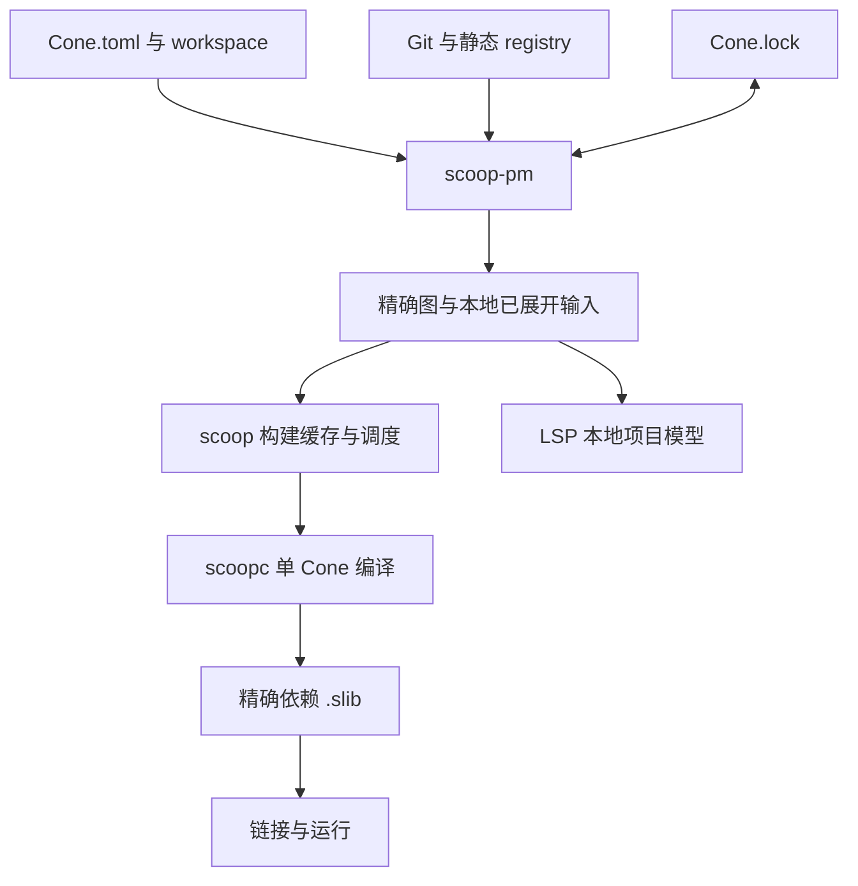

# Scoop 包管理设计与实施步骤

状态：实施中；对应 [ROADMAP M63](../ROADMAP.md#m63-独立包管理器与-workspace实施中)。更新日期：2026-10-28。规范合同见 [Scoop 包管理规范](../specs/SCOOP-PACKAGE-SPEC.md)，已完成范围与验证见[实施记录](PROGRESS.md)。

采用独立 `scoop-pm` 可执行程序：它处理 workspace、版本求解、GitHub/Git、registry、源码打包和 `Cone.lock`；`scoop` 取得 lock 的精确图与本地输入后继续使用现有构建调度、缓存和链接。`scoopc` 仍只编译一个 Cone。这将新增复杂度集中在 PM，便于在不启动 LLVM 的测试中验证解析和下载行为。

## 1. 为什么这样拆分

现有 `scoop` 已经有可复用的精确图：`compiler/scoop/src/graph.rs` 的 `ResolvedBuildGraph` 保存 root、节点、边和依赖优先顺序；`discovery/` 从 manifest/artifact 收集图，`schedule.rs` 调度单 Cone 编译。新增 PM 应替换前面的“发现和选择”，不重写后面的构建执行。

原始包声明与已解析单 Cone 配置已分开，machine protocol 18 用 `ExpandedCone` 交付已绑定配置，child 不再读取原 manifest。独立 PM 已能准备完整图；普通构建入口与 `compiler/analysis/src/workspace/` 的项目发现仍需切到同一准备结果。低层直接调用 `scoopc` 时只绑定调用者提供的精确产物，不承担包解析或下载。

`Cone.lock` 适合提交到仓库，不能记录下载到哪台机器的哪个缓存目录，也不应把不断变化的源码/native 构建配置全部复制进去。因此增加的 `PreparedWorkspace` 只是 PM 对 lock 和现有清单的一次本地展开响应：源码位置、实际配置、精确边。driver 消费确定的结果，不理解 ref 更新、版本范围或 registry HTTP。响应可按普通更新规则缓存，不是一份需要用户同步维护的新清单。

这仍需要修改 driver 的图输入、单 Cone 请求和多根结果管理；不会做到完全零改动。修改集中在边界，不进入名称解析、类型系统、IR、单态化、codegen 或 runtime。直接 `scoopc`、single-file 和 artifact-only 链接保留低层用途。

## 2. 关键决定

| 问题 | 决定与原因 |
| --- | --- |
| 同包多版本 | 每个程序的闭包中 `group:name` 唯一；不改变现有语言/链接身份规则 |
| workspace 是否全局统一版本 | 按 root/purpose/target 求解，一份 lock 存多个闭包；互不链接的程序不应互相制造冲突 |
| 默认版本策略 | 保留有效锁定选择；新解析与 update 偏好较新的满足全图约束的版本，必要时回溯 |
| 没有可行版本 | 报告要求和依赖路径；不能静默忽略某条要求 |
| 配置格式 | 声明式 TOML；显式 workspace 继承，不使用可执行 manifest 或任务脚本 |
| Git 版本 | 明确 ref，锁完整 commit；version 检查该 commit 的 Cone 版本，不扫描 tag 推测发布约定 |
| Registry | 静态 HTTP 索引加源码 tar.zst；先根据小型 metadata 求解，再下载所选源码 |
| 全局源码缓存 | 默认`~/.scoop/packages/`；同registry的同包版本、同Git仓库的同commit跨项目共用，不复制到各项目 |
| 依赖身份 | `group:name:version` 保持；source 另外参与选择/缓存，同坐标不同来源必须显式处理 |
| 本地修改远端依赖 | 只允许根 overrides 一致替换来源，仍满足原版本要求 |
| 测试 | 测试根自己的闭包；普通生产请求不解析测试 deps，不连带下载或失效 |
| 尚未发布 | 一次性更新现有清单和协议，不维护旧字段和新语义的并行路径 |
| 发布范围 | 源码打包、静态目录维护与 HTTP 消费全部交付；账号网站及远端上传服务不在 M63 内 |

最容易遗漏的两点是“多个解析闭包中的同一个 Cone”及“.slib 已固定的依赖”。前者可能需要以不同上游版本分别编译，不能跨根仅用 ConeIdentity 去重；后者即使版本范围兼容，也不能修改 lock 后继续冒用已绑定其他依赖的旧二进制。两者都复用现有实际依赖结果参与构建键的原则，不修改实体 ID。

## 3. 从其他工具借鉴什么

| 来源 | 可借鉴部分 | Scoop 的取舍 |
| --- | --- | --- |
| Cargo | [workspace 共享字段](https://doc.rust-lang.org/cargo/reference/workspaces.html)、[锁定优先与版本回溯](https://doc.rust-lang.org/cargo/reference/resolver.html)、[sparse index](https://doc.rust-lang.org/cargo/reference/registry-index.html) | 保留声明式输入、显式继承和小型索引；不采用其允许不兼容版本共存的规则，也不将整个 workspace 绑定成单一求解结果 |
| SwiftPM | [根据全部要求解析并记录 Package.resolved](https://github.com/swiftlang/swift-package-manager/blob/main/Sources/PackageManagerDocs/Documentation.docc/ResolvingPackageVersions.md)、[Git 包与 registry 源码归档](https://github.com/swiftlang/swift-package-manager/blob/main/Documentation/PackageRegistry/PackageRegistryUsage.md) | 借鉴应用级一致选择与源码获取；保持 Cone 一个基本单位，不增加 package/product/target 三层，不采用 Swift 可执行 manifest |
| Maven | [dependencyManagement/BOM 与依赖调停](https://maven.apache.org/guides/introduction/introduction-to-dependency-mechanism.html) | 借鉴共享依赖声明；workspace.dependencies 只供显式引用，不复制父 POM 继承体系或 nearest-wins |
| Gradle | [version catalog](https://docs.gradle.org/current/userguide/version_catalogs.html)、[dependencyInsight](https://docs.gradle.org/current/userguide/viewing_debugging_dependencies.html) | 借鉴集中声明和“为什么选这个版本”的诊断；不引入任务 DSL、插件生命周期、variant/capability 求解 |

[Cargo 外部子命令](https://doc.rust-lang.org/cargo/reference/external-tools.html)说明独立程序可以保留统一 CLI 使用方式。本次为Scoop增加`scoop pm`到配套`scoop-pm`的明确转发；自动build使用一个窄prepare协议。既有`commands/`外部命令机制保持，不因PM再增加一套插件发现。

[Cargo Git 依赖](https://doc.rust-lang.org/cargo/reference/specifying-dependencies.html)中 version 用于检查选中 Git 源的包版本；这适合首版 Scoop 的多 Cone 仓库。以后若确实需要 Git SemVer tag 发布，可单独设计标签命名及每个 subdir 的版本发现，不能让首版隐式猜测。

[Cargo 源码打包](https://doc.rust-lang.org/cargo/commands/cargo-package.html)和[registry 配置](https://doc.rust-lang.org/cargo/reference/registries.html)也提示要分清源码归档、消费索引与上传 API。M63 的静态 registry 可由普通 Web 托管；提供本地维护命令即可完成首次发布/消费闭环，不需要同时建设公共网站。

[Cargo home](https://doc.rust-lang.org/cargo/guide/cargo-home.html)将 registry 索引、下载归档、解包源码与 Git objects/checkouts 分开保存。Scoop 借鉴这种跨项目复用方式，在 `~/.scoop/packages/` 下由 PM 统一管理；lock 只记录可移植的来源与选择，源码位置由本机投影提供。编译结果仍由已有构建缓存按实际编译输入决定是否复用。

## 4. 代码归属与最小改动面

以下目录是实施落点；各项进度以实施记录为准：

| 位置 | 预期变更 |
| --- | --- |
| `compiler/pm/`（新 crate，binary `scoop-pm`） | workspace、要求求解、来源获取、lock、prepare、package、静态 registry 命令；内部按当前职责拆模块，不建立 source 插件层 |
| `compiler/manifest/` | 解析原始 TOML、版本要求和 workspace 字段；提供展开后单 Cone 数据；保留原位置、生产/测试分离、native/源码清单规则 |
| `compiler/protocol/` | PM 请求/响应和已展开单 Cone 输入的纯数据合同；复用 host path/诊断载体，不引入网络或 solver 依赖 |
| `compiler/scoop/` | `pm` 转发、prepare 调用、精确图接入、多根调度与输出；移走普通 manifest 路径的来源/版本发现 |
| `compiler/driver/` | 接收已展开配置及精确边；现有 stage 编排和 direct/support 产物加载继续复用 |
| `compiler/analysis/` 与 LSP | 读取相同已准备模型及本地成员信息；消除自有版本选择，编辑时不下载 |
| 发行与 fixtures | 分发配套 PM；新增独立 CLI 测试及少量编译闭环，更新仓库所有 Cone.toml 和文档示例 |

复用现有 `semver`、TOML、`toml_edit`、serde/JSON、URL、SHA-256、文件锁等依赖。resolver 使用 [pubgrub-rs 0.4](https://pubgrub-rs.github.io/pubgrub/pubgrub/trait.DependencyProvider.html) 的冲突回溯；PM 的 Rust 最低版本按该库要求为 1.92，独立于 Scoop 产物兼容性。求解变量仍是 group:name，候选包含实际来源，范围匹配继续使用 Scoop 的版本规则。索引/本地 manifest 提供 metadata，求解成功后才获取 registry 归档。Git 首版调用系统 Git；HTTP 使用 ureq 3.5，归档使用 tar 0.4/zstd 0.14。发行许可证收集须包含 PM（PubGrub 为 MPL-2.0），不手写协议、压缩或回溯算法。

PM 的 library 入口供自身命令与单元测试使用；构建 driver 通过进程边界调用它，不直接链接其实现。数据 crate 中不放网络、锁文件写入、求解算法或 compiler stage。无需为仅存在于测试中的调用者造 factories、credentials 状态机或通用 transport 框架。

## 5. 实施步骤与完成条件

每步都更新实际进度；设计完成不等于实现完成。阶段可独立验证，但正式 M63 完成需全部闭合。中间步骤只接入已实现的来源，不能将未支持分支以空实现发布为完成。

### 第一步：数据边界与独立程序

建立 `scoop-pm`、`scoop pm` 转发和 prepare 数据合同。先用 path/sysroot/artifact 的精确图连接现有调度；将已展开 Cone 配置传到 child。当前 manifest 的版本要求开始区分声明与已解析 coordinate，既有“固定版本”意图统一改写为 `=...`。

验收：PM 可单独 build/test，无 LLVM stage 依赖；独立进程产生完整图；driver 用准备结果完成一个真实 Cone 的构建；低层 direct/support 错误仍有代表性测试。不是先将全部 PM 代码加入 `scoop` 后再拆。

### 第二步：workspace 与多根构建

实现成员定位、virtual/root workspace、显式字段继承、共享依赖、根选择及多根输出。准备接口一次返回多个独立闭包；已有编译调度按完整构建输入共享任务。fmt/members 仅需本地展开。

验收：根/成员目录调用、`-p`、`--workspace`、重复坐标/错误继承诊断；两个独立程序可使用不同版本；相同 Cone 在不同上游绑定下不错误共用产物；共享相同输入只构建一次，jobs 为整体上限。

### 第三步：版本求解与锁文件

实现 SemVer 要求、单版本全图求解、回溯和原因链，使用内存候选元数据完成算法测试。落实 Cone.lock、默认锁定优先、update/precise、locked/offline/frozen 和并发原子写入。path/sysroot/artifact 的精确约束同样经过这一合同。

验收：兼容范围、0.x、pre-release、build metadata、菱形依赖、必须回溯、无解、循环、不同来源冲突和根 override；不同 root/purpose/target 的锁记录互不覆盖；测试变化不使生产解析更新。模拟候选仅用于求解器单测，最终交付必须由后续真实 Git/HTTP 来源覆盖。

### 第四步：GitHub 与 Git 来源

实现 Git URL/GitHub 便捷语法、ref 到完整 commit、subdir、同 repo 多 Cone/workspace/path 依赖、submodule 及共享 checkout 缓存。branch/tag 只在新增解析或明确 update 时更新；锁定 checkout 可离线复用。

验收：用本地 Git 仓库真实创建 branch/tag/commit，验证引用前进后普通构建仍保持 lock、update 才变化；同 repo 多 Cone、version 不匹配、缺失 subdir、来源冲突、离线缺 object；复用用户 Git credential 行为，不建设登录模块。

### 第五步：registry、打包与静态发布

实现静态协议、metadata 候选、选中归档获取、一次下载校验、yank 以及源码 package。完成 workspace/path/Git 依赖的发布转换、native vendor 映射和 package --check；交付本地 registry add/yank/unyank 命令与部署说明。

验收：本地 HTTP 服务提供两个有传递依赖的包，真实打包、加入索引、消费、锁定、离线构建和更新；索引求解不下载所有候选源码；两个项目先后及并发消费相同版本共用一次成功下载/解包，不同registry同名版本保持分离；撤回不破坏旧 lock；坏归档/metadata 不发布结果，同版本不能覆盖。至少一个带共享 vendor native 文件的包通过真实编译，源码/工具保持存在。

### 第六步：工具统一、发行与正式验收

接入 build/run/test/check/doc 与 LSP 的相同结果，移除普通 manifest 路径的旧来源发现；实现 add/remove/deps/metadata，更新帮助、new 模板和全部仓库清单。发行打包包含配套 PM，单文件与 artifact-only 链接仍独立工作。

验收：现有生产/测试隔离、sysroot/prebuilt、增量复用合同不退化；冷构建、命中、真实源码/manifest/lock 变化、失败不发布和普通并发均通过。先格式化/lint，再运行 PM tests 和必要 CLI fixtures；现有语言行为按仓库完整验收要求回归，避免把同一下载/热构建验证复制到所有库测试中。

## 6. 验收矩阵

| 领域 | 独立测试 | 必要组合验证 |
| --- | --- | --- |
| 清单与 workspace | 字段/继承/路径基准/诊断位置 | 同 repo Git workspace 成员及 native 配置展开 |
| 求解 | 内存图及各版本边界、来源冲突 | path + Git + registry 菱形图，单程序无解/多程序可解 |
| Lock | round-trip、未知格式、缺节点、模式与原子写 | 两个根并发更新保留彼此条目；编译失败保留正确 lock |
| 获取 | 本地 Git、HTTP 索引与归档、失败清理 | 有效 lock 不查新版本；缺缓存的 locked fetch；无网络 frozen |
| 构建边界 | prepare 请求/响应格式、配套工具失败 | scoop → PM → scoopc → 链接/运行，两个闭包的实际依赖绑定 |
| 生产/测试 | 只启用根测试依赖、正确源码角色 | 普通构建不下载测试包，测试配置修改不失效生产结果 |
| 产物与缓存 | 精确 prebuilt 约束、实际输入更新 | 旧 slib 不能重绑定；未变化不重复读取摘要/探测/复制 |
| 发布 | 清单展开、path 转换、Git 固定、归档文件集 | 归档解包后普通编译；HTTP 消费 native vendor 包 |
| 工具与发行 | members/deps/metadata 输出与诊断 | LSP 不联网、doc 多根、分发含 PM，single-file/link 不依赖 PM |

验证以真实调用次数、输出与结果为证据；不删除/移走源码、工具或原产物要求缓存仍可用。不新增 GC stress 或与包管理无关的语言组合测试。原始日志放仓库外，后续验收记录仅保存范围、结论和必要限制。

## 7. 本期明确不做的扩展

多版本同程序、任意 feature/variant、build scripts、Gradle 式任务图、远端构建执行、二进制 registry、公共账号/上传网站、来源签名和包授权体系均不属于 M63。Git SemVer tag 自动枚举、registry 搜索服务和依赖平台条件也不作为交付前置项。

未来扩展应由实际使用场景驱动，并单独修改规范。当前完成条件是 workspace + Git + registry + lock 经独立 PM 到现有编译/链接的完整可用闭环。
