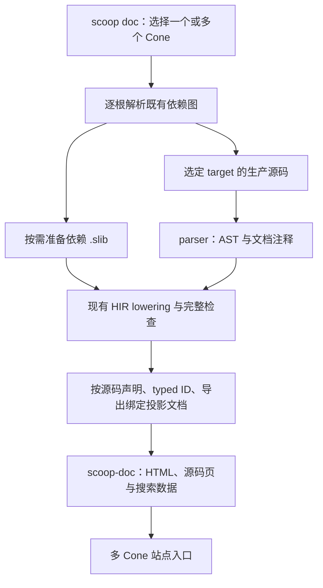

# `scoop doc` 调研与建议

日期：2026-10-17。代码调研基线：`43ff43117`；同时参考当前工作区中尚未实施的 M52 设计。本文是方案建议，不是已生效的语言规范或实现验收记录。本次仅新增本文，未修改编译器、core、三份规范或路线图。

建议采用 **Cargo 的多包编排方式、rustdoc 的编译器前端复用方式，以及接近 KDoc 的源码注释格式**。首版支持一个或多个源码 Cone，生成可离线打开的 HTML 站点；复用现有完整 HIR 检查，从源码声明视图提取 API。首个文档控制注解采用普通的 `@DocHidden`，搜索别名可用 `@DocAlias`。

## 1. 上游做法与可借鉴部分

| 参考 | 已确认的行为 | 对 Scoop 的建议 |
| --- | --- | --- |
| [cargo doc][cargo-doc] | 默认生成所选 package 及依赖的文档；支持多 package、workspace、`--no-deps`、`--open`、`--document-private-items`、target 选择 | 复用 Cone 定位、依赖图和目标源码选择；首先支持显式多个 Cone，不以 workspace 为前置 |
| [rustdoc 架构][rustdoc-architecture] | 使用 rustc 的 HIR 与类型查询，将编译器数据整理为适于文档的模型，再渲染页面 | 使用 Scoop 自己的 parser/HIR，独立完成文档投影和 HTML 渲染 |
| [rustdoc 属性][rustdoc-attributes] | 文档注释可表示为 `doc` 属性；`hidden` 隐藏条目，`alias` 增加搜索词，`inline/no_inline` 控制 re-export 展示 | 借鉴隐藏与搜索别名；无需为了文档增加宏求值或通用 annotation processor |
| [rustdoc 符号链接][rustdoc-links] | 链接沿定义处作用域解析；歧义有诊断；re-export 原文仍使用原定义处上下文 | 文档链接必须绑定真实声明，不能全站按显示名称猜目标 |
| [KDoc][kdoc] | `/** ... */`、Markdown、`@param`、`@property`、`@receiver`、`@constructor`、`@return`、`@throws` 等 | 更适合 Scoop 的主构造器属性、扩展函数和 Kotlin 风格语法 |
| [Dokka][dokka] | 根据 KDoc 和语言结构生成文档，可组织多个模块 | 借鉴页面组织；不需要引入 Kotlin/JVM 工具链或其插件体系 |
| [rustdoc 文档测试][rustdoc-tests] | 独立的测试入口提取、编译和运行示例；支持 `no_run`、`compile_fail` 等 | 将示例执行留给后续 `scoop test --doc`，首版生成文档只展示示例 |

需要区别的一点：rustdoc 官方实现当前会跳过函数体类型检查。Scoop 的表达式体函数和属性允许推断结果类型，语义工作也尚未拆成适于 rustdoc 的独立声明查询入口。首版应继续执行正常 HIR 检查，不能照搬“忽略函数体”或把缺失类型的 AST 当成完整 API。

## 2. 仓库现状及其直接影响

| 位置 | 当前情况 | 所需改动 |
| --- | --- | --- |
| [CLI 参数](../../compiler/scoop/src/cli/args.rs) | 只有 Build、Run、Test、Link；构建 root 是一个可选路径 | 新增 Doc 参数与多 root 输入 |
| [构建图](../../compiler/scoop/src/graph.rs) | `ResolvedBuildGraph` 有一个 root；非 root 的 executable 非法；同一依赖图中同一 group:name 只有一个版本 | 每个文档 root 保持自己的合法依赖图，在站点层组合结果 |
| [lexer](../../compiler/parser/src/lexer.rs) | `skip_trivia` 丢弃全部行注释和块注释，仅保留换行事实；块注释当前不嵌套 | 增加文档注释的保留和准确位置，不另写源码扫描器 |
| [AST 声明](../../compiler/ast/src/declarations.rs) | 声明有 annotations、span、原始类型语法；没有文档注释字段 | 保存附着于声明的文档片段和位置，覆盖成员、字段、variant 等声明位置 |
| [HIR 模型](../../compiler/hir/src/entities.rs) | 有源码声明身份、泛型定义、属性/构造器、public surface、re-export 和 source metadata | 使用这些真实关系投影文档；保留源码写法，并用 HIR 补全推断类型 |
| [HIR 完成入口](../../compiler/hir-lower/src/lib.rs) | `finish_output` 同时生成 ExportHir、LocalConcreteHir 和 native-boundary 数据 | 首版接受这一既有成本；文档内容从源码/Export 视图取，不从 concrete 实例列表取 |
| [driver 的 HIR 观察出口](../../compiler/driver/src/request/preflight/production.rs) | 已能在 HIR 后返回，不继续当前节点的 MIR/LIR/codegen | 借鉴该编排增加结构化文档输出，不能把现有文本 dump 作为数据接口 |
| [注解规范](../specs/SCOOP-SPEC.md) §9.4 与 [core 声明](../../sysroot/lib/scoop.core/src/serialization_annotations.scoop) | 已有 typed annotation identity、Target、Repeatable、静态参数、use-site 和跨 Cone 保存 | 文档注解可以是普通 core annotation class，不必新增 annotation 语法 |
| [持久化源码信息](../../compiler/hir/src/source_record.rs) | `SourceRecord` 保存位置、长度等，明确不保存完整源码；现有格式也没有文档注释 | 不能从当前 `.slib` 恢复完整注释、Markdown 或源码页 |
| [manifest parser](../../compiler/manifest/src/semantic/parse.rs) | 未知字段被拒绝，尚无 `[doc]` | 文档配置若进入 Cone.toml，需要正式定义字段及其用途投影 |

扫描 `sysroot` 和 `tests/fixtures` 的 Scoop 文件，未发现以行首 `///`、`/**`、`//!` 开始的文档注释。生成器交付后，还需给核心 API 写实际说明；仅有声明提取只能得到 API 骨架。

## 3. 建议的命令与多 Cone 行为

以下均为建议的新命令接口：

```sh
scoop doc
scoop doc ./libs/model
scoop doc ./libs/model ./libs/client --open
scoop doc ./libs/client --no-deps
scoop doc ./libs/model --document-private-items
scoop doc ./libs/model --target x86_64-unknown-linux-gnu --output-dir ./site
```

- 省略 root 时使用当前目录 `Cone.toml`，沿用现有 build/run 的定位规则。
- 显式 root 接受 Cone 目录或 Cone.toml。首版围绕用户要求的 Cone，不扩展 single-file、workspace、包版本选择或 glob 输入。
- 默认生成所有显式 root，以及其依赖图中以源码形式选中的 Cone 的文档；共享依赖在输入相容的前提下按 ConeIdentity 和 target 合并生成一次。已选择的 prebuilt 节点不因别处存在源码就自动改为源码构建。
- `--no-deps` 只关闭依赖文档生成，依赖仍参与类型检查与符号解析。
- 只按所选 target 的生产源码清单生成文档，沿用 `sources/when`。不因为生成文档就拼接互斥平台源码或加载测试源码、测试依赖。
- 建议默认输出 `target/doc/<canonical-target-triple>/index.html`；`--target-dir` 替换 target 根，`--output-dir` 直接指定这次站点的输出目录。不同 target 的 API 保持独立。
- `--open` 在成功生成后打开站点入口。多 root 共用 Cone 列表、导航和搜索入口。
- 复用现有 `--sysroot`、`--cone-path`、`--cache-dir`、`--message-format` 等实际适用的公共选项。

多 root 是一组文档任务，不是一个新的语言 Cone。两个 executable 可以各自生成文档；不能构造一个把它们都当依赖的 synthetic Cone。每个 root 内仍遵守既有版本、可见性和依赖规则。不同 root 使用不同版本的库时，站点按完整 ConeIdentity 区分，各自的符号链接跟随其实际依赖。同一 identity 的冲突输入使用既有冲突规则诊断，不能让后生成的页面覆盖另一个结果。

## 4. 注释格式与归属

建议以 `/** ... */` 为主格式，同时接受连续 `///` 为等价简写。正文使用 Markdown；首段作为摘要。先支持 `@param`、`@property`、`@constructor`、`@receiver`、`@return`、`@throws`、`@see`、`@since`。其中 `@throws` 是作者提供的说明，不引入 checked exception 规则。

示例中的 `DocAlias` 和 `DocHidden` 是拟新增的注解：

```scoop
/**
 * A user account with a stable identifier.
 *
 * Use [Account.id] when storing references to this account.
 *
 * @property id The stable identifier.
 * @property name The display name.
 */
@DocAlias("user")
public struct Account(val id: Long, val name: String)

/**
 * Returns twice the receiver value.
 *
 * @receiver The value to double.
 * @return The doubled value.
 */
public fun Int.twice(): Int = this * 2

@DocHidden
public fun generatedHelper(): Int = 0
```

实现前需要在 spec 中写清：

1. 注释附着于紧随其后的完整声明，允许位于 annotations 和 modifiers 之前；不能越过其他声明、package 或 import 错绑。
2. 字段、主构造器参数、enum variant、成员、构造器和 accessor 的文档分别归属何处。`@property` 可描述主构造器字段/property；`@param` 与 `@property` 不自动互相复制。
3. 连续片段的合并、空行、块注释装饰性 `*`、无附着目标的注释及 `////`、`/***` 等普通注释的区分。块注释继续遵守已有的非嵌套词法规则。
4. 去除注释前缀后仍能将链接和 tag 诊断定位回原 UTF-8 byte span。代码围栏中的 `@`、方括号和缩进不能被误当成文档 tag 或符号链接。

Cone 首页可默认读取可选的 README.md。首版无需文件级 annotation 或 `//!`。将来自定义 README 路径、package 概述等确有需求时，再增加有限的 `[doc]` 配置；它属于文档输入，不并入生产编译语义投影。不能把分散的多个文件头注释随意当成同一 package 的介绍。

## 5. 文档控制 annotation

### 5.1 首先提供 `@DocHidden`

推荐将它声明为 `scoop.core` 中公开、不可重复、无参数的普通 annotation class。沿用已有 `@Target`，覆盖 Class、AnnotationClass、EnumVariant、Field、Property、Function、Constructor、TypeAlias。Class 已包含 class/struct/enum/interface/object，无需增加枚举成员。

建议语义：

- 从 API 页面、成员目录和搜索索引中省略目标。隐藏一个容器时，其文档包含的子条目一并省略；不会给派生类型增加语言层的注解继承。
- 按真实声明身份生效。re-export 的别名不会把原声明重新显示出来；对某一个 overload 的标注只影响该声明。
- `--document-private-items` 控制可见性筛选，不覆盖显式 DocHidden。
- 目标依然参加正常编译和 HIR 检查，仍遵守原语言可见性。其他可见 API 的签名如果引用它，保持完整的类型文字，不生成指向被省略页面的坏链接。
- 普通值参数和 Type use 不允许使用 DocHidden，以免把必要参数或类型成分从 API 签名中删掉。隐藏主构造字段的成员条目，也不删除构造器签名中的对应参数。property 与原始 backing field 的归属遵守现有 use-site 规则。

文档控制根据实际 core annotation 的 typed identity 识别。用户自己定义的同名 DocHidden 不获得该含义；正常 import alias 和 re-export 保留作用。不要复用 `scoop.test.Ignore`，它有测试源码及 Test 组合约束。

### 5.2 可同批增加 `@DocAlias`

`DocAlias(val name: String)` 使用已有 `@Repeatable`，只给文档搜索增加关键词，不改变源码名称、import、重载或 ABI。例如为 Account 增加 user、account record 等查找词。目标仍限于实际生成的文档条目，隐藏条目的 alias 也不进入索引。

如果要压缩首版范围，只实现 DocHidden 即可。`@DocInline`、`@DocInclude`、`@DocInherit`、自定义渲染回调均不作为首版前置。尤其是 `public import` 目前不是 annotation target，不能直接照搬 Rust 的 re-export 属性语法。

### 5.3 必须先处理 `@Intrinsic` 的组合规则

[语言规范](../specs/SCOOP-SPEC.md) §13.1 原则上禁止 Intrinsic 与其他注解共存；[类型注解检查](../../compiler/hir-lower/src/annotations.rs)还直接检查 `decl.annotations.len() != 1`。因此新文档注解不能直接用于 intrinsic struct/class。

建议在 §13.1 为已定义的文档注解增加明确例外，并按真实 annotation identity 识别该例外，保留已有 NoGC/Unsafe/Extern 等效果和目标规则。需要覆盖 intrinsic 类型与函数两条路径。普通文档注释本身不是 annotation，不受该组合限制。

不建议在本任务顺带增加 Deprecated 的完整语言语义；它会涉及普通编译警告和跨库传播，应独立设计。API 文本、链接和生成策略也不需要用户代码执行、runtime retention 或 annotation processor。

## 6. 实现路径与职责



建议只新增一个实际承担提取后处理和渲染的 `compiler/doc` crate（`scoop-doc`）。AST 中保存源码文档片段；需要跨 stage 传递的文档数据放在 `scoop-hir`，保持为纯数据。文档 stage 只依赖其输入数据 crate，不调用 parser/hir-lower 的内部实现；driver 继续负责前端与文档 stage 的编排。

| 层次 | 本功能的职责 |
| --- | --- |
| `scoop` / manifest | 多 root、target 源码选择、依赖准备、更新判断、站点输出和 `--open` |
| parser / AST | 保留和附着文档注释，保留原始签名语法及文档位置 |
| hir-lower / HIR | 既有语言语义检查；把注释与真实声明关联；在已有作用域中解析文档链接；输出完整的文档语义数据 |
| `scoopc` driver / protocol | 一次处理一个 Cone；请求文档输出，在已有 HIR 边界调用文档 stage；返回页面及搜索数据位置 |
| `scoop-doc` | Markdown/tag 呈现、可见性和隐藏筛选、页面、源代码链接、索引和站点所需静态资源 |

文档请求属于输出意图，源码仍使用 Production 用途，不需要新增一套 Doc 源码发现语义。低层协议沿现有 single-Cone 请求增加文档输出能力即可；首版不必另行安装一个独立 `scoopdoc` executable。

### 6.1 首版复用完整 HIR

当前 `lower_current_cone` 会走到 `finish_output`，并生成两类 HIR。首版应复用这条已完成的语义路径，从其中的源码声明/ExportHir 视图取文档。**从 LocalConcreteHir 或机器符号反推 API 不可行**：会丢失未实例化的泛型定义、透明 typealias 和源码 property 等信息，还可能把实例化结果当成多个 API。

文档模型需要完整声明类型与参数、默认值的源码呈现、泛型 binder/bound、继承/接口关系、logical property 与 accessor 能力、annotation、来源位置及 resolved doc links。显式类型优先保留作者的 alias 等写法，推断类型从 HIR 补全；不能只截取 AST 签名，也不能展示内部降级后的物理参数。

首次实现无需强行拆出一个“只检查签名”的新编译器入口。将来测量表明具体化成本确实明显时，再在共有语义完成处拆分文档投影和 concrete 生产，并明确哪些泛型/默认值检查必须在前者完成。不能通过跳过错误或增加第二套语义检查降低成本。

### 6.2 冷依赖的真实成本

现有源码依赖消费以完整 `.slib` 为边界，因此“当前文档节点在 HIR 后结束”不等于“整个命令永远不执行 native 编译”。缺少产物的源码依赖，首版仍可按现有图编译成 `.slib`，其中可能包含 native 工作；已存在的有效依赖结果直接复用。文档根不因是 executable 而要求最终程序链接或 runtime 构建。

依赖确需编译且也要生成文档时，应在同次 HIR 结果上提取文档，避免立即重做一遍语义检查。产物命中但文档缺失时，借鉴现有 observation-only 路径，只补文档所需前端工作，不重做有效的机器输出。

如果要求“所有源码依赖从空缓存生成文档也不经过 native/backend”，就需要进一步解耦源码依赖的前端接口生产。这是明确的后续优化范围，不能宣称现有 HIR 观察出口已经实现它。`scoop-doc` crate 自身可以无 LLVM 依赖，但复用现有 scoopc 并不自动消除 scoopc 的 LLVM 运行依赖。

## 7. 哪些 API 应出现、如何链接

### 7.1 可见性与源码表面

- library 默认呈现实际公开 API，并包含公开可继承类型上供子类使用的 protected 成员；effective visibility 必须计入全部词法 owner。
- `--document-private-items` 纳入非公开的非局部声明。executable 可参照 cargo doc，默认启用这一模式，避免只有 internal main 的应用得到空白页面。
- struct 字段和 enum variant 的固定 public 表示规则不等于其 internal/private owner 对外公开。
- property 作为一项 API 呈现，并准确显示 getter/setter 的能力和可见性。不把 backing storage、初始化函数、bridge 或 box helper 当作源码 API。
- 构造器、嵌套类型、companion、泛型定义、typealias、注解声明和语言提供的可见合成成员，都从真实声明关系取得。
- 扩展函数/属性属于其声明 Cone 和 package，附带 receiver 类型及相应导航；不能因为 receiver 是 core 类型就把扩展伪装成 core 自带成员。
- 继承成员通过原声明及已确定的关系显示或链接。首版不自动从任意同名基类/接口方法复制注释。

### 7.2 标识与链接

文档条目的键使用现有 typed declaration identity；re-export 额外保留 binding 与 origin 的关系。Cone、package 和名称只是显示/导航数据，不能代替声明身份。文件路径与锚点应由规范化的 Cone/声明身份确定，用户可见名称单独编码显示，避免重载、split package、反引号标识符或不同版本导致覆盖。

建议支持 `[Type]`、`[Type.member]`、`[label][Type]` 与普通 Markdown URL。真正的符号链接由 HIR lowering 在原声明的词法、import 和 direct dependency 环境中解析；Markdown 定义的普通引用链接保留其正常优先级。渲染器只使用已解析的引用。

同名 overload 可参考 KDoc 汇总到同一函数组页面，各声明仍有自己的 typed anchor。无参数选择的 `[parse]` 链接到该组，不随机选一个 overload；不相关实体的歧义照常给出文档诊断。首版不必设计另一套文档专用重载求解语法。

`public import` 页面列出实际导出名称和来源链接，不制造第二份实体。原注释中的符号链接继续使用原定义处语义；同一实体经菱形 re-export 到达时共用原目标。没有目标页面时保持名称/签名的文本呈现，不输出必然失效的本地 URL。

源码链接来自 SourceIdentity 和真实位置，源码页由当前已经读入的文本生成。不能为了渲染页面再扫描一遍未选中的源码目录。

## 8. 预编译依赖与 M52

有源码的显式根可以生成完整文档；依赖如果只有现有 `.slib`，仍可以参与 HIR 类型解析，但没有可恢复的注释正文。应在生成结果中明确哪些依赖未生成文档，正常完成具有源码的 root，不把缺少可选依赖文档当成语言编译错误。

有三条清楚的演进路径：

| 路径 | 收益 | 代价/适用范围 |
| --- | --- | --- |
| 首版从已选中的源码 Cone 生成 | 能直接完成用户要求；不修改 `.slib` 文档格式 | 只有旧 `.slib` 的依赖没有完整文档 |
| 库或工具链随包提供静态文档及符号索引 | 内置库可直接浏览、交叉链接；无需每个项目重建 core 文档 | 需要发布布局和已生成站点的定位约定 |
| 将公开文档模型放入可选产物 section 或独立文档产物 | 可在没有库源码时重新组织完整 API 文档 | 需要正式规定格式、版本、引用和发布行为 |

推荐先做第一条；为内置库分发采用第二条。第三条只在明确需要从预编译库生成完整文档时设计，不作为首版的隐含前置。

[M52](../milestone52/DESIGN.md)计划默认使用预编译 `.slib`，同时在 `sysroot/src` 提供源码。不能把“源码目录存在”重新解释成普通构建图必须重建这些库。可在文档/发布流程中显式选择这些源码 Cone，或随工具链附带静态站点。M52 目前仍是设计，不能把计划中的安装布局当成已经可用的接口。

## 9. HTML、搜索与依赖选型

首版输出独立静态站点：Cone 首页、package 列表、类型页、函数组页、成员锚点、源码页和搜索索引。搜索至少覆盖 Cone/package、名称、摘要、声明种类和 DocAlias。HTML/CSS/JS 随输出一起保存，用相对链接，支持直接打开本地 index.html。

本地文件浏览时，不应依赖 HTTP fetch 一个 search-index.json 才能搜索；可输出普通脚本加载的索引数据。无 JavaScript 时仍能通过页面导航浏览 API。代码围栏先保证正确呈现，语法高亮不是完整文档闭环的前置。

截至调研日，查询 crates.io 得到：

| 库 | 可选用途 | 当前版本 / 最低 Rust / 最近发布 | 结论 |
| --- | --- | --- | --- |
| [pulldown-cmark][pulldown-cmark] | CommonMark 解析、链接事件及 source offset | 0.13.4 / 1.71.1 / 2026-05-20 | 优先选用；rustdoc 本身也使用它 |
| [MiniJinja][minijinja] | 固定 HTML 模板 | 3.0.1 / 1.70 / 2026-10-15 | 与仓库声明的 Rust 1.85 兼容，可选 |
| [Handlebars][handlebars] | 固定 HTML 模板 | 6.4.4 / 1.85 / 2026-08-12 | 同样满足当前最低 Rust，可作为替代 |
| [Askama][askama] | 编译期模板 | 0.16.1 / 1.88 / 2026-09-04 | 最新版超过仓库声明的 Rust 1.85，不宜直接采用 |

建议 pulldown-cmark 加一套有限的固定 HTML 模板，模板库选择 MiniJinja 即可；无需并列引入多套渲染实现。HTML 对标识符、签名和源码做正常转义；首版可将注释中的原始 HTML 按文本显示，明确 Markdown 子集。文档 tag 解析可以是包围 Markdown 的小模块，无需自己实现 Markdown。

## 10. 更新判断、诊断与验证

文档结果有独立更新记录，输入包括选中的 Cone/target/源码集合、源码和 README 的普通文件状态、依赖结果、文档工具版本及生成选项。先判断输入更新和所需输出是否存在，再读取源码、解析注释和准备必要工具。注释、可见性、依赖、target 或隐藏策略变化都应使相关文档更新。

命中直接使用页面和索引，不读回 HTML/索引内容复核摘要或生成过程。不为文档建立产物来源证明、语义重复验算或资源预算。只重新渲染确有输入变化的 Cone；站点入口和搜索索引反映本次选中集合，删除/隐藏声明后不保留旧搜索条目。失败不把不完整结果发布为成功站点。

语法和类型错误继续作为正常编译错误。文档专有问题，例如未知 `@param`、悬空注释、不可解析/歧义符号链接，建议默认 warning，附准确源码位置；可提供 `--deny-doc-warnings` 供文档 CI 使用。普通 build 不因 Markdown 链接错误产生文档警告。默认不以“所有 public API 必须有注释”为语言正确性条件。

正式验收应包含：

1. 单 Cone 和多 Cone 的真实 `scoop doc` 调用、默认 root、输出路径与浏览器入口。
2. 注释附着、Unicode/CRLF、代码围栏、tag 位置和错误诊断。
3. class/struct/enum/interface/object、主构造器字段、accessor、泛型、推断类型、扩展成员、typealias 和继承的独立及组合 fixture。
4. internal 默认可见性、protected、外层 owner 限制、私有 setter、DocHidden 与 DocAlias；注解 alias、同名用户注解、错误 Target、重复应用和 intrinsic 组合。
5. 源码/预编译依赖、跨 Cone 链接、overload、同名 split package、re-export 和菱形关系；多个 executable root 各自合法。
6. 不同 target 的源码选择；文档不误读测试源码或互斥平台输入。
7. 缓存命中、实际输入变化、缺失输入、失败不发布和普通并发协调；源码和真实工具始终保留，通过实际调用与输出验证行为。
8. 页面链接、HTML 转义、搜索结果和本地文件浏览；断言小而有针对性，不为全部库保存整站 HTML 快照。

Rust 实现变更后按仓库规则先 fmt/clippy，再进行单元与正式 CLI fixture 验证。若扩展 Python fixture runner，先运行指定版本 Ruff。调研本身没有执行这些实现验收，也没有性能数据。

## 11. 实施顺序与成本判断

建议按四个可验证步骤落地：

1. **规范与前端文档数据**：确定附着规则、tag、DocHidden、intrinsic 例外；修改语言规范 §9.4/§13.1、实现规范 §2.1/§2.2/§2.7，并同步实际新增的 manifest 或产物条款。runtime 不需要新 ABI。
2. **单 Cone 完整闭环**：真实 CLI → 完整 HIR → 源码 API 投影 → HTML/链接/搜索；同时交付隐藏和可见性规则的 fixture。
3. **多 Cone 与更新复用**：图编排、共享依赖、re-export、站点入口、target 区分、预编译依赖的明确行为，以及同次 HIR 复用。
4. **实际库验收**：为 core 和至少一个含扩展、泛型及依赖关系的标准库补充有用的注释，用真实生成的站点检查组织和导航。

这属于中等偏大的工具链功能。页面渲染的风险较低，主要工作在注释到真实声明的归属、完整源码 API 投影、跨 Cone 链接和既有编排的复用。通过保留完整 HIR 入口、暂不修改 `.slib` 文档格式，可以避免把前端架构重构和产物分发设计同时变成验收前置。

后续最有价值的增强是文档测试、package 概述及内置库静态文档分发。文档测试应接入真实编译/测试流程：当前 single-file 模式只能依赖 core，不能直接拿 `scoop run example.scoop` 验证任意库示例；需要普通临时 manifest Cone 或另行规定的测试入口，明确导入、可见性和 executable 根的限制。`no_run`、`compile_fail` 等届时再一起设计。

[cargo-doc]: https://doc.rust-lang.org/cargo/commands/cargo-doc.html
[rustdoc-architecture]: https://rustc-dev-guide.rust-lang.org/rustdoc.html
[rustdoc-attributes]: https://doc.rust-lang.org/rustdoc/write-documentation/the-doc-attribute.html
[rustdoc-links]: https://doc.rust-lang.org/rustdoc/write-documentation/linking-to-items-by-name.html
[rustdoc-tests]: https://doc.rust-lang.org/rustdoc/write-documentation/documentation-tests.html
[kdoc]: https://kotlinlang.org/docs/kotlin-doc.html
[dokka]: https://kotlinlang.org/docs/dokka-introduction.html
[pulldown-cmark]: https://crates.io/crates/pulldown-cmark
[minijinja]: https://crates.io/crates/minijinja
[handlebars]: https://crates.io/crates/handlebars
[askama]: https://crates.io/crates/askama
