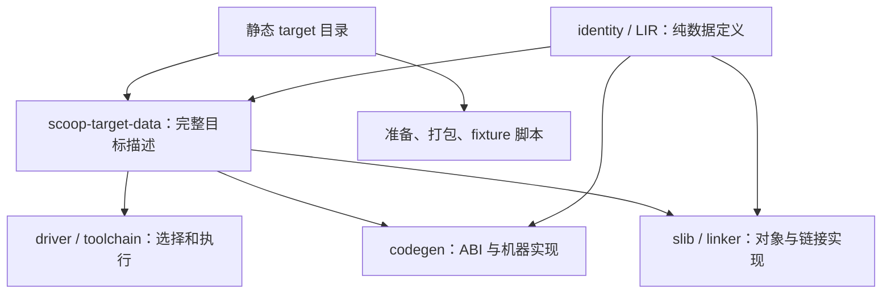

# Target 边界重构设计

状态：实施中。Windows 完成后的设计复审已完成；本阶段在 `codex/target-refactor-macos-x86-64` 分支完成目标边界重构并加入 macOS x86_64。实施与验证进度见[实施记录](PROGRESS.md)。

初稿：2026-10-29。复审：2026-10-30。

代码依据：主线 [`09be3315a85cfa9e50f79e49785bd23e0880f1f0`](https://github.com/windoze/scoop/tree/09be3315a85cfa9e50f79e49785bd23e0880f1f0)。Windows targets 经 `b0de037002`（#70）合入，随后 `2ae2534a1c`（#71）和 `09be3315a8`（#72）加入 macOS／Windows 窗口库及其实际需要的 native 支持。以下代码链接指向当前主线文件。

Windows 的[实施记录][windows-progress]确认 W0～W4 完成，包括高层 HTTP 失败闭合、新版候选归档安装，以及 Linux／macOS 各交叉生成 18 个 Windows 程序、共 36 个程序在真实 Windows 上执行通过。这些结果是重构前的已有证据；[窗口库记录](../windowing/PROGRESS.md)分别说明后续 AppKit／Win32 骨架的验证范围，不扩大为当前主线全量测试已经重新通过。

| 当前基线项 | 值 | 用途 |
| --- | --- | --- |
| runtime ABI／metadata ABI | 30／9 | 配套 compiler、runtime 与目标库的机器合同 |
| runtime index／开发 runtime cache | schema 7／`runtime-v8` | 可跨宿主消费的对象 locator／本机更新记录 |
| compiler machine protocol | 24 | 包含独立 `objc_flags` 的展开配置 |
| package protocol | 3 | 配套 PM 的 manifest 数据传输 |

这些版本用于复现本次审查，后续按实际数据变化同步更新，不设为历史兼容边界。

权威依据：[语言规范](../specs/SCOOP-SPEC.md)、[运行时规范](../specs/SCOOP-RUNTIME-SPEC.md)、[实现规范](../specs/SCOOP-IMPL-SPEC.md)。本设计承接 [M39](../milestone39/DESIGN.md)，保留其已经实现的 ABI 规划与完整 LIR 交接，继续整理尚未收口的登记、对象、工具链、runtime 和系统库职责。

## 1. 目标与交付边界

重构的目标是：增加一个 target 时，只登记完整目标、实现其实际新增的机器／系统差异、准备配套资源并验收；共享编译流程不再逐处增加完整 target 名称的分支。

本轮重构以以下六个 target 的现有功能为回归基线，并在边界拆分后加入 `x86_64-apple-darwin`。Linux ARM64 GNU／musl 与 OpenHarmony AMD64／ARM64 留待后续阶段，不提前登记。

| 完整 Scoop target | 过程 ABI／对象格式 | native 环境 |
| --- | --- | --- |
| `aarch64-apple-darwin` | Darwin AArch64／Mach-O | Apple SDK、系统 libc／libc++ |
| `x86_64-unknown-linux-gnu` | SysV AMD64／ELF | glibc、现有 GNU 工具链环境 |
| `x86_64-unknown-linux-musl` | SysV AMD64／ELF | musl、现有静态／动态链接合同 |
| `x86_64-pc-windows-msvc-ucrt` | Win64／COFF、PE | Microsoft SDK、UCRT、MSVC C++ ABI／STL |
| `x86_64-w64-windows-llvm-mingw-msvcrt` | Win64／COFF、PE | LLVM-MinGW、MSVCRT、libc++／libc++abi |
| `x86_64-w64-windows-llvm-mingw-ucrt` | Win64／COFF、PE | LLVM-MinGW、UCRT、libc++／libc++abi |

“彻底分离”是职责边界要求：通用代码消费明确的数据和计划，具体实现位于有名字的模块。它不要求删除所有平台分支，也不要求把整个编译器搬进一个 `targets/` 目录。对象 reader、链接器和 runtime 各自保留其实际平台实现。

遵循 [AGENTS.md](../../AGENTS.md) 的“未发布阶段直接演进”：允许为本轮职责分离修改内部 API、profile 表达、wire 编码、ABI 和构建记录，并同步规范、实现、调用方与必要重建。回归检查当前功能和同次构建的相容性，不要求旧产物、旧指纹或旧 API 继续可用；不增加兼容别名、转发层、双格式 reader 或双轨实现。此原则不扩大本轮语言与库功能范围。

本轮不重新设计语法、类型系统、泛型、GC 算法、协程模型或 `.slib` 的整体结构；不增加任意 target 组合、用户插件、32 位／大端支持或新的产物信任体系。未来目标只写入移植计划，不提前注册空实现。

## 2. 代码审查结论

M39 已把具体 ABI 算法移到 `scoop-abi-plan`，并通过 driver 完成 `prepare → plan_abi → complete`。问题主要不在前端，而在同一平台事实被多个消费者重新推导，以及原先只有一种组合时形成的隐含等价关系。

| 现有位置 | 当前耦合 | 本轮处理 |
| --- | --- | --- |
| [target-data](../../compiler/target-data/targets.toml)、[registry](../../compiler/toolchain/src/registry.rs)、[manifest catalog](../../compiler/toolchain/src/manifest.rs)、准备脚本和 fixture runner | 完整 target、alias、os／arch／env、host 默认值重复列举 | 一份静态目录提供事实，各消费者仅适配自身数据类型 |
| [ABI 选择](../../compiler/codegen/abi-plan/src/lib.rs)、Windows 的 [LIR contract][windows-contract] 和 [EH 签名][windows-machine-abi] | 完整 ID 反复映射 ABI；COFF 被用于选择 Win64 classifier 和 SEH personality | 过程 ABI、Scoop ABI 规则和 EH 合同分别显式绑定 |
| [目标布局](../../compiler/target-data/src/layout.rs)、[backend](../../compiler/target-data/src/backend.rs)、[LLVM target](../../compiler/codegen/src/target.rs) | Linux 从整个 Darwin 描述继承，Windows 又从 Linux backend 继承 | 只共享中性的标量／指针等常量，平台差异逐项明确 |
| [stackmap frame](../../compiler/slib/src/link_object/stackmap_normalization/frame.rs)、[AArch64 frame](../../runtime/src/platform/arch/aarch64.c) | 架构名包含 Darwin 帧几何假设；Windows 新增第三种实际恢复方式 | 按 backend 的 frame recovery 合同分派，不从架构或格式猜测 |
| [ELF architecture](../../compiler/slib/src/link_object/elf/architecture.rs)、[Mach-O reader](../../compiler/slib/src/link_object/macho.rs)、[native slice](../../compiler/linker/src/native_input/slice.rs) | ELF 默认 x86_64，Mach-O／fat slice 默认 arm64 | 容器解析与 machine／relocation／slice 选择分开 |
| [Linux C probe](../../compiler/toolchain/src/linux_c.rs)、[Darwin link](../../compiler/toolchain/src/final_link/darwin.rs)、[deployment](../../compiler/codegen/src/target/deployment.rs) | Linux 绑定 GCC／x86-64；Darwin 绑定 arm64 和本机 SDK 发现 | native 环境、driver 方言、架构参数、SDK 发现分别负责 |
| Windows 的 [NativeDriver][windows-driver]、[native command][windows-native] 和 [SDK environment][windows-environment] | 已区分 GNU／clang-cl／cl，但通用调用仍需识别 Windows／具体 target | 延续这些实现，按明确的 native 环境和工具角色选择 |
| [crypto manifest][windows-crypto]、[生成头文件选择][windows-crypto-target]及其他 native 系统库 | 每个库重复六套 target 路径；按 os／env 选路径会在新增 arch 后选错目录 | 增加所选 target sysroot 的明确路径形式，移除 C 头文件中的 target 路径表 |
| [emission](../../compiler/codegen/src/emission.rs)、[card regions](../../compiler/codegen/src/statepoint/bounded_loops/card_regions.rs) | 以 LLVM target 名称决定接口复用、TLAB、卡表等优化 | 抽为 codegen 内的目标调优数据，迁移时保持既有默认值 |
| [fixture CLI](../../tests/fixture_runner/cli.py)、[sysroot 准备](../../scripts/prepare_sysroot.py)、[维护脚本](../../scripts/README.md) | host 可运行集合同时限制交叉编译；准备脚本新增的 `TARGET_FACTS` 又复制了一份目标事实 | 分开宿主、编译目标、库适用目标和执行环境，共用目录 |

### 2.1 Windows 实现已经证明的区别

完整 Scoop target 不等于 LLVM triple。Microsoft target 使用 `x86_64-pc-windows-msvc` 发射机器代码；两个 LLVM-MinGW target 都使用 `x86_64-w64-windows-gnu`，却不能合并 CRT、native C++ 环境、sysroot 或缓存。Microsoft UCRT 与 MinGW UCRT 同样不能互换。

编译器品牌也不决定 native 环境。`cl` 和 `clang-cl` 可以生产同一个 Microsoft target；GNU 风格 Clang 可以服务不同 SDK。generated-C、用户 native C／C++／Objective-C、runtime、startup、最终链接可能使用不同可执行文件，不能缩成一个 `cc` 路径。

Windows 的 Win64 caller-copy、接口间接返回、SEH、COFF／bigobj／COMDAT、import library、PDB、Unicode 启动、RC 和 subsystem 都是现有实现，应直接纳入重构。Windows 宿主的进程、路径和命令部署支持则属于另一条边界，不应因输出 ELF 而失效。

### 2.2 合入后已完成的能力与重构要求

| 已完成的实际能力 | 重构要求 |
| --- | --- |
| [runtime index](../../compiler/linker/src/runtime/index.rs) 使用 UTF-8 相对路径和 `/`，同一份 Windows 目标资源已被两个 Unix 宿主消费 | 区分可搬迁产物 locator 与本机 `HostPathCarrier`，复用现有格式与普通更新记录 |
| [native 文件参数][windows-native]统一处理 clang-cl 的 `/Users/...` 误识别 | 参数方言适配覆盖预处理、编译、probe 和最终链接，不退回裸 `.arg(path)` |
| [Objective-C 源码](../../compiler/manifest/src/native/language.rs)与独立 `objc_flags` 已服务 AppKit／Metal | native 工具角色包含 `.m`／ARC；条件未选中的源码不探测，C++ 需求仍独立 |
| [COFF imports](../../compiler/linker/src/namespace/coff.rs)、[PE 输入顺序](../../compiler/linker/src/link/pe.rs)、[Darwin re-export](../../compiler/linker/src/dynamic/exports.rs)与 selector stub 已修正 | 对象分层保留真实惰性导入、输入顺序及最终 provider 语义，不统一为“同名即重复强定义” |
| 系统库准备和文档生成已按目标的生产 `sources` 条件选择 Cone | 复用选择流程、合并其目标事实；编译器支持某 target 不表示所有窗口／系统库也支持它 |

## 3. 总体结构与所有者

保留现有 stage 数据流：

```text
完整 MIR + 已选依赖 LIR + 目标布局
  → lir-lower::prepare
  → codegen::plan_abi
  → prepared.complete
  → 完整 LIR
  → codegen 发射
```

目标相关职责按下面的维度分开，只有静态目录允许把它们绑定为一个受支持的完整 target。

| 事实／行为 | 所有者 | 通用消费者收到什么 |
| --- | --- | --- |
| canonical target、alias、os／arch／env、具体实现选择 | `scoop-target-data` | 无 I/O 的静态目标描述 |
| typed identity、布局／ABI／backend 的可编码数据 | `identity`、`lir` 等 IR/meta crate | 完整数据及必要的局部格式检查 |
| 过程 ABI、整数扩展、aggregate／寄存器分类 | `codegen/abi-plan` | 以完整签名为单位的物理 ABI 计划 |
| LLVM machine、statepoint、EH 发射、调优 | `codegen` | 按目标生成的对象与已有产物记录 |
| 容器、machine、relocation、对象归一化 | `slib`、`codegen` 各自的对象边界 | 已读取的对象事实；不重放上游语义 |
| native 输入、符号归属、最终程序组合 | `linker` | 已选目标的链接计划和产物 |
| SDK／工具发现、命令执行、runtime 准备、链接工具调用 | `toolchain` 与维护脚本 | 本次实际使用的工具配置和输入记录 |
| 宿主路径／进程、命令命名与部署 | `process`、toolchain 宿主模块、打包脚本 | 可在本机执行的工具和路径 |
| OS primitives、frame recovery、loaded image | `runtime/platform` | 现有 runtime API 的具体实现 |
| 文件／网络／终端／事件循环／证书等系统行为 | 各系统库 native 后端 | 现有 Scoop 库 API |

`scoop-target-data` 从 `compiler/codegen/target-data/` 移到 `compiler/target-data/`，保留包名。它是共享目标事实，不是 LLVM stage；依赖仍可指向 `identity`／`lir` 的纯数据，不能反向让 `lir` 依赖它。`scoop-abi-plan` 仍属于 codegen。`lir-lower` 对 ABI planner 的现有测试依赖不变成生产依赖。



图中箭头表示事实的提供方向。artifact-only reader／linker 可以使用静态目录，但不得因此加载 `scoop-codegen`、inkwell、LLVM 或 ABI classifier。

## 4. 统一目标目录

### 4.1 目录只登记事实与现有实现

在 `compiler/target-data/targets.toml` 保存跨 Rust／Python 共用的有限静态目录。选择文件形式是因为 LLVM／sysroot 的准备发生在编译器可用之前，脚本不能靠启动 `scoopc` 才知道有哪些 target。

目录登记 canonical 名称、alias 规则、typed profile 名称／版本、os／arch／env、LLVM machine triple，以及已有 layout、procedure ABI、EH／frame、对象、native 环境、runtime 源组合的选择键。Rust 的 `build.rs` 仅把这些记录机械转换为静态类型化数据；Python 用已有 `tomllib` 读取同一文件。重复名称、无效枚举和缺失实现引用在构建目录时诊断，不增加运行时目录 reader 或每次构建的复核流程。

布局常量、ABI 算法、命令构造、relocation 解释、第三方库构建步骤仍是各自模块中的代码，不放进 TOML 编程。已有纯事实从散落的表中迁入目录，不能同时保留旧表作为第二个权威来源。各 consumer 的 `match` 只列举自己实际实现的 ABI／格式／环境种类，不重新列出全部完整 target。

为避免循环依赖，目录中的实现选择使用共享的纯数据标识；具体函数由所属模块按该标识调用。不得把 codegen 函数指针、trait object、工具路径或 `Command` 放进 IR。

例如，MinGW UCRT 的记录按下面的方式绑定现有实现；backend 记录提供自己的 EH／frame 数据，object 记录提供格式和机器规则，不在每个 consumer 中再次推导：

```toml
[[targets]]
symbol = "WINDOWS_X86_64_MINGW_UCRT"
canonical = "x86_64-w64-windows-llvm-mingw-ucrt"
profile = "windows-x86-64-llvm-mingw-ucrt"
version = 1
os = "windows"
arch = "x86_64"
env = "llvm-mingw-ucrt"
llvm_triple = "x86_64-w64-windows-gnu"
layout = "WindowsX86_64"
procedure_abi = "Win64"
scoop_abi = "Win64CallerCopyAndIndirectInterfaceResult"
exception_handling = "WindowsSeh"
tuning = "X86_64"
backend = "LLVM_22_1_WINDOWS_X86_64"
native_environment = "LlvmMingwUcrt"
c_bridge_profile = "windows-x86-64-llvm-mingw-ucrt-clang"
native_rust_target = "x86_64-pc-windows-gnullvm"
```

这些键绑定仓库内已实现的类型化常量，不接受任意路径或加载外部实现。MSVCRT 记录可共享 ABI／backend／object／runtime 实现，但保留自己的 profile、source env、native 环境和资源目录。纯选择枚举可随目录放入 `scoop-target-data`；分类函数继续留在 ABI planner，消除目录反向依赖 codegen 实现的需要。

### 4.2 不同名称各有用途

| 名称／属性 | 用途 | Windows 例子 |
| --- | --- | --- |
| canonical Scoop target | CLI、目标身份、sysroot 目录、产物和缓存选择 | `x86_64-w64-windows-llvm-mingw-ucrt` |
| LLVM machine triple | TargetMachine 和相应 Clang 模式 | `x86_64-w64-windows-gnu` |
| native 环境 | SDK、CRT、C++ ABI／标准库和链接约定 | LLVM-MinGW UCRT |
| native Rust target | Rust 文本后端等实际外部生产器 | 上述 target 映射 `x86_64-pc-windows-gnullvm` |
| host Rust target | Scoop 工具自身的构建和部署 | Windows 分支也使用 `x86_64-pc-windows-gnullvm` |
| source condition | 用户 manifest 选择目标源码、内置库准备和文档选择 | `os = "windows"`、`arch = "x86_64"`、`env = "llvm-mingw-ucrt"` |

native Rust target 映射由该后端的构建配置明确提供，不能以“不是 Windows 就原样传 Scoop triple”作为长期规则。外部生产器的 target 拼写和版本不改变 Scoop target 身份。

目标名称、profile ID 和 alias 按当前实际调用需要收口，允许同步改名或移除冗余入口；不为兼容旧拼写保留别名层。三个 Windows native 环境的区别是当前 ABI／资源相容性要求，不能因名称简化而丢失。SDK 版本与 deployment target 属于具体构建配置，版本化 Darwin 输入的处理在同一入口明确，不在多个 consumer 中重新解释。

manifest 继续由目录投影获得 `SourceTarget`，保留未知键／值诊断、同键取“或”、不同键取“与”的规则。当前 parser 会将谓词展开为目标集合，目录扩展时 PM 的派生解析记录必须随配套工具更新，不得复用旧集合而漏选新目标；本轮不另建一种条件语言。

### 4.3 host 与 target 分开选择

宿主表只描述本机程序命名、路径／环境处理、SDK 自动发现方式、工具部署和默认 Scoop target。Windows 宿主默认仍选 Microsoft UCRT，即使工具本身由 Rust GNU LLVM 环境构建。

命令文件名的 `.exe` 取决于 host，输出程序的扩展名、格式和默认入口取决于 target。保留 Windows 的 `sco.exe` 安装名，以及各宿主公开 LLVM／LLDB 命令的 `scoop-` 前缀。跨目标选择不能改写宿主命令名。

target 目录查询是纯选择，位于缓存更新判断之前；SDK、compiler、linker 探测只在实际缺少结果且该步骤需要它们时执行。现有 `ResolvedTargetProfile` 和子进程传递已发现工具的方式可以沿用，但不要让静态目标选择隐式触发所有工具的准备。

同宿主 parent／child 的工具和文件路径仍使用 `HostPathCarrier` 表达本机原始路径。可搬迁目标资源使用自身的相对 locator：runtime index schema 7 已使用 UTF-8 与 `/`，不再保存生产宿主的路径编码。不能因共享一个 target 描述就把这两种路径合并，也不能要求消费预编译 runtime 的宿主使用生产方相同的 compiler、SDK 路径或版本。

### 4.4 显式字段替代平台继承

共用 `ScalarLayout`、64 位指针和对齐常量，但停止以 `..DARWIN`、`..LINUX_BACKEND` 继承整个另一平台。各目标明确绑定 data layout、对象格式、符号归一化、Scoop ABI classifier、EH、frame recovery 和 backend。

这不是开放这些字段让用户任意组合。只有目录中的完整记录可被选中；GNU／musl、两个 MinGW CRT、Microsoft／MinGW C++ 环境继续独立。

## 5. ABI、LLVM 与机器栈

### 5.1 保留完整签名分类

现有 `ProcedureAbi` 的 Darwin AArch64、SysV AMD64 和 Win64 选择来源改为目标描述。新 AAPCS64 只在实际实现时加入，不提前放入空分支。

参数／结果分类继续使用完整签名，覆盖隐藏 sret、前序参数造成的寄存器耗尽、aggregate 整组回退、byval／caller-copy、接口参数和返回值。定义、调用、adapter 和跨 Cone 导出复用同一计划；通用 LIR lowering 不按 ABI 再猜一次存储方式。

Windows 必须保留 LLP64、Win64 caller-copy 和接口间接返回。Scoop `Long` 仍固定 64 位，不映射为 Windows C `long`。接口作为参数的 object／itab carrier 和作为结果的 scanned indirect storage 不能被一个“接口都是两个寄存器”的统一规则覆盖。

`TargetProfileContract::scoop_abi_classifier` 改为读取显式字段；EH personality 的机器签名来自明确 EH 合同。不能再通过 `NativeObjectFormat::Coff64` 决定这两件事。数据模型直接表达当前需要的事实，编码随之同步，不为维持旧 wire 布局增加适配层。

### 5.2 AArch64 必须区分 Darwin 与 AAPCS64

Linux ARM64 不能给 Darwin AArch64 换一个 triple 就接入。使用本机 Clang 22.1.8 对同一小型 C 输入做过组件探测：Darwin AArch64 的窄整数参数／返回有 `signext`，Linux／OHOS AArch64 对照没有；二浮点 aggregate 的属性也有差异。

同一保留 frame pointer 的 `-O2` 函数中，96 字节栈帧的 FP 在 Darwin 为 `SP + 80`，Linux／OHOS 为 `SP + 64`。这足以否定当前 `FP + 16 == SP + N` 是所有 AArch64 的规则；它不构成 Scoop statepoint 或 GC 正确性证明。

AAPCS64 移植需要独立验证窄整数、Boolean、HFA、小／大 aggregate、寄存器耗尽、隐藏返回参数，以及普通 C 与 Scoop 双向调用。可复用已验证的标量／aggregate 计算代码，规则选择必须独立。

### 5.3 frame recovery 是 backend 合同

将 stackmap 中的寄存器编号、slot 大小和 frame recovery 分开表达。现有 Darwin 固定帧、SysV x86_64 固定帧和 Windows SEH 分别有明确选择，不能用 `Aarch64`／`X86_64` 两个名字同时表示架构与栈几何。

Windows 继续由 `RtlVirtualUnwind` 恢复实际 RSP／RBP，再定位精确根。artifact reader 检查其负责的 stackmap 结构、寄存器、slot 对齐与配对；它不解析 SEH 来提前猜 FP。runtime 使用实际 frame 和线程栈边界检查地址，不重演 reader 的全部对象检查。

本轮只收口三种已实现的恢复方式。Linux／OHOS AArch64 在后续移植时，先以真实 statepoint call／invoke、callee-saved 寄存器、大栈帧和多层调用确定所需上下文与 anchor；再选择受 LLVM 约束且能验证的固定帧方案，或配套 unwinder／CFI 的实际上下文恢复。第 5.2 节的普通 C 探测只能否定套用 Darwin 公式，尚不能证明哪种新实现最小、可行，因此本轮不预建通用 CFI 层。

新 frame model 需要的少量描述可以扩充 IR 数据，但不能把 unwinder、机器指令解释或 ABI 算法搬入 LIR。只在真实新路径需要时增加该模型。

### 5.4 LLVM 设置与调优

CPU／features、frame／EH 必需设置和性能调优分开。`emission.rs` 等位置按 LLVM target 名称选择的接口复用、数组区域、TLAB 完成阈值、线程地址复用和卡表重取规则，集中为 codegen 内部的目标调优记录；通用优化读取这些记录。

重构保持六个目标的现有有效默认值。新 ARM64 或新 x86_64 环境不能仅凭架构名自动获得只在另一平台测量过的调优，先采用通用实现，再按实际结果启用。

LLVM 全局初始化及命令行开关保持一次初始化；不能在同进程切换 target 时反复解析全局选项。能随 TargetMachine／函数表达的设置放在相应层，必须全局生效的配套约束集中说明并测试多目标生产顺序。

现有 [statepoint return-PC 补丁][windows-statepoint-patch]属于所有生产 Windows 代码的 LLVM 构建，不能被归入仅 Windows host 的脚本分支。runtime 继续精确匹配 return PC，不以邻近 PC 容错掩盖补丁缺失。

## 6. 对象格式、产物与链接

沿现有 `object` 库和 Mach-O／ELF／COFF 模块整理，不新增通用对象框架。每种容器负责 header、section、symbol、archive 等结构，机器实现负责 machine 值、relocation 含义、TLS、调用／地址引用和所需的成对记录。

| 现有组件 | 重构后负责的范围 | 新目标应补的位置 |
| --- | --- | --- |
| Mach-O reader／writer、atom boundary、native fat slice、dylib／TBD | Mach-O 容器与按目标选择 slice／平台版本 | x86_64 machine、relocation、EH、TBD 中的架构匹配 |
| ELF reader／writer、native ELF、system namespace、动态映像 | ELF 容器与已选目标的 machine／ABI 约束 | AArch64 relocation、PLT／GOT／TLS、EH／stackmap 与动态指针修复 |
| Windows COFF／PE、bigobj、COMDAT、import library | 已实现的 COFF 结构、关联 section、导入与 PE 链接 | 本轮迁移选择入口，保留分支已完成能力 |

`DarwinArm64`／`ElfX86_64Rela` 一类内部容器命名要拆开“格式”和“机器”的职责；允许同步调整内部类型和 wire 表达、重建旧产物，不保留旧枚举的转发包装。读入对象时用选中目标核对 machine，不能接受“只要是 ELF 就是本次目标”。

`codegen`、`slib` 和 `linker` 的对象边界分别消费共享的机器描述。relocation 语义先在现有 `slib` 对象模块内共用，其他边界复用已经提取的事实；不要仅为消除几个 `match` 再建平行 reader。AArch64 的 PAGE／LO12 等配对、Mach-O subtractor 等必须按实际语义处理，不能统一为“写若干字节”。只增加当前发射、runtime 和 native 依赖实际用到的类型。

Windows generated-C 的 `.pdata`／`.xdata` 及其 relocation 继续作为真实 native 对象内容保留，不要求每项都具有 Scoop definition atom。Scoop 自己发射的 unwind atom 仍按其已有计划关联。保留 CRT helper 的 weak／COMDAT 合并规则和 runtime 强符号的一致性要求。

保留当前 native 链接中已经由窗口库验证的三条规则：

- COFF import library 的条目是惰性导入候选。默认 namespace 中同名条目按 native 输入顺序选择，最终 PE linker 使用相同顺序；显式 library 仍限定来源，普通对象的 Strong 冲突照常诊断。
- Darwin framework 的多条 re-export 路径如果到达同一最终 provider 和原始符号，按同一定义处理；不同最终定义仍可能冲突。
- Darwin 的非空 `_objc_msgSend$selector` 是 native linker 生成的 selector stub，需要解析实际 `_objc_msgSend` dispatcher；这条规则留在 Darwin native 链接实现，不扩散为通用未解析符号豁免。

调试格式和最终伴随文件同样显式选择：Darwin 的 DWARF／dSYM、ELF 分离调试文件、Windows 的 CodeView／PDB 继续接入现有发布流程。Windows 的 PE 只记录相邻 PDB 名称、LLDB 对匹配 PDB 的优先规则、RC／subsystem 和 Unicode startup 都纳入回归。

library 生产不要求无关的最终 linker 或启动资源；artifact-only 链接消费已保存的入口、native 需求和 Windows resource，不重新编译 RC 或 managed 源码。

## 7. 工具链与 native 环境

### 7.1 扩展现有 NativeDriver，避免另造一套

保留 Windows 已有 `NativeDriverKind::{Gnu, ClangCl, Msvc}`，其中 `Gnu` 表示命令行方言，不能用于断言程序一定是 GCC。compiler family、版本与 driver 方言分别记录，SDK／CRT 则由完整 target 的 native 环境决定。

通用构建代码提出已有操作需要的源文件、输出、语言、include／define、优化和调试要求，由对应 driver 构造真实参数。沿用已有 `Command`／`OsString` 路径处理、depfile／`sourceDependencies` 读取和缓存记录，不增加 shell 拼接或一层通用任务 DSL。文件输入也由 driver 适配：clang-cl 现有 `/clang:<path>` 通道覆盖 Unix 绝对路径，必须用于实际 source、object、archive 输入及 probe；输出路径继续使用对应 driver 的输出参数。

| 工具角色 | 保留的区别 |
| --- | --- |
| generated-C bridge | 使用实际受支持的 producer；Microsoft 环境可由配套 Clang 生产，不被用户选择的 `cl` 覆盖 |
| 用户 native C／C++ | 采用 `--cc`／C++ 配置及相应环境；`cl`、clang-cl、GNU 风格 driver 各用本身参数和依赖输出 |
| Darwin native Objective-C | 选中的 `.m` 使用 Apple Clang、ARC 和独立 `objc_flags`；不要求 `native.cxx`，不混用 C／C++ flags |
| runtime／startup／unwind | 使用相应源码、CRT、ABI flags 和真实构建 recipe；不强求与用户 C++ 同一个可执行文件 |
| final link／debug／resource | 根据目标输出与实际可执行工具选择；可分别使用 LLD、LINK、GNU ld、Darwin 工具和资源编译器 |

native C++ 环境继续由完整 target 决定，依赖传播沿用 `native_cxx`。不再添加一套可与 target 相矛盾的公开 C++ profile。Microsoft `/MD`、MinGW 的 libc++／compiler-rt、当前 GNU 环境和现有 musl C++ 支持边界分别保持；Scoop debug 不自动切换 debug CRT。

Objective-C 的支持选择取决于构建 target，不能取决于 host。现有语义先筛选 `when`，再检查选中源码的语言与目标；非 Darwin 选中 `.m` 报错，未选中时不读取或探测它，`.mm` 仍不在当前范围。`objc_flags` 在 manifest、native 更新输入、compiler／PM 传输中同步，generated-C 和 runtime 继续按 C 编译。

### 7.2 消除限制未来移植的硬编码

- Linux C 探测拆开 GCC／Clang producer，`REALGCC` 仅属于实际使用它的 musl wrapper。加入 GNU 风格 Clang 的 Linux 路径时先做真实 ABI／对象／链接验证，不把 Windows Clang probe 改个 target 就直接视为通过。
- `-march=x86-64`、`-mno-red-zone`、Darwin `-arch arm64`、machine triple 和 deployment triple 从相应架构／ABI配置产生。toolchain 不自行从 OS 猜参数。
- 链接参数分别由 driver 方言、native 环境和链接模式提供。GNU ld、LLD 的 GNU 接口、lld-link／LINK 和 Darwin ld 不能共享一串“通用 linker flags”；libgcc／compiler-rt、loader、CRT 和库顺序按环境选择。
- SDK 发现分为显式配置和 host 自动发现。保留 Microsoft `msvc.toml`、两个 MinGW prefix；Darwin 的架构、SDK、最低系统版本独立传入，现有 xcrun 自动发现只负责宿主发现。
- OpenHarmony 的 SDK Clang／sysroot／API baseline 单独解析。它与 Scoop 的 LLVM 22.1 后端版本是不同配置，是否配套由当前需要的 C ABI／对象探测确认。

probe 可以预处理或编译并读取目标对象，不在交叉编译时执行目标程序。工具发现结果按既有记录复用；只有输入变化时重新探测。完整 target、所用 driver、SDK／CRT、编译／链接选项进入各自现有更新判断，不让未使用的工具成为构建依赖。

## 8. runtime 与系统库

### 8.1 runtime 按已有接口继续拆分

Windows 已新增 POSIX／Win32 primitives、numeric、PE image 和 SEH frame，应复用这些接口。建议职责目录为：

```text
runtime/src/platform/
  primitives/    POSIX / Win32 同步、线程、计时等现有接口
  numeric/       libc 数值／locale 适配
  os/            线程栈、虚拟内存、系统能力
  arch/          ISA 浮点环境及真正只依赖架构的实现
  frame/         ABI / backend 的 anchor、精确根和逐帧恢复
  image/         Mach-O / ELF / PE 映像
  profiles/      实际受支持目标的现有组件组合
```

这是源码职责划分，不为每层增加动态分发。继续使用现有 `ScoopManagedFrameOps` 等接口；源码组合和 flags 由工具链选择。已有 `aarch64.c` 的 Darwin frame 部分与通用 AArch64 浮点部分分开，Windows frame 迁移时保持实现。

汇编至少按 ABI＋对象格式选择。Darwin 的前导下划线／Mach-O directives、ELF 的 `.type`／CFI、Windows 的 SEH directives 和 Win64 寄存器约定不能只用 `arch = x86_64` 或 `aarch64` 选择一份文件。

collector、对象表示、roots 配对、线程握手、pin／handle、callback 和 native transition 继续共用。目标返回约定需要的 shim 位于实际 ABI 边界，不将平台差异扩散进 GC 算法。

### 8.2 系统库是新增 OS 的实际工作量

`scoop.platform`、`scoop.asyncio`、`scoop.terminal`、TLS 系统信任源、`scoop.window`／`scoop.window.asyncio` 等继续维护自身 native 后端。共享 POSIX 函数可以抽取，但“不是 Darwin 就是 Linux”“不是 ARM64 就是 x86_64”的 fallback 应改为明确选择，未知组合在选择入口诊断。

窗口库现已支持 AppKit 与 Win32，普通 Cone 的 source conditions 表达其适用目标。维护脚本仅为所选目标准备和生成适用库的文档；当前 Linux 不准备窗口库。保留共享 Application／Window／asyncio 逻辑与各 OS 后端的分工，不把全部库能力收进编译器 target 目录，也不要求新增 Linux ARM64 或 OpenHarmony 的编译器支持同时完成新的窗口后端。

OpenHarmony 不伪装成 Linux GNU 或普通 Linux musl：

- manifest 拟使用 `os = "openharmony"`、`env = "ohos"`，与 machine triple 中的 `linux` 分开；`scoop.platform` 的公开 OS 值在实际移植时同步规范。
- ELF、AAPCS64／SysV AMD64 和部分 POSIX primitives 可以复用；SDK ABI、动态加载器、TLS、线程栈／VM 和 native 依赖仍须实际验证。
- 现有 Linux asyncio 依赖 Linux 6.1 基线及 io_uring 操作／能力。OpenHarmony SDK、设备内核和应用运行环境是否提供这些能力要实测，再决定复用该后端或实现相应系统后端。
- 系统证书、网络、终端、进程和文件 API 按真实平台接入。不能把 `/etc` 的 Linux 信任源和运行环境限制直接作为 OpenHarmony 合同。

首批 OpenHarmony 以当前原生 executable／`.slib` 消费模型为移植范围。HAP 打包、ArkTS／N-API 集成和 GUI 宿主接入若有需求，应按对应产品能力另行设计，不混入本轮 target 抽象。

## 9. sysroot、第三方 native 依赖与脚本

### 9.1 明确引用当前 target 的资源

保持已存在的 `sysroot/lib/<canonical-target>/<backend>/...` 布局。为普通 `native.include` 增加一种明确的相对根，替代各 Cone 中按 target 重复的路径：

```toml
[native]
include = [
    { sysroot = "openssl/include" },
]
```

拟定语义如下，实施前写入语言规范 12.2.1 和实现规范的 native 输入／更新合同：

1. 字符串及 `{ path = ... }` 支持绝对路径或以 Cone 为根的相对路径；`{ sysroot = ... }` 以本次已选择的 Scoop sysroot 下 `lib/<canonical-target>/` 为根。它不是 `--native-sysroot` 指定的操作系统 SDK。
2. `path` 与 `sysroot` 互斥，均可使用现有 `when`；按声明顺序形成当前目标的 include 列表，未选项不进入输入集。
3. 只支持这一明确的相对路径形式，不支持 `${target}` 字符串插值、准备 callback、任意变量或依赖搜索插件。路径按正常 I/O 规则处理，不增加文件系统来源／symlink 审计。
4. toolchain 为实际消费者解析所选 include：native C／C++／Objective-C 的预处理与编译，以及 Windows RC 的预处理和资源查找。只有 RC、没有 native 源码的 executable 也使用同一解析结果；无相关编译步骤时不探测这些目录。显式 include 先于编译器隐式系统目录，库没有声明的 backend include 不会被全部自动注入；C／C++／Objective-C flags 不自动传给 RC。
5. OpenSSL wrapper 改为普通 `#include <openssl/opensslconf.h>`，selected backend include 位于其共用／SDK include 之前；删除 `native/target.h` 内所有完整 target 路径分支。头文件找不到时报告普通编译错误，不回退到另一 target 的包。
6. manifest 保存路径种类及对应路径；实际解析后的目录和使用的头文件／RC 资源沿已有预处理、depfile 与资源输入记录参与更新。缓存命中先判断输入更新，不为解析此形式重新读取源码、预处理或探测工具。
7. 开发准备与发行包消费使用同一形式；准备脚本在构建这些 Cone 之前准备声明的 native backend。普通应用继续消费预编译资源，不隐式构建第三方依赖。

这是一个有现有消费者的 manifest 路径扩展，需要同步 parser、manifest 语义投影、PM／子进程数据、native 与 [RC 调用方](../../compiler/toolchain/src/windows_resource.rs)及其更新判断。相应协议和构建记录可以直接演进、重新生成；runtime ABI 仅在实际机器合同变化时调整。不能只改库清单，遗漏独立 RC 消费或仍将新字段当成普通相对路径。

### 9.2 脚本共用目标事实，保留库自己的 recipe

`prepare_sysroot.py`、runtime builder、OpenSSL／PCRE2／压缩／HTTP／文本后端、fixture runner 共用静态目录。删除各自的完整 `TARGETS` 副本，保留确有差异的第三方构建参数，例如 OpenSSL Configure 平台、CMake toolchain、Rust target 和 CRT。

`prepare_sysroot.py::has_target_sources`／`cone_order` 和文档生成已经共用目标筛选后的库顺序，本轮直接接入公共目标事实，不再另做一套库支持清单。显式非空生产 sources 全未选中时跳过该库；缺省／显式空 sources 按普通编译规则处理；选中库依赖该目标不可用的库仍报缺失依赖。来源条件属于库清单，目标事实属于公共目录。

维护脚本把当前 target 实际使用的目录投影作为配置输入，不把其他 target 的 SDK／工具探测加入本次更新判断。共用目录读取不启动编译器，也不提前解包或复制源码。

现有 `cone_order` 的命中记录只跟踪 manifest、准备脚本和 target；接入外部目录后须把实际影响该目标及谓词解析的目录规则加入更新输入，避免仅修改目录却复用旧库顺序。目录配置的读取与源码读取分开，正常命中继续先于 manifest 正文解析。共用脚本依赖处理还要保留已修复的 CMake Makefile `link.d` 相对目录、空依赖规则，以及 Ninja／Microsoft 的既有路径解释。

新增同 ABI 的架构／OS 组合时，只在确实使用新参数的 recipe 中登记映射。C++ 标准库、MSVC flags、LLVM-MinGW 两个 prefix 继续明确；不为每个库再复制一套 host／target 解析。

`scripts/release.toml` 继续维护发行版本、最低系统／SDK 版本和实际发行组合；目标名称等静态事实引用公共目录。host 工具构建和随包携带哪些 target 资源分别配置，不再由 `host == Darwin` 等判断推导整个包内容。

LLVM／LLDB 补丁作为实际构建输入保留，尤其是 Windows statepoint return-PC、MSVC SEH libunwind 和 PE/PDB 调试修正。新增 Linux ARM64 host 与新增 Linux ARM64 target 是两项工作，脚本不能将支持生成 ARM64 等同于编译器已能在 ARM64 上安装使用。

## 10. 新 target 的预期增量

下表是完成重构后的移植清单，不是注册表。名称及 OpenHarmony source condition 是本设计建议，正式加入前同步规范并确认 SDK 拼写。ARM64 统一使用 canonical `aarch64`，AMD64 使用 `x86_64`。

| 目标 | 可直接复用的部分 | 实际新增／必须确认的部分 |
| --- | --- | --- |
| `aarch64-unknown-linux-gnu` | Linux OS、ELF 容器、glibc 资源组织、共享编译流程 | AAPCS64、AArch64 ELF relocation／TLS／EH、frame／anchor、GCC／Clang 参数、loader、unwind、ARM64 native 依赖 |
| `aarch64-unknown-linux-musl` | 上一行的 ABI／机器实现、已有 Linux musl 构建流程 | ARM64 musl SDK／loader、静态与显式动态链接、配套 unwind 和 native 依赖；不顺带承诺新的 musl C++ 能力 |
| `x86_64-unknown-linux-ohos` | SysV AMD64 基础、x86_64 ELF、共享 POSIX 部分 | OpenHarmony SDK／API baseline／native 环境、系统库后端、loader／TLS／unwind 的实际兼容性 |
| `aarch64-unknown-linux-ohos` | Linux ARM64 验证后的 AAPCS64／ELF 机器路径、上一行的系统接入 | SDK 的 ARM64 差异、实际 frame／unwind 与两种架构各自资源 |
| `x86_64-apple-darwin` | SysV AMD64 中相容的分类代码、Mach-O 容器、Darwin OS／框架与系统库、Objective-C 管线 | Darwin x86_64 ABI 差异、Mach-O x86_64 relocation／TLS／EH、fat／TBD slice、汇编与 frame、SDK／deployment、调试和 native 依赖；分别验证适用的窗口与 renderer |

本阶段顺序：完成六目标重构 → Darwin x86_64 → 七目标回归。后续阶段再推进 Linux ARM64 GNU → Linux ARM64 musl → OpenHarmony SDK／系统能力探测 → 两个 OpenHarmony target。

Darwin x86_64 是本阶段第一项验证抽象是否成立的移植：复用 x86_64 机器和 Darwin OS，同时验证 Mach-O 已不再等于 AArch64。后续 Linux ARM64 GNU 再组合已有 Linux／ELF 与另一种 ARM64 ABI；OpenHarmony 的两个架构共用 OS 接入，但各自运行验收。

Darwin x86_64 使用本机 SDK 和 Rosetta 执行环境进行本阶段验证，分别记录实际 SDK、部署版本与系统版本；先通过真实编译检查 SDK slice 和 API，不从 ARM64 设置推定 Intel 机器的最低系统承诺。Rosetta 运行与真实 Intel 硬件验证分开记录。OpenHarmony 的 SDK、API level 和执行方式在后续移植时确定。

## 11. 实施顺序与规范同步

Windows 已完成并合入，本轮可以直接从当前主线按小批次实施。本次复审完成了基线和差异核对；下面各批的规范调整与代码重构仍待实施，不需要重新执行 Windows 收尾项目才开始 R1。

| 批次 | 改动与交付 | 验收出口 |
| --- | --- | --- |
| R0 基线与规范 | 本次已核对主线与验收范围；实施各批前按下表同步对应规范 | 六目标及现有窗口消费者有清楚基线，数据演进和必要重建范围明确 |
| R1 静态目录 | 移动 `scoop-target-data`，统一 target／实际需要的 alias／source condition／脚本元数据，分开 host | 六目标选择和条件语义正确；目录变化使相关派生记录更新；无重复权威目录 |
| R2 ABI／backend 数据 | 显式 procedure／Scoop ABI、EH、frame 和调优选择，清除格式推 ABI 与整个平台继承；同步当前编码与生产消费方 | 六目标真实物理调用、roots、异常与调优选择正确，不以旧指纹相等代替验证 |
| R3 对象与 runtime | 清除 ELF=x86_64、Mach-O=arm64 的入口假设；整理格式／机器／frame，保持相对 UTF-8 locator、COFF 惰性导入与 Darwin native 链接语义 | 真实对象、native archive、跨宿主 runtime 消费、跨产物链接、GC／EH 定向回归通过 |
| R4 工具链 | 复用 NativeDriver，分开 C／C++／Objective-C 等工具角色、输入路径方言、SDK、架构参数和链接模式；接通可验证的 Linux Clang 路径 | 现有 native 工具组合、Objective-C、交叉编译和对应机器运行通过 |
| R5 sysroot／维护 | 实现 native／RC 共用的 sysroot include；迁移实际库和头文件；统一准备、打包、文档与 fixture 配置 | 六目标的适用库与资源准备／消费、安装及普通更新／缓存复用通过；RC-only 场景完整 |
| R6 macOS x86_64 | 完成 Darwin AMD64 ABI／Mach-O／frame／工具链与资源，接入静态目录和宿主默认选择 | 本机执行源码、预编译库消费、GC／EH、native C／C++／Objective-C 与链接／调试验收 |
| R7 回归与后续入口 | 完成七目标受影响范围的回归，记录可运行与仅交叉构建的边界；保留后续目标移植清单 | 重构和 macOS x86_64 验收完成，未实现目标仍不出现在支持目录 |

R3／R4 在 R1／R2 的公共数据稳定后可分别实施；R5 的 manifest 语义先单独落地，再迁移库。每批都删除被替代的旧入口，避免长期保留两套生产路径。

| 权威文档 | 实施前需要明确的内容 |
| --- | --- |
| 实现规范 1、2.4、2.5 | 六目标基线、目录与实现的所有权；保留现有 ABI 规划交接；显式 ABI／EH／frame 数据 |
| 实现规范的对象、runtime index、native、链接和调试章节 | machine／格式区别、真实 relocation、Windows SEH／COFF／PDB／RC、可搬迁 locator、导入顺序／framework／selector stub、producer 与 host／target 分工 |
| 语言规范 12.2、12.2.1 及实现规范 native 输入／更新章节 | 新 sysroot include 形式、C／C++／Objective-C／RC 共用的所选路径、搜索顺序与输入跟踪；配套 compiler／PM 数据一起演进 |
| 运行时规范的机器帧、GC、EH 和平台章节 | 现有三种 frame 恢复的数据合同和检查边界；新 AAPCS64 路径在实证后追加 |
| 后续 OpenHarmony 移植涉及的库规范 | OS 枚举、事件循环和系统接口的实际可用行为，不把 Linux 库合同整份继承 |

实施采用当前模型直接演进：必要的 schema、profile、协议与构建记录同步更新，配套 compiler／PM／runtime／系统库重新生成，旧且不相容的输入正常拒绝，不提供兼容 reader 或转换服务。无需为没有变化的机器 ABI 换号，也不为保持旧编码而扭曲新数据结构。验收核对实际参数／返回、布局、GC、对象和链接行为，固定向量随新的当前格式更新；版本或指纹变化本身不证明重构正确。

## 12. 验证与完成标准

设计复审完成了当前主线、Windows 完成记录及后续窗口库实现的静态对照；第 5.2 节保留初稿时的 Clang 22.1.8 组件探测结论。以下为本阶段验收要求，实际执行结果和环境限制记入实施记录，已有验收记录按各自提交和实际范围引用。

| 层次 | 必要验证 |
| --- | --- |
| 目录和 stage 边界 | 六目标、当前支持的输入拼写／非法组合、manifest 及内置库的目标选择、目录变化后的派生记录更新；正常依赖图中 IR 不依赖 target 实现、artifact-only linker 不依赖 LLVM |
| ABI／C bridge | 标量扩展、HFA、小／大 aggregate、寄存器耗尽、sret／caller-copy、接口参数／结果；真实 C↔Scoop、callback、跨 Cone 组合 |
| 对象／链接 | ELF／Mach-O／COFF 的 machine 与 relocation、TLS、archive／COMDAT／import library、native C++、Objective-C／framework；COFF 导入顺序、Darwin re-export 与 selector stub；完整 `.slib` 生产、消费与 CLI 重链接 |
| frame／GC／EH | statepoint call／invoke、多层／大栈帧、scanned return、移动根更新、callback／线程切换、throw／catch／finally；GC stress 仅用于这些正确性测试 |
| 平台附属产物 | dSYM／ELF debug／PDB、源码行号；Windows Unicode argv、RC、subsystem、精确输出路径和安装名；同一份目标 runtime 的跨宿主消费和目录迁移 |
| native include／构建复用 | C／C++／Objective-C 与 RC-only 使用所选 sysroot include；未选中条件不触发读取；输入不变直接复用；实际头文件／RC 资源、target、SDK／工具配置变化触发对应更新；失败不发布和普通并发协调 |
| 系统库／发行 | 普通库行为使用所属 Cone tests，准备一次后共享预编译资源；五种 Windows 链接组合及三个 native 环境；当前适用目标上的 window／window.asyncio 和 renderer 代表用例 |

fixture runner 分开“可编译”和“可在本机执行”：交叉编译用例允许指定目标及 SDK，只执行宿主工具并检查真实目标产物；需要运行的用例在目标机器执行，或在尚无对应环境时明确记录未完成。禁止把未执行的运行断言算作通过，也不为本轮建立通用远程执行插件。

交叉编译回归沿用已完成的 macOS／Linux → 三个 Windows target，并在 Windows 运行产物，覆盖 C++、接口移动 GC、Throwable 与 GUI／RC。保留复用同一份 Windows 准备的目标库／runtime／unwind、Unix 绝对路径和中文／空格路径的实际调用。其余既有目标在对应系统完成源码编译、预编译库消费和运行；本阶段 Darwin x86_64 使用本机 Rosetta 执行并验证调试产物，后续 ARM64／OpenHarmony 分别追加对应环境的运行和调试验证。

GUI 回归按现有窗口库记录，在各自原生桌面串行执行，避免多个目标争用同一前台窗口。选择实际受本批变更影响的窗口／asyncio／renderer 测试，不把混合 DPI、所有实体键盘或输入法人工验收加入 target 重构的完成门槛，也不把 Windows 上的通过视作 AppKit 已复测。

每批 Rust 代码变更先 `cargo fmt --all`、`cargo clippy --workspace --all-targets`，再运行受影响的 ABI／对象／工具链／runtime 测试。Python 按仓库指定 Ruff 版本先格式化和检查。最终执行配套 sysroot 下的 workspace 测试、fixture runner 规则测试、正式 CLI fixture 与相关 Cone tests；文档记录范围、结果和未闭合项，原始日志置于仓库外。

完成标准：

- 七个目标及当前适用的系统库功能正确，配套新数据、ABI 和产物相容，Windows／窗口库的实际合入能力没有被遗漏；不要求旧产物继续可用，无关库失败单独记录。
- 在共享 parser／HIR／MIR／LIR lowering、构建编排和库 wrapper 中增加新完整 target 时，不再要求逐处复制名称分支；OS 与机器差异只进入其所有者模块。
- 对于全部复用现有实现的组合，增量集中于目录、实际 SDK／资源 recipe 和验收；遇到新 ABI／OS 能力时，只扩充相应局部实现与必要数据合同。
- native 与 RC 共用的 include 不再枚举 canonical target 路径；准备、打包、文档、fixture 不再各维护一份完整 target 事实；库自己的适用条件继续由其 manifest 表达。
- 缓存仍只判断更新，不新增内容验真、重放检查、输入隐藏或来源审计；所有新登记的 target 均有完整实现，没有空 handler。

[windows-progress]: ../windows-targets/PROGRESS.md
[windows-contract]: ../../compiler/lir/src/target/contract.rs
[windows-machine-abi]: ../../compiler/lir/src/runtime_abi/machine.rs
[windows-driver]: ../../compiler/toolchain/src/native_driver.rs
[windows-native]: ../../compiler/toolchain/src/windows_native.rs
[windows-environment]: ../../compiler/toolchain/src/windows_c/environment.rs
[windows-crypto]: ../../sysroot/src/scoop.crypto/Cone.toml
[windows-crypto-target]: ../../sysroot/src/scoop.crypto/native/target.h
[windows-statepoint-patch]: ../../sysroot/vendor/llvm-project/22.1.8/patches/llvm-windows-statepoint-return-pc.patch
